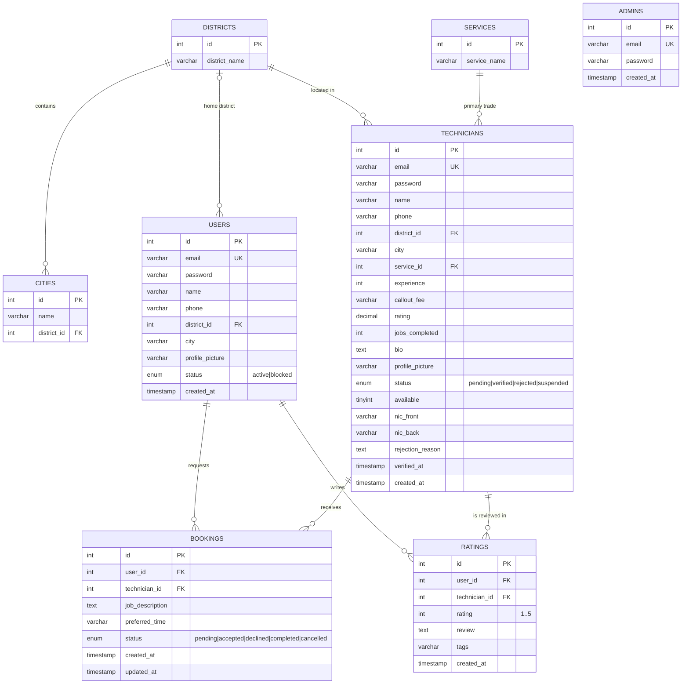
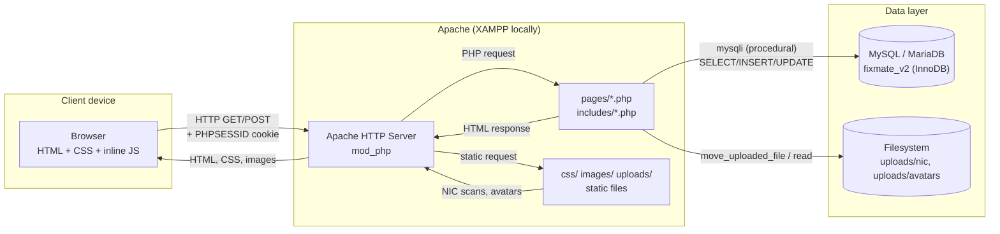
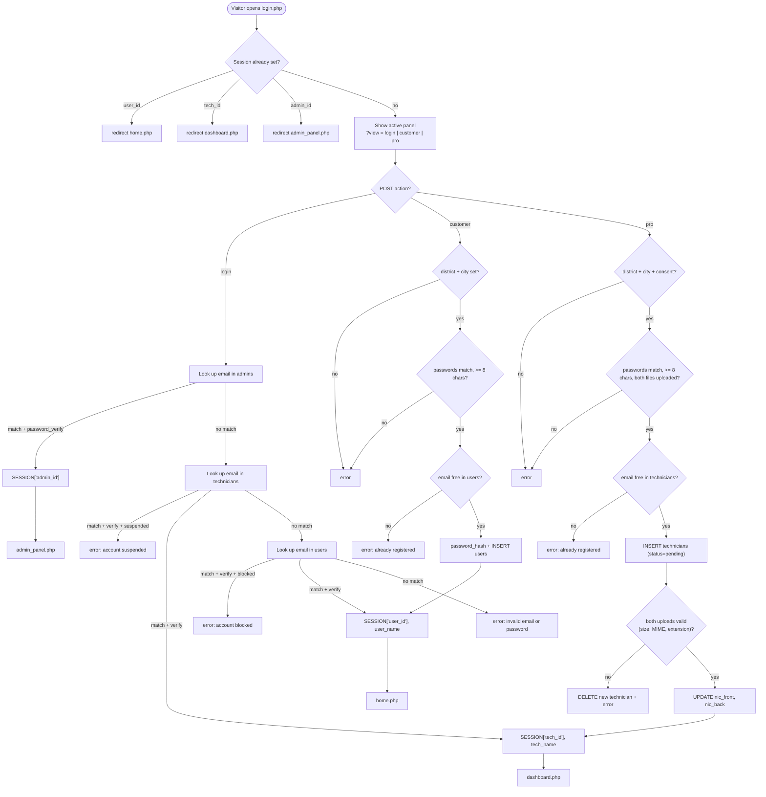
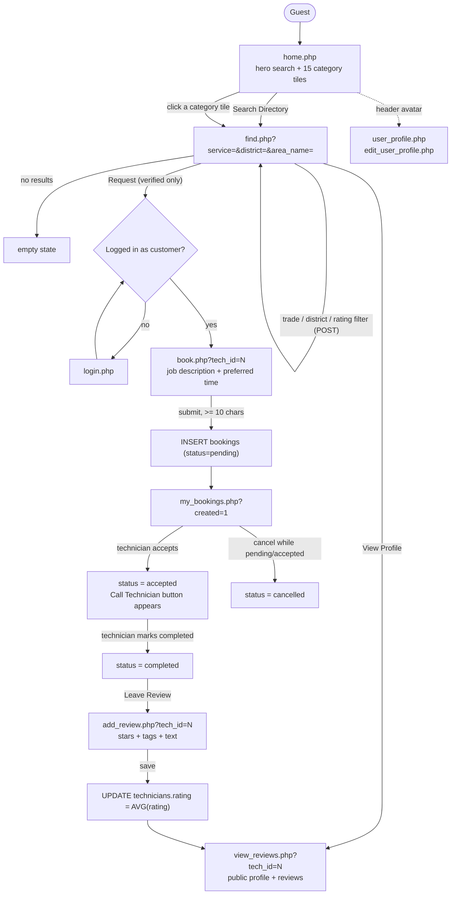
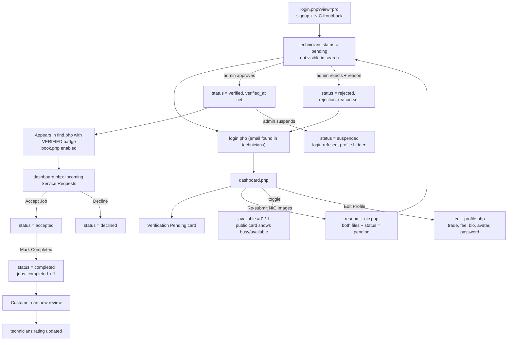
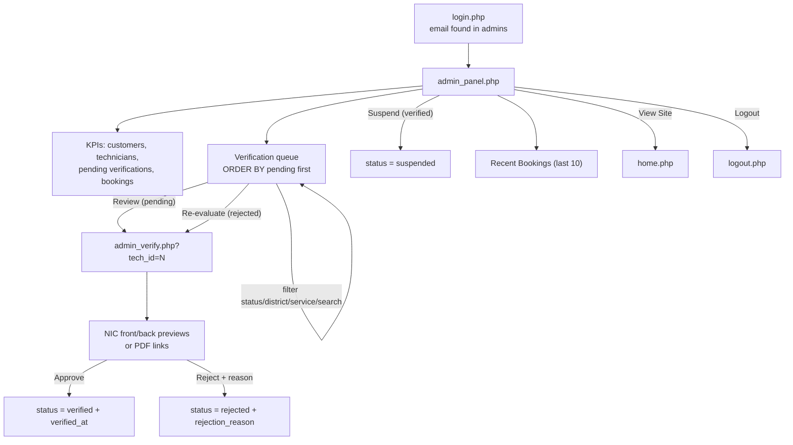
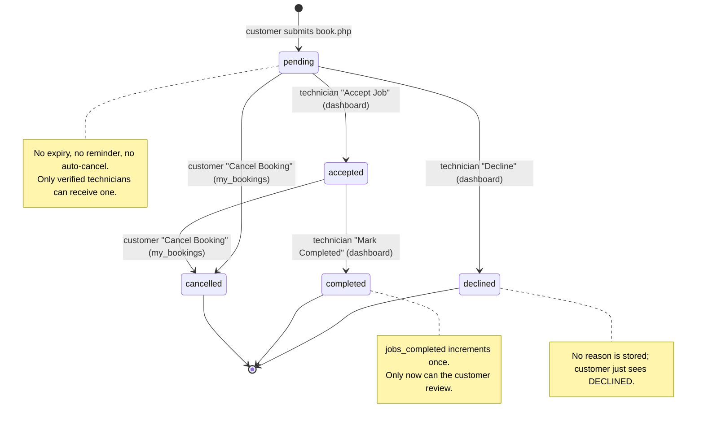

# FixMate — Complete Technical Documentation

**Project:** FixMate – A Digital Directory for Local Tradesmen in Sri Lanka
**Module:** ITIC1282 – Skill Development Project I
**Group:** 09 (five members)
**Document type:** Evidence-based technical knowledge base for final academic evaluation
**Analysis date:** 20 November 2026
**Code analysed:** the working tree of the `fixmate-v2` repository (branch `main`, commit `90bd140`)

---

## How to read this document

This document was produced by reading the **actual source code, the actual SQL dump and the actual Git history** — not by trusting the project report.

Three evidence levels are used throughout, and they are always labelled:

| Marker | Meaning |
|---|---|
| **Verified** | Directly confirmed in source code, SQL or Git history. Line references are given. |
| **Partially implemented / Discrepancy** | The feature exists in some form, but behaves differently from the report, or is incomplete. |
| **Not implemented** | There is no code for it. |
| **Recommendation** | Something the authors did *not* build; a suggestion, not a description. |

File paths are given relative to the project root. Line numbers refer to the files as they exist in this working tree (they are exact for this commit; if code is edited later, numbers shift).

No passwords, password hashes, real e-mail addresses, real phone numbers, NIC numbers, uploaded documents or database credentials are reproduced in this document. Seed accounts are referred to as placeholders such as `[SEEDED_ADMIN_EMAIL]`, `[DEMO_CUSTOMER_EMAIL]`.

---

## Table of contents

**Part 1 — Project background**
**Part 2 — Complete project structure**
**Part 3 — File-by-file source code analysis**
**Part 4 — Complete database analysis**
**Part 5 — System architecture**
**Part 6 — Authentication and security**
**Part 7 — Frontend and user interface**
**Part 8 — Complete functional workflows**
**Part 9 — Local development and deployment**
**Part 10 — GitHub and version control**
**Part 11 — Project limitations and future improvements**
**Part 12 — Final evaluation preparation (60+ questions and answers)**
**Part 13 — Live demonstration guide**
**Part 14 — Known bugs, discrepancies and verification table**
**Part 15 — Glossary, inventory and coverage statement**

---

# PART 1 — PROJECT BACKGROUND

## 1.1 What FixMate actually is (verified)

FixMate is a **server-rendered PHP + MySQL web application**. It is *not* a single-page app, not a framework project, and it has no build step. Every page is a `.php` file that:

1. includes `includes/config.php` (which starts the session and opens the database connection),
2. optionally handles a POST action,
3. runs SQL queries,
4. prints HTML,
5. includes `includes/header.php` / `includes/footer.php` around the HTML body.

The feature set that the code actually implements is:

| Area | What the code actually does |
|---|---|
| Public directory | Home page with 15 hard-coded service categories and live counts, search panel, "Find a Pro" listing filtered by trade / district / minimum rating |
| Accounts | Three independent login identities in three tables: `users` (customer), `technicians` (service pro), `admins` |
| Registration | Customer signup and technician signup are **two forms inside `pages/login.php`**, not separate pages |
| Technician verification | NIC front/back upload at signup, `status` enum `pending/verified/rejected/suspended`, admin approve/reject with reason, technician re-submission |
| Bookings | Customer creates request → technician accepts / declines → technician marks completed; customer can cancel pending or accepted requests |
| Reviews | Only after a `completed` booking, one review per customer per technician, 1–5 stars, optional text, six fixed tags, average recomputed into `technicians.rating` |
| Dashboards | Technician dashboard (requests, upcoming jobs, stats, availability toggle, verification state) and admin console (stats, verification queue, recent bookings) |
| Customer area | Profile page, edit profile, my bookings, review submission |

## 1.2 Verified technology stack

| Reported in the report | Verified in the code | Notes |
|---|---|---|
| HTML5 | Yes | Every page emits HTML5 (`<!DOCTYPE html>`, semantic `<section>`, `<header>`, `<nav>`) |
| CSS3 | Yes | One stylesheet, 7,193 lines, Flexbox + Grid + custom properties + media queries |
| PHP | Yes | PHP 8-era syntax: null coalescing `??`, short arrays, typed casts, `str_contains`-free code (uses `String.prototype.includes` in JS only) |
| MySQL / MariaDB | Yes | Dump generated by MariaDB 10.4.32; `mysqli` extension used procedurally |
| Apache | Yes | `.htaccess` used for the 404 document; `uploads/nic/.htaccess` used to disable PHP execution |
| Vanilla JavaScript | Yes | All inline `<script>` blocks in PHP files; **no `.js` files exist** |
| XAMPP | Consistent | Dump says "Host: 127.0.0.1", "PHP Version: 8.2.12"; `config.php` uses `localhost` / `root` / empty password (the XAMPP default) |
| Git / GitHub | Yes | `origin` is `github.com/tw-santhush/fixmate-v2`; 16 commits on `main` |
| Byet.Host live hosting | **Not verifiable from the repository** | No deployment config, no hosting notes, no `.env`, no remote database settings exist in the code. This claim cannot be confirmed or refuted from the files. |

**PHP version requirement (verified by usage):** PHP 8.0 or newer is effectively required, because the code uses `??`, and PHP 8.1+ is needed for `mysqli_fetch_assoc(...)` returning `false` handling in newer styles. The dump itself records PHP 8.2.12.

## 1.3 The five reported functionalities — checked

The task brief lists a long feature list. The honest result of checking each is:

| Claimed feature | Status | Evidence |
|---|---|---|
| Homepage and service categories | Verified | `pages/home.php:9-25` (hard-coded 15-category array), `:182` (live per-category count) |
| Technician search and filtering | Partially implemented | `pages/find.php:11-32` builds filters for trade, district and rating — **city name is collected but never used in the query** |
| City and district selection | Partially implemented | City picker UI exists on home/find/login; only the *district* reaches SQL (`find.php:17-19`) |
| Customer registration and login | Verified | `pages/login.php:66-105` (signup), `:16-62` (login) |
| Technician registration and login | Verified | `pages/login.php:108-252` (signup + NIC upload), login branch `:30-42` |
| Administrator login | Verified | `pages/login.php:22-28`; account row seeded in both SQL files |
| Session-based authentication | Verified | `includes/config.php:3`, `$_SESSION` keys `user_id` / `tech_id` / `admin_id` |
| Password hashing | Verified | `password_hash(..., PASSWORD_DEFAULT)` and `password_verify(...)` |
| Customer profile management | Verified | `pages/user_profile.php`, `pages/edit_user_profile.php` |
| Technician profile management | Verified | `pages/edit_profile.php` |
| Profile picture uploads | Verified | `edit_profile.php:66-90`, `edit_user_profile.php:51-75` |
| NIC document uploads | Verified | `login.php:141-171` helper, `resubmit_nic.php:31-60` helper |
| Technician approval / rejection / resubmission | Verified | `admin_panel.php:16-33`, `admin_verify.php:34-43`, `resubmit_nic.php:62-90` |
| Technician dashboard | Verified | `pages/dashboard.php` (553 lines) |
| Booking requests | Verified | `pages/book.php` |
| Booking accept / reject / cancel / complete | Verified | `dashboard.php:26-51`, `my_bookings.php:11-20` |
| Technician availability toggle | Verified | `dashboard.php:15-21` and `:179-186` |
| Customer reviews | Verified | `pages/add_review.php`, `pages/view_reviews.php` |
| 1–5 star ratings | Verified | `add_review.php:53-55` clamps to 1..5; DB `CHECK (rating >= 1 and rating <= 5)` |
| Review tags | Verified | `add_review.php:95-101` (six fixed tags, stored as a comma-separated string) |
| Automatic average rating | Verified | `add_review.php:71-74` (`SELECT AVG(rating)` then `UPDATE technicians SET rating = ...`) |
| Administrator dashboard | Verified | `pages/admin_panel.php` |
| Technician verification queue | Verified | `admin_panel.php:76-110` (queue query), `:340-395` (table) |
| User and technician management | Partially implemented | Technicians: approve / reject / suspend. Customers: **view-only count** — no list, no block/unblock UI, although `users.status` supports `blocked` and login checks it (`login.php:46-49`) |
| Recent booking activity and statistics | Verified | `admin_panel.php:61-72` (stats), `:112-127` (feed query), `:435-470` (table) |

## 1.4 Database claims — verified counts

| Claim | Verified value | Method |
|---|---|---|
| Database name `fixmate_v2` | Confirmed | `fixmate_V2.sql:25`, `SQL CODE.sql:11` |
| Eight tables | Confirmed: `admins`, `bookings`, `cities`, `districts`, `ratings`, `services`, `technicians`, `users` | `SHOW`-style inspection of both dumps |
| 25 districts | **Confirmed** — IDs 1–25, `AUTO_INCREMENT=26` | `fixmate_V2.sql:465-497` |
| 366 cities / towns | **Confirmed** — IDs 1–366, `AUTO_INCREMENT=367` | `fixmate_V2.sql:81-460` |
| 15 service categories | **Confirmed** — IDs 1–15, `AUTO_INCREMENT=16` | `fixmate_V2.sql:530-550` |

Repository contents: 50 indexed files in total, of which **21 PHP files**, **1 CSS file**, **2 SQL files**, **21 images** in `images/`, **6 uploaded avatars**, **6 uploaded NIC files** (these last two groups are local test data and are deliberately excluded from Git by `.gitignore`).

---

# PART 2 — COMPLETE PROJECT STRUCTURE

## 2.1 Directory tree (verified against the working tree)

```
fixmate-v2/                          ← project root (document root is the PARENT folder on XAMPP)
├── .freebuff/
│   └── project-id                   ← tooling artefact; irrelevant to the application
├── .git/                            ← Git metadata (16 commits)
├── .gitignore                       ← excludes uploads, vendor, logs, .env
├── .htaccess                        ← single line: custom 404 ErrorDocument
├── index.php                        ← redirects to pages/home.php
├── SQL CODE.sql                     ← clean installer schema + reference data (no user records)
├── fixmate_V2.sql                   ← full phpMyAdmin dump (schema + reference data + test records)
├── css/
│   └── style.css                    ← the entire visual design (7,193 lines)
├── images/                          ← static artwork (21 files)
│   ├── Plumber.jpg  Electrician.jpg  Carpenter.jpg  Mechanic.jpg  Painter.jpg
│   ├── Welder.jpg   Mason.jpg        Locksmith.jpg  Appliance_Repair.jpg
│   ├── AC_Technician.jpg  Phone_Repair.jpg  Computer_Tech.jpg
│   ├── Plumbing_Gas.jpg  Electrical_&_Solar.jpg  General_Repairs.jpg
│   ├── hero-tall.jpg  hero-short-1.jpg  hero-short-2.jpg  handyman.jpg
│   └── pro-2.png  pro-3.png         ← UNUSED (no reference anywhere in PHP/CSS)
├── includes/
│   ├── config.php                   ← session + DB connection (15 lines)
│   ├── header.php                   ← <head>, site header, mobile menu JS (171 lines)
│   └── footer.php                   ← site footer, closes </body></html> (78 lines)
├── pages/                           ← every user-facing screen
│   ├── home.php                     ← landing page (446 lines)
│   ├── find.php                     ← search / filter results (390 lines)
│   ├── login.php                    ← login + customer signup + pro signup (841 lines)
│   ├── register.php                 ← redirect shim → login.php?view=customer
│   ├── register_technician.php      ← redirect shim → login.php?view=pro
│   ├── logout.php                   ← destroys session → home.php
│   ├── book.php                     ← booking request form (166 lines)
│   ├── my_bookings.php              ← customer booking list + cancel (230 lines)
│   ├── user_profile.php             ← customer profile (283 lines)
│   ├── edit_user_profile.php        ← customer edit + avatar + password (372 lines)
│   ├── dashboard.php                ← technician dashboard (554 lines)
│   ├── edit_profile.php             ← technician edit + avatar + password (482 lines)
│   ├── resubmit_nic.php             ← rejected technician re-upload (162 lines)
│   ├── view_reviews.php             ← public technician profile + reviews (317 lines)
│   ├── add_review.php               ← star rating + tags + text (374 lines)
│   ├── admin_panel.php              ← admin console (537 lines)
│   ├── admin_verify.php             ← single technician verification screen (184 lines)
│   └── 404.php                      ← styled not-found page (81 lines)
└── uploads/                         ← runtime file storage (not in Git)
    ├── avatars/                     ← 6 test avatar images, NO .htaccess here
    └── nic/
        ├── .htaccess                ← disables PHP execution, forces .php* to text/plain
        └── *.jpg / *.png            ← 6 test NIC scans
```

## 2.2 Every directory and file: purpose, necessity, interactions

| Path | Contains | Purpose | Interacts with | Essential? |
|---|---|---|---|---|
| `index.php` | 3 lines of PHP | Sends the browser to the real home page | Nothing; entry point only | Yes (convenience). Could be replaced by an Apache rewrite |
| `.htaccess` (root) | `ErrorDocument 404 /fixmate-v2/pages/404.php` | Shows the styled 404 | Apache, `pages/404.php` | Yes for the 404 experience; **hard-codes the folder name**, so it breaks if the folder is renamed |
| `.ignore` / `.gitignore` | Ignore rules | Keeps user uploads and secrets out of Git | Git | Yes (privacy) |
| `fixmate_V2.sql` | Full dump: schema + reference data + test records | Restores the *exact* database the team demonstrated, including the NIC verification history | MySQL; used for local restores | Yes for reproducing the demo; contains test personal data, so it should not be shared publicly |
| `SQL CODE.sql` | Schema + reference data only | Clean installer for a fresh database — the file to use for a new deployment | MySQL; the intended "install" script | Yes (this is the safer installer) |
| `css/style.css` | All styling | Single stylesheet for every page | Every page via `header.php:19` | Yes |
| `images/` | Category photos, hero photos, about photo | Visual content for the home page and service tiles | `home.php` | Yes; 2 files are unused |
| `includes/config.php` | DB credentials + `session_start()` | Bootstraps every request | Included by **all 21 PHP files** except the redirect shims (which don't need it) | Yes — the single point of failure |
| `includes/header.php` | `<head>`, logo, nav, avatar, hamburger, 4 inline JS behaviours | Shared top of every page | Every content page; queries `users` / `technicians` for the avatar | Yes |
| `includes/footer.php` | Footer columns and closing tags | Shared bottom | Every content page | Yes |
| `pages/` | 18 screens | The whole application UI | `includes/*`, `uploads/*` | Yes |
| `uploads/avatars/` | Uploaded profile pictures | Stores `profile_picture` targets | `edit_profile.php`, `edit_user_profile.php`, all avatar `` tags | Yes at runtime; created automatically by `@mkdir` |
| `uploads/nic/` | Uploaded NIC scans | Stores `nic_front` / `nic_back` targets | `login.php`, `resubmit_nic.php`, `admin_verify.php` | Yes; protected by its own `.htaccess` |

### Files that are unused, duplicated, outdated or abandoned

| Item | Finding |
|---|---|
| `images/pro-2.png`, `images/pro-3.png` | **Unused.** A repository-wide search finds no reference in any PHP or CSS file. Left over from an earlier design. |
| `pages/register.php`, `pages/register_technician.php` | **Abandoned standalone pages.** Both are 3-line redirects into `login.php?view=customer` / `?view=pro`. They stay because the header, footer and many buttons still link to them. |
| `pages/admin_panel.php` line 24-27 (reject branch) | **Unused code path in practice.** The queue table only offers "Review" for pending technicians, so the `reject` branch never runs from this screen; rejection happens in `admin_verify.php`. It is also the only place that would reject without saving a reason. |
| `pages/find.php` lines 44-60, 205-260 (non-verified ticket branches) | **Dead code.** The SQL always requires `t.status = 'verified'` (line 11), so `$is_verified` is always true and every "PENDING VERIFICATION" branch is unreachable. |
| `pages/find.php:41-43` (`$pending_count`) | Computed but never rendered. |
| `pages/dashboard.php:82-84` (`$completed_count`) | Computed but never rendered. |
| `uploads/avatars/.htaccess` | **Missing**, although `.gitignore` has an exception rule `!uploads/avatars/.htaccess` expecting it. Only `uploads/nic/.htaccess` exists. |
| `.freebuff/project-id` | Editor/tooling artefact, not part of the application. |
| Two SQL files | **Duplicate schema.** `fixmate_V2.sql` and `SQL CODE.sql` describe the same eight tables but are not identical (see §4.7 and §14.3). |

---

# PART 3 — FILE-BY-FILE SOURCE CODE ANALYSIS

Every first-party source file is covered below. Files are grouped by folder; within each folder they are ordered by execution dependency.

## 3.1 Root files

### File: `index.php`

**1. Purpose** — Site entry point. The project is served from a sub-folder (`/fixmate-v2/`), and all real screens live in `pages/`, so the root needs a door.

**2. Execution** — Runs when someone opens `http://localhost/fixmate-v2/`. It performs no output; it immediately issues an HTTP redirect.

**3. Dependencies** — None. It does **not** include `config.php` and does **not** start a session.

**4. Code explanation**

```php
1  <?php
2  header('Location: pages/home.php');
3  exit();
```

- Line 2: `header('Location: ...')` writes the `Location:` response header. The browser then requests `pages/home.php`. The path is **relative to the current directory**, so `/fixmate-v2/` → `/fixmate-v2/pages/home.php`.
- Line 3: `exit()` stops PHP immediately. Without it, any later output would be appended to a redirect response, which browsers ignore or treat as an error.

**5. Inputs/outputs** — No input. Output is a `302`-class redirect with no body.

**6. Database** — None.

**7. Concepts** — HTTP headers, server-side redirect, relative URL resolution.

**8. Related files** — Target `pages/home.php`, which includes `includes/config.php` and `includes/header.php`.

**9. Potential problems** — If the project were placed at the web root (not in a sub-folder), `pages/home.php` still resolves correctly; but the root `.htaccess` 404 path would not. No functional bug here.

**10. Evaluation preparation**
- *Q: Why do you need `index.php` at all?* — Because a request to a directory without a default document returns a directory listing or 403. `index.php` is Apache's default document, so it converts `/fixmate-v2/` into the real home page. `exit()` guarantees no accidental output after the header.
- *Q: Does a redirect lose the session?* — No. The session cookie belongs to the whole host/path, and `pages/home.php` calls `session_start()` again through `config.php`.

---

### File: `.htaccess`

**1. Purpose** — Configures Apache's custom 404 handler for this folder.

**2. Execution** — Read by Apache on every request inside this directory tree (when `AllowOverride` permits).

**3. Dependencies** — Apache `mod_alias`/core `ErrorDocument`; `pages/404.php` must exist.

**4. Code explanation** — The file contains exactly one directive:

```
ErrorDocument 404 /fixmate-v2/pages/404.php
```

When Apache cannot map a URL to an existing file it serves that PHP file with a 404 status.

**5. Inputs/outputs** — Input: a failing request path. Output: the 404 page.

**6. Database** — None directly (`404.php` opens one through `config.php`).

**7. Concepts** — Apache per-directory configuration, custom error documents.

**8. Related files** — `pages/404.php`.

**9. Potential problems** — The path is **absolute and hard-coded** to `/fixmate-v2/`. If the folder is renamed, or the site is uploaded to a hosting account where the app sits at the domain root, the 404 handler points at a non-existent file and Apache falls back to its default error page. (`header.php` solves the same problem for links by computing a base URL dynamically — see §3.2 — but `.htaccess` cannot do that.)

**10. Evaluation preparation**
- *Q: What does `.htaccess` do?* — It is a per-directory Apache configuration file. Here it only maps 404 errors to a styled page; it is not used for URL rewriting, authentication or caching.

---

### File: `SQL CODE.sql` (291 lines)

**1. Purpose** — A clean, re-runnable **installer**: creates `fixmate_v2`, creates the eight tables, inserts the 1 admin, 366 cities, 25 districts, 15 services, then adds indexes, AUTO_INCREMENT values and foreign keys. It deliberately contains **no** customer, technician, booking or rating rows ("No seed data — created at runtime", e.g. line 41).

**2. Execution** — Manually imported (phpMyAdmin → Import, or `mysql < "SQL CODE.sql"`). Never executed by PHP.

**3. Dependencies** — MySQL/MariaDB; an account allowed to `CREATE DATABASE`.

**4. Code explanation** — Structure, in file order:
1. Header comments (`:1-3`) and `SET SQL_MODE`, `START TRANSACTION`, `SET time_zone = "+00:00"` (`:5-7`).
2. Character-set save/restore comments and `SET NAMES utf8mb4` (`:9-13`).
3. `CREATE DATABASE IF NOT EXISTS fixmate_v2 ... utf8mb4 / utf8mb4_general_ci` then `USE fixmate_v2` (`:11-12`).
4. `admins` table (`:17-22`), then one seeded admin row (`:26-27`). The comment at `:24-25` says to change the password after first login.
5. `bookings` table (`:30-38`) with the five-value `status` enum.
6. `cities` table (`:45-49`) + 366 rows written compactly (`:51-56`).
7. `districts` (`:63-66`) + 25 rows (`:68-72`).
8. `ratings` (`:79-87`) with the `CHECK (rating >= 1 and rating <= 5)` constraint.
9. `services` (`:94-97`) + 15 rows (`:99-102`).
10. `technicians` (`:109-130`) — the widest table, including NIC paths, verification state and rating cache.
11. `users` (`:137-147`).
12. `ALTER TABLE ... ADD PRIMARY KEY / ADD UNIQUE KEY / ADD KEY` for all eight tables (`:154-161`).
13. `ALTER TABLE ... MODIFY id ... AUTO_INCREMENT=n` (`:166-173`).
14. Six `FOREIGN KEY` constraints (`:179-196`).
15. `COMMIT` and character-set restore (`:198-202`).

**5. Inputs/outputs** — Input: nothing. Output: a populated schema; importing it twice fails on duplicate keys (the `INSERT`s are not `INSERT IGNORE`).

**6. Database interaction** — Defines all eight tables, all indexes, all six foreign keys and the reference data. See Part 4 for the column-by-column analysis.

**7. Concepts** — DDL vs DML, charset/collation, InnoDB, referential integrity, `AUTO_INCREMENT`.

**8. Related files** — The schema it creates is what `includes/config.php` connects to; it is the *only* SQL file that should be used for a new installation.

**9. Potential problems**
- It creates a **different** database from `fixmate_V2.sql`: the live dump has `ADD UNIQUE KEY unique_user_tech (user_id, technician_id)` on `ratings` (`fixmate_V2.sql:664`), the installer does **not**. Consequences are in §4.7.
- The seeded admin password hash is a real bcrypt hash of a weak demo password. The file tells you to change it, but nothing forces that.
- It is not idempotent.
- `.gitignore` does not exclude this file (correctly, since it holds no personal data).

**10. Evaluation preparation**
- *Q: Why two SQL files?* — One is a clean installer for a fresh database; the other is a phpMyAdmin dump of the team's working database used to reproduce the demo (it contains test accounts). They differ in one index, which is a known inconsistency.
- *Q: What does `START TRANSACTION ... COMMIT` around the DDL do?* — It is generated by phpMyAdmin; in MySQL, DDL causes an implicit commit, so it mainly documents intent rather than providing atomicity.

---

### File: `fixmate_V2.sql` (783 lines)

**1. Purpose** — A phpMyAdmin dump of the team's actual database at the end of development (`Generation Time: Oct 09, 2026`). It is the **authoritative record of the schema actually used at runtime**.

**2. Execution** — Imported manually. Never executed by PHP.

**3. Dependencies** — MariaDB/MySQL 10.4+ (the `CHECK` constraint is honoured only on MariaDB 10.2+/MySQL 8+).

**4. Code explanation** — Same ordering as the installer, plus real rows: 1 admin, 6 bookings, 366 cities, 25 districts, 1 rating, 15 services, 9 technicians, 3 users. The schema block is byte-for-byte equivalent to `SQL CODE.sql` **except** the ratings table's unique key at line 664:
```sql
ALTER TABLE `ratings`
  ADD PRIMARY KEY (`id`),
  ADD UNIQUE KEY `unique_user_tech` (`user_id`, `technician_id`),
  ...
```
AUTO_INCREMENT counters reflect the live data (`bookings`=7, `technicians`=10, `users`=4, `ratings`=2).

**5. Inputs/outputs** — Input: none. Output: a schema pre-populated with the team's test data. **This file contains personal data** (names, e-mail addresses, phone numbers, NIC scans paths) and must not be published.

**6. Database interaction** — Full definition of the eight tables; see Part 4. Two seed details matter for the demo:
- Only **one** rating row exists, so almost every technician shows `0.0` stars, which is why the "Average rating" column looks empty in a fresh demo.
- Technician `nic_front` / `nic_back` values show the naming conventions produced by the two upload helpers, including a `_resubmit_` variant — direct confirmation that the re-submission flow ran during testing.

**7. Concepts** — Database dumps, reproducibility of a demo environment, difference between schema and data.

**8. Related files** — Consumed by MySQL; the live application in `pages/*` assumes exactly this schema.

**9. Potential problems** — Contains personal data: never commit or share publicly. `uploads/` is git-ignored, so the NIC paths in this dump point at files that a fresh clone will not contain.

**10. Evaluation preparation**
- *Q: Why does the average rating show 0.0 for five technicians?* — Because `technicians.rating` is a cached value written only by `add_review.php:74`. With just one rating row in the dump, every other technician keeps the column default `0.0`. The "review count" shown in the UI comes from `COUNT(*)` on `ratings`, which is genuinely zero for them.

---

## 3.2 Includes

### File: `includes/config.php` (15 lines)

**1. Purpose** — The bootstrap for every request: start the PHP session and open the one MySQL connection used everywhere.

**2. Execution** — First line of every content page (`pages/home.php:2`, `find.php:2`, `login.php:2`, …). Also `index.php` does *not* use it (it only redirects) and the two register shims do not either.

**3. Dependencies** — PHP `session` extension; `mysqli` extension; a running MySQL server; credentials that match the local XAMPP install.

**4. Code explanation**

```php
1  <?php
2  session_start();
3
4  $host = "localhost";
5  $user = "root";
6  $password = "";          // ← value intentionally not reproduced here
7  $database = "fixmate_v2";
8
9  $conn = mysqli_connect($host, $user, $password, $database);
10
11 if (!$conn) {
12     die("Connection failed: " . mysqli_connect_error());
13 }
14
15 mysqli_set_charset($conn, "utf8");
```

- Line 2: `session_start()` creates or resumes a session and gives the page `$_SESSION`. It must run before any output (it sends a cookie header). Every page that includes `config.php` therefore gets session access for free.
- Lines 4–7: connection parameters for a **default XAMPP install** (`root`, empty password). These are the values that must be changed for live hosting.
- Line 9: `mysqli_connect()` returns a connection object, or `false` on failure. It is a **procedural** call, not OOP, and no error-reporting mode is set.
- Lines 11–13: on failure, `die()` prints the MySQL error. This is convenient locally and **dangerous in production**, because it can reveal server details.
- Line 15: `mysqli_set_charset($conn, "utf8")` makes the client connection use UTF-8 so Sinhala/Tamil text stored in `ratings.review` is readable. Note it says `utf8`, not `utf8mb4`; MySQL's 3-byte `utf8` is enough for Sinhala and Tamil (which are in the Basic Multilingual Plane) but **not** for emoji (4-byte). Emoji in a review would be truncated/rejected.

**5. Inputs/outputs** — Input: nothing from the user. Output: global `$conn` (mysqli link) and an active session.

**6. Database** — Opens the connection; no queries.

**7. Concepts** — Configuration file pattern, session cookie, procedural mysqli, character sets.

**8. Related files** — Required by all 21 page files; `$conn` is used directly in every query in the project; `$current_page`, `$base_url` etc. in `header.php` rely on the session already being started.

**9. Potential problems**
- **Credentials are hard-coded in a tracked file.** `.gitignore` excludes `.env`, but no `.env` is used, so the XAMPP credentials are in Git (they are harmless defaults, but the pattern does not scale).
- `die(mysqli_connect_error())` leaks technical detail.
- `utf8` instead of `utf8mb4`.
- No `mysqli_report(MYSQLI_REPORT_ERROR)`; failed queries return `false` silently, and several pages then call `mysqli_fetch_assoc(false)`, which is a **fatal TypeError in PHP 8** (see §14).
- Session security settings (httponly, samesite, strict mode, regeneration) are not configured here.

**10. Evaluation preparation**
- *Q: Why is `session_start()` in the config file?* — So that a single `include` both starts the session and connects to the database; every page then automatically has `$_SESSION` and `$conn` available without repeating code.
- *Q: What must change when you deploy?* — Host, database name, username and password (hosting panels give a prefixed database name and user). Nothing else in the code references the database.

---

### File: `includes/header.php` (171 lines)

**1. Purpose** — Emits the document head and the public site header, and contains the only navigation/front-end JavaScript reused across pages (hamburger menu + scroll-hide).

**2. Execution** — Included by every content page **after** the page's PHP logic and **before** its HTML body. It is *not* used by `login.php` or `admin_panel.php`, which build their own `<head>`/top bar.

**3. Dependencies** — `$conn` and the session (so `config.php` must already have run); `css/style.css`; `images/`.

**4. Code explanation**

*Base URL computation (lines 3-8)*
```php
3  $current_page = basename($_SERVER['PHP_SELF']);
6  $script_path = $_SERVER['SCRIPT_NAME'];
7  $base_url    = rtrim(dirname(dirname($script_path)), '/');
```
`PHP_SELF` gives `/fixmate-v2/pages/find.php` → `basename` = `find.php`, used to highlight the active nav link. `SCRIPT_NAME` treated with `dirname` twice removes `/pages/find.php` and leaves `/fixmate-v2`, so links work no matter what the parent folder is called. `rtrim(..., '/')` prevents a trailing slash (which would produce `//css/style.css`).

*Document head (lines 10-20)*
- `lang="en"`, UTF-8 meta, responsive viewport, fixed `<title>` (identical on every page — a minor SEO/accessibility weakness).
- Line 17: `<base href="<?php echo $base_url; ?>/pages/">` — **the single most important line for links.** Because of it, *all* relative URLs in every page resolve against `/fixmate-v2/pages/`. That is why a footer link `href="find.php"` works from `pages/home.php` and also why content pages must write `../images/...` for assets (they resolve to `/fixmate-v2/images/...`).
- Line 19: stylesheet link built from `$base_url`.

*Header markup (lines 22-105)*
- Logo (inline SVG wrench + wordmark) linking to `home.php`.
- `#headerMenu` wrapper around two blocks: `nav.nav` (Home / Find a Pro / How It Works / About) and `.header-actions`.
- Active-link highlighting uses a ternary per link, e.g. line 45: `class="<?php echo ($current_page == 'home.php') ? 'active' : ''; ?>"`.
- Session-aware actions (lines 50-60): a customer sees **My Bookings**; a technician sees **Dashboard**; an admin sees **Admin Panel**; a guest sees **Login** and a "Join as Pro" button. The order matters: `user_id` is tested first, then `tech_id`, then `admin_id`.
- Avatar block (lines 63-96): for a customer it runs
  `SELECT name, profile_picture FROM users WHERE id = '$hdr_uid'` (line 66); for a technician the same against `technicians` (line 81). If a picture exists it renders `">`, otherwise it builds initials: split the name on spaces, take the first letter of each word, keep two.
- Hamburger button `#navToggle` (lines 98-102) — three `<span class="nav-toggle-bar">` elements.

*JavaScript (lines 108-169, inside an IIFE)*
1. `toggle.addEventListener('click', ...)` toggles `.open` on both the button and `#headerMenu`; `e.stopPropagation()` prevents the document-level handler from immediately closing it.
2. A `document` click listener closes the menu when the click is outside `.header-inner` (`e.target.closest(...)`).
3. Every link inside the menu closes it on click, so the menu does not stay open after navigation.
4. Scroll handling: a `scroll` listener guarded by a `ticking` flag uses `requestAnimationFrame` to avoid layout thrash; it compares the new `pageYOffset` with the last one. On screens ≤768 px, scrolling **down** past 80 px adds `.header-hidden`, scrolling **up** removes it; on desktop the class is always removed. Opening/closing also collapses the menu.

**5. Inputs/outputs** — Input: request URL (`$_SERVER`), session keys, database row for the current identity. Output: HTML head + header + the menu script.

**6. Database interaction** — One `SELECT name, profile_picture` per request for a logged-in customer or technician (a "N+1"-style query on every page load). Admins trigger none.

**7. Concepts** — Code reuse via `include`, dynamic base URLs, server variables, session-driven UI, progressive enhancement, event delegation, `requestAnimationFrame` throttling, CSS class toggling.

**8. Related files** — Included by 15 pages; depends on `config.php` for `$conn`/session; paired with `footer.php`; styled by CSS sections 10 (Header) and "MOBILE HEADER + HAMBURGER" (`css/style.css:6763`).

**9. Potential problems**
- `<base>` affects *everything*, including links inside `pages/404.php` served by Apache from a deeper URL — that is why the base tag exists, but it also means an `<a href="index.php">` would wrongly resolve into `pages/`.
- The avatar query result is used without checking: `mysqli_fetch_assoc(false)` throws a `TypeError` in PHP 8 if the query fails.
- If a session contains **both** `user_id` and `tech_id` (possible only by tampering), the customer branch wins in the header while `login.php` would have redirected earlier.
- `<title>` is not page-specific.
- The header prints HTML; any page that includes it can no longer send redirect headers (this actually bites `dashboard.php:66`).

**10. Evaluation preparation**
- *Q: How do links keep working when the folder is renamed?* — `header.php` derives `$base_url` from `$_SERVER['SCRIPT_NAME']` at runtime (`:6-7`) and prints it into `<base href>` (`:17`) and the stylesheet link (`:19`), so no hard-coded folder name is needed in PHP.
- *Q: How does the mobile menu work without a library?* — A click handler toggles a class on the menu and button; CSS hides `.header-menu` on small screens and shows it when `.open` is present; a scroll listener adds `.header-hidden` to slide the header away on downward scroll.
- *Q: Why is `htmlspecialchars()` used on the avatar `title` and `src`?* — Those values come from the database and could contain quotes or angle brackets, so escaping prevents broken attributes and script injection.

---

### File: `includes/footer.php` (78 lines)

**1. Purpose** — Shared footer: brand blurb, customer links, tradesman links, contact block, closing `</body></html>`.

**2. Execution** — Last include on every content page.

**3. Dependencies** — Nothing PHP-side (no queries, no session reads). Pure markup with `$base_url`-independent relative links (they work because of `<base>` in the header).

**4. Code explanation**
- Lines 6-17: brand column — logo SVG, and the sentence "Connecting Sri Lankan households with honest, verified local craftsmen since 2026."
- Lines 20-27: "For Customers" — Browse Services → `find.php`; How It Works → `home.php#how-it-works`; Create Account → `register.php` (the shim); Sign In → `login.php`.
- Lines 30-37: "For Tradesmen" — Register Free → `register_technician.php`; Pro Login → `login.php?view=pro`; Why FixMate → `home.php#grow`; Support → `href="#"` (a **dead link**).
- Lines 40-66: contact block — an invented support e-mail, a `+94 11` landline and "Galle Road, Colombo 03". These are **placeholder marketing details**, not read from any configuration.
- Lines 70-72: `footer-bottom` copyright line.
- Lines 76-77: closes `</body>` and `</html>`. **Every page therefore ends its document here except `login.php`, `admin_panel.php` and `404.php`**, which close their own.

**5. Inputs/outputs** — Static HTML output only.

**6. Database** — None.

**7. Concepts** — Layout partials, anchor links to in-page sections.

**8. Related files** — Paired with `header.php`; anchors target `pages/home.php` ids `how-it-works` (line 205) and `grow` (line 314).

**9. Potential problems** — Two links go nowhere (`Support`, and in the same spirit `Forgot password?` in `login.php:313`); the contact details are fake; the footer is omitted from the admin console by design.

**10. Evaluation preparation**
- *Q: Why is the footer a separate file?* — So the four-column layout is edited in one place and automatically appears on every page; it also closes the document tags so pages do not have to repeat them.

---

## 3.3 Stylesheet

### File: `css/style.css` (7,193 lines)

**1. Purpose** — The complete visual design: colour system, typography, layout, every component (buttons, forms, cards, tables, stars, stamps), page-specific layouts and all responsive rules.

**2. Execution** — Loaded by `header.php:19` on public pages and directly by `login.php:262`, `admin_panel.php:141` and (through the header) `404.php`.

**3. Dependencies** — Three Google Fonts imported at line 37: **Inter** (body), **Space Grotesk** (headings), **JetBrains Mono** (small labels/counters). The import requires internet access; offline, the browser falls back to `system-ui`/`sans-serif` and the design degrades but still works.

**4. Code explanation, section by section (line numbers from the file's own table of contents, lines 1-34)**

| Lines | Section | What it does |
|---|---|---|
| 37 | 1. Fonts | `@import` of the three web fonts |
| 52-94 | 2. Colour variables | `:root` custom properties: backgrounds (`--bg`, `--card`, `--bg-soft`), text (`--ink`, `--ink-soft`, `--ink-muted`), borders, **amber** CTA (`--amber #FFB020`), **teal** accent (`--teal #0F6B62`), status colours (`--verify` green, `--danger` red), radii (`--radius-sm 8px` … `--radius-pill 999px`) and three shadow levels |
| 97-133 | 3. Base reset | `* { margin:0; padding:0; box-sizing:border-box }`, smooth scrolling, body font/size/line-height, link colour inheritance |
| 135-195 | 4. Typography | Heading sizes and `letter-spacing`, `.teal`, `.amber-pill`, small-label styles |
| 197-227 | 5. Layout helpers | `.container` (max-width + auto margins + side padding), `.narrow`, grid helpers |
| 229-311 | 6. Buttons | `.btn` base plus `.btn-amber`, `.btn-teal`, `.btn-ink`, `.btn-ghost`, `.btn-white`, `.btn-block`, `.btn-sm`; hover/active states |
| 313-490 | 7. Forms | `.form-group`, `.form-row`, inputs/selects/textareas, focus rings, `.input-wrap` with icons, `.input-prefix` for +94, `.file-input-wrap`, `.auth-error` / `.auth-success`, `.checkbox-row`, `.label-row` |
| 492-512 | 8. Cards | `.card` surface: white background, 1px border, radius, shadow |
| 514-534 | 9. Badges / pills | `.pill`, `.pill-verify` (green), `.pill-pending` (amber), `.pill-teal` |
| 536-645 | 10. Header | Sticky bar, `.header-inner` max-width flex row, logo mark/text, `.nav` link spacing and `.active` underline, `.header-actions`, `.header-avatar` circle |
| 647-719 | 11. Footer | Dark footer, 4-column grid (`.footer-grid`), link lists, contact rows with inline SVG |
| 722-879 | 12. Home — hero | Two-column `.hero-grid`, `h1` with `.teal` span and `.amber-pill`, the "mad-libs" `.search-card`/`.search-sentence`/`.search-select`/`.search-pill-btn`/`.search-dropdown`, and `.hero-photos` — a collage where `.tall` spans two rows and `.short` images stack |
| 881-971 | 13. Browse services | `.services-grid` (auto-fill grid), `.service-tile` with a `.number` watermark, `.service-image` (fixed aspect ratio, `object-fit: cover`), hover lift |
| 973-1046 | 14. How it works | `.how-grid` 4-up cards, `.step-tag`, `.how-icon` round badge |
| 1048-1128 | 15. Grow your business | Dark `.grow` band, `.grow-cards` 3-up, `.tag` chip |
| 1130-1615 | 16. Find a tradesman | `.find-hero`, `.find-filter-card`, `.find-filters` (grid of four controls + submit), `.find-select-wrap` with floating icon, `.find-city-pill` + `.find-city-dropdown`, **`.find-ticket`** — the "cinema ticket" result card with a perforated `.find-perf` divider (notches + dashed line), avatar with status dot, `.find-ticket-stats`, price block, action buttons |
| 1617-1943 | 17. Auth page | `.auth-wrapper` full-height centring, `.auth-card` split layout, `.auth-topbar`, left `.auth-promo` (dark panel with tabs and copy), right `.auth-forms`, `.auth-view` show/hide, password eye button, `.auth-info-box` |
| 1945-2668 | 18. Technician dashboard | `.dash-welcome` header, `.dash-toggle` (availability switch), `.dash-stats` 4-up, `.dash-grid` 2-column (left requests / right verification + reviews), `.request-card`, `.request-priority`, `.request-btn` variants, `.verify-card` + rotated `.verify-stamp` badge, `.reviews-card` |
| 2670-2980 | 19. User profile | `.profile-stats` 4-up with oversized watermark icons, `.profile-card`, `.profile-avatar-wrap`, `.profile-info-grid` (`.pinfo`), `.profile-actions` |
| 2982-3382 | 20. Edit profile | `.edit-grid` (side card + form), `.edit-card` with corner "SL" notch, `.edit-avatar-wrap`, `.edit-section`, `.edit-section-head`, highlight variant, `.edit-actions` |
| 3384-3940 | 21. Admin panel | `.admin-topbar`, `.admin-stats`/`.astat`, `.admin-card`, `.admin-tabs`, `.admin-filter-bar`, `.admin-table` (`.admin-table-wrap` for horizontal scroll), `.admin-status-pill` colour per status, `.admin-doc`, `.admin-empty` |
| 3942-4399 | 22. View reviews | `.reviews-header-card`, `.reviews-tech-avatar` + check badge, `.reviews-breakdown` (big score + `.reviews-bars`), `.reviews-sort-bar`, `.review-card-new`, `.review-stars-row`, `.review-footer` |
| 4401-4790 | 23. Add / edit review | `.add-review-card`, `.add-review-accent` gradient strip, `.add-review-tech`, `.add-star-btn` (`active` = amber fill), `.add-chip` toggle chips, `.add-review-text`, `.add-review-lang`, `.add-review-verified` |
| 4792-5042 | 24. 404 | Centred `.nf-content`, circular `.nf-stamp` (slight rotation), giant `.nf-number`, rule-with-dot divider, `.nf-actions`, `.nf-support` |
| 5044-5262 | 25. Phone input utility | `.input-wrap.with-prefix`, `.input-prefix`, `.input-with-prefix` padding compensation |
| 5264-5330 | Home — About | `.about-grid` text/image split, `.about-stats` inline figures |
| 5332-5674 | 26. Booking pages | `.book-page`, `.book-card` with `.book-card-accent`, `.book-tech` summary, `.book-call`, `.book-hint`, `.book-actions`; `.my-bookings-*` stats and `.booking-card` with `.booking-status` colour-coded by status class |
| 5676-6044 | 27. Uploads / verify / resubmit | `.verify-page`, `.verify-id-card`, `.verify-docs-grid`, `.verify-doc-box` (image preview / PDF tile), `.verify-actions-grid` with `.approve` / `.reject` cards |
| 6046-6146 | 28. Simple centred auth card | `.auth-section`, `.auth-container`, `.auth-box` — the older card style reused by `resubmit_nic.php` |
| 6148-6180 | 29-30. Dropdown polish | `.search-dropdown-group` district headers (uppercase, muted, sticky), scrollbar styling |
| 6181-6265 | 32. Find page city picker | `.find-city-wrap`, `.find-city-dropdown` positioning, `.open` state |
| 6266-6712 | 26. Media queries (consolidated) | Breakpoints **1100, 1024, 900, 768, 700, 640, 560, 500, 480, 400** — grids collapse (4→2→1), the find filter bar stacks, the admin table gains horizontal scroll, auth becomes single-column |
| 6713-6761 | Admin city picker overrides | Fixes the reused find-page picker inside the admin filter bar |
| 6762-6981 | Mobile header + hamburger + scroll-hide | `.nav-toggle` shown ≤768 px; `.header-menu` becomes an off-canvas panel (`position: fixed`, transform), `.header-menu.open` slides in; `.header-hidden` translates the bar up |
| 6982-7137 | Mobile home hero | Reworks the hero into a desktop-style composition at small widths, resizes the photo collage and the search sentence |
| 7138-7182 | Header avatar | Circle sizing, `object-fit: cover`, initials fallback typography |
| 7183-7193 | Header right | `.header-right` flex alignment for avatar + hamburger |

**5. Inputs/outputs** — No dynamic input; purely declarative. The only per-request variation is which classes PHP prints (e.g. `.active`, `.open`, `.header-hidden`, `.pending`, `.available`).

**6. Database** — None.

**7. Concepts** — CSS custom properties (design tokens), Flexbox vs Grid, `position: sticky/fixed/absolute`, `clamp()`/fluid sizing, `object-fit`, pseudo-elements, transforms/transitions, mobile-first vs desktop-first media queries, `@import`.

**8. Related files** — Every page. Class names in PHP must match this file; e.g. `find.php` prints `.find-ticket`, `.find-btn-request`, `.find-avatar-dot.live/offline/pending`, and those exact selectors are defined here.

**9. Potential problems**
- **One 7,193-line file** for the whole site: no minification, no cache-busting, no splitting. Every visitor downloads all styles for all pages.
- Two sections numbered **26** (line 5332 and 6266) — a documentation slip in the contents list.
- Media queries are at the very end, so they depend on source order to override earlier rules; moving sections would break layouts.
- Three font families are fetched from Google, which is a third-party dependency and slows first paint on a slow Sri Lankan connection.
- Colours are partly duplicated as inline styles in PHP (e.g. `find.php` prints `style="color: var(--teal)"`), so some styling lives outside this file.

**10. Evaluation preparation**
- *Q: How is the design made consistent?* — All colours, radii and shadows are CSS variables in `:root` (line 52), and every page uses the same component classes; changing `--teal` updates the whole site.
- *Q: How does the site become responsive without a framework?* — Ten `@media` breakpoints from 1100 px down to 400 px collapse grids, stack the filter bar, turn the nav into an off-canvas panel and enable horizontal scrolling for the admin table.
- *Q: Flexbox or Grid?* — Both: Grid for two-dimensional page sections (`services-grid`, `admin-stats`, `reviews-breakdown`) and Flexbox for one-dimensional rows (`header-inner`, `booking-actions`, `review-head`).
---

## 3.4 Pages — public and customer screens

### File: `pages/home.php` (446 lines)

**1. Purpose** — The landing page: hero with a three-part search sentence, fifteen service tiles with live technician counts, a four-step "How FixMate Works" explainer, an About block with live statistics, and a recruiter panel for tradesmen.

**2. Execution** — Reached from `index.php` (redirect), from the logo and "Home" link, and from the post-login redirect for customers (`login.php:52`). It runs top-to-bottom: config → stats queries → category array → header include → five page sections → inline JS → footer.

**3. Dependencies** — `includes/config.php`, `includes/header.php`, `includes/footer.php`; tables `technicians`, `districts`, `cities`; images in `images/`; JS functions `goSearch()`, `toggleDistrictPanel()`, `filterDistricts()`, `pickCity()` defined at the end of the same file.

**4. Code explanation**

*Bootstrap and live statistics (lines 1-7)*
```php
2  include '../includes/config.php';
5  $tech_count = mysqli_fetch_assoc(mysqli_query($conn, "SELECT COUNT(*) as c FROM technicians WHERE status = 'verified'"))['c'];
6  $dist_count = mysqli_fetch_assoc(mysqli_query($conn, "SELECT COUNT(*) as c FROM districts"))['c'];
```
Two aggregate queries. The `['c']` suffix reads the aliased column directly from the returned row. Only **verified** technicians are counted, which is why the figure differs from "Total Technicians" in the admin console.

*The service catalogue (lines 9-25)* — A PHP array keyed by service id, each entry carrying `name`, `image` and a pastel `bg`. **This duplicates the `services` table**: the ids and names match the seeded rows, but the *display* names are shortened ("Computer Tech" vs DB "Computer Technician"). The `bg` values are defined but never applied in the markup.

*Cities grouped by district (lines 105-121)*
```sql
SELECT c.id, c.name, c.district_id, d.district_name
FROM cities c JOIN districts d ON c.district_id = d.id
ORDER BY d.district_name ASC, c.name ASC
```
All 366 rows are printed as dropdown buttons. A PHP-side `$current_district` variable detects when the district changes and prints a `<div class="search-dropdown-group">` header — a way to render a grouped list without repeating headers. Each button carries `data-name` (used by the client-side filter) and an `onclick` calling `pickCity(<district_id>, '<city name>')`. Because the city name is embedded in a JS string literal, `addslashes()` is applied (`:117`); the visible text is `htmlspecialchars()`-escaped.

*Hero (lines 33-165)* — `<section class="hero">` → `.hero-grid` → left column with `<h1>`, `.lede` and `.search-card`. The card is a **"mad-libs" sentence**: a `<select id="homeTrade">` hard-coded with the 15 trades (`:39-58`), a custom city button (`:66-80`) with hidden `#selectedDistrictId` / `#selectedCityName`, a searchable dropdown (`#districtSearchInput` filtering `#districtList`), the word "today." and a Search button calling `goSearch()`.

*Browse services (lines 170-208)* — `.services-grid`; `foreach ($services as $id => $svc)` (`:180`) runs **one COUNT query per category**:
```sql
SELECT COUNT(*) as c FROM technicians WHERE service_id = $id AND status = 'verified'
```
`$id` is an integer literal from the array, so interpolation is safe. Each tile links to `find.php?service=<id>`, shows a zero-padded ordinal (`str_pad($number, 2, '0', STR_PAD_LEFT)`), the photo, the name and "`N` pros listed".

*How it works (lines 211-279)* — four `.how-card`s with `step-tag`, inline SVG icon, heading and paragraph; one paragraph interpolates `$dist_count` ("Filter across 25 Sri Lankan districts").

*About (lines 282-311)* — `.about-grid`; `.about-stats` prints `$tech_count`, `$dist_count` and the static claim "100 % Free to Use"; image `../images/handyman.jpg`.

*Grow your business (lines 314-367)* — dark band with three `.grow-card`s and a CTA to `register_technician.php`.

*JavaScript (lines 372-441)*
1. `goSearch()` reads the trade select and both hidden inputs, then builds `find.php?service=<trade>` + `&district=<id>` (if chosen) + `&area_name=<urlencoded city>` and assigns `window.location.href`. It sends **`service`**, not `trade`; `find.php:6` accepts both.
2. `toggleDistrictPanel(e)` calls `e.stopPropagation()` (so the document-level close handler does not immediately fire), toggles `.open`, clears and focuses the search box, then re-filters.
3. `filterDistricts()` lower-cases the query and hides items whose `data-name` does not `includes()` it, then walks each group header and hides it if every item up to the next header is hidden; finally resets `scrollTop`.
4. `pickCity(districtId, cityName)` writes both hidden fields, updates the pill label and treats `''`/`'all'`/`'Any city'` as "no city".
5. A document click listener closes the dropdown when the click is outside `#districtPicker`.

**5. Inputs/outputs** — Input: DB aggregates, the cities table and the three controls. Output: the home page; on search, a GET navigation to `find.php`.

**6. Database interaction**

| Query | Table(s) | Purpose |
|---|---|---|
| `COUNT(*) … status='verified'` (`:5`) | `technicians` | "Registered Pros" figure |
| `COUNT(*)` (`:6`) | `districts` | "Districts Covered" (25) |
| city+district join (`:106-110`) | `cities`, `districts` | grouped city picker (366 rows) |
| per-category `COUNT(*)` (`:182`) | `technicians` | "N pros listed" — executed **15 times per page view** |

**7. Concepts** — Server-side rendering with PHP loops, aggregate SQL, grouped lists, client-side filtering of server-rendered markup, `addslashes` (JS context) vs `htmlspecialchars` (HTML context).

**8. Related files** — `find.php` (search target), `includes/header.php`, `login.php` / `register_technician.php` (CTAs), `css/style.css` sections 12-15 and 26.

**9. Potential problems**
- **15 count queries per page view** (N+1); one `GROUP BY` query would suffice.
- The catalogue is duplicated in three places — the PHP array, the `<select>` options, and the `services` table — so adding a trade needs three edits.
- Tiles echo `<?php echo $svc['name']; ?>` unescaped, but the values are hard-coded, so it is not exploitable.
- `onclick` strings are built with `addslashes()`; a city name containing a double quote would break the attribute (none do in the seed data).
- There is no keyword search; "search" means "choose a trade and an area".

**10. Evaluation preparation**
- *Q: Are the service categories read from the database?* — For display, no: `home.php:9-25` is a PHP array that mirrors the 15 seeded rows. Only the per-category *count* is queried. `find.php:79-84` does read the `services` table for its select.
- *Q: What happens when I press "Search Directory"?* — `goSearch()` (`:374`) assembles a query string and navigates to `find.php`, which makes a fresh request and builds the results in PHP.
- *Q: Why does a tile show zero?* — The count only includes `status = 'verified'` technicians for that `service_id`.

---

### File: `pages/find.php` (390 lines)

**1. Purpose** — The directory results page: a filter bar (trade, city/district, minimum rating) and a list of verified technicians rendered as ticket-style cards with call-out fee, availability and actions.

**2. Execution** — Arrives as `find.php`, `find.php?service=1` (home tile), `find.php?district=13&area_name=Wariyapola` (hero search) or a **POST** from its own filter form. It includes `header.php` at line 3 — **before** its queries — which is harmless only because it never redirects.

**3. Dependencies** — `config.php`, `header.php`, `footer.php`; tables `technicians`, `services`, `districts`, `cities`, `ratings`; JS `toggleFindCity()`, `filterFindCities()`, `pickFindCity()`.

**4. Code explanation**

*Reading the filters (lines 6-9)*
```php
$trade_id    = $_POST['trade']  ?? ($_GET['trade']  ?? ($_GET['service'] ?? ''));
$district_id = $_POST['area'] ?? $_POST['district'] ?? $_GET['district'] ?? $_GET['area'] ?? '';
$city_name   = $_POST['area_name'] ?? $_GET['area_name'] ?? '';
$min_rating  = $_POST['rating'] ?? ($_GET['rating'] ?? 'all');
```
Chained null-coalescing gives POST priority, then GET, then a default. Both `trade` and `service` are accepted, and both `area` and `district`, because parameters arrive from two different forms.

*Building the WHERE clause (lines 11-29)*
```php
$where = ["t.status = 'verified'"];
if ($trade_id != '' && $trade_id != 'all')        $where[] = "t.service_id = '"  . (int)$trade_id . "'";
if ($district_id != '' && $district_id != 'all')  $where[] = "t.district_id = '" . (int)$district_id . "'";
if ($min_rating != '' && $min_rating != 'all') {
    $min_rating_sql = mysqli_real_escape_string($conn, $min_rating);
    $where[] = "t.rating >= '$min_rating_sql'";
}
$where_sql = 'WHERE ' . implode(' AND ', $where);
```
Three protections are visible: verified-only is **always** applied (pending/rejected/suspended technicians can never appear); ids are cast with `(int)`; and the one free-form value is escaped. The "array of conditions joined with AND" pattern allows any combination of filters without branching the SQL string.

*Executing (lines 31-38)*
```sql
SELECT t.*, s.service_name, d.district_name
FROM technicians t
JOIN services  s ON t.service_id  = s.id
JOIN districts d ON t.district_id = d.id
$where_sql
ORDER BY t.rating DESC, t.created_at DESC
```
Inner joins are safe because the foreign keys guarantee a service and district. The result set is drained into `$results`; `$total_found = count($results)`.

*Unused context queries (lines 40-53)* — `$pending_count` (pending technicians platform-wide) is computed and never used. `$city_label` defaults to "All cities"; if a city was supplied it is displayed verbatim, otherwise the district name is looked up.

*The filter form (lines 62-176)* — `method="POST"` with: the trade select built from `SELECT id, service_name FROM services ORDER BY service_name` (`:79-84`), current value marked `selected`; hidden `area` (district id) and `area_name` (city text) plus a pill button and searchable dropdown listing all cities under district group headers (`:124-141`); a rating select with four fixed thresholds (4.5+, 4.8+, 4.0+, any); a submit button.

*Result cards (lines 181-330)* — per row: initials (first letters, max two); phone normalisation (strip non-digits, prefix `94`); `$is_verified` (always true here), `$is_available` and `$dot_class` for the coloured avatar dot; then `.find-ticket` showing avatar, verified pill, `service · district, city`, `⭐ rating (N reviews)` where N is a **separate COUNT per technician** (`:236-237`), experience, "● Available now" / "○ Currently busy", and a 60-**byte** bio excerpt via `substr` (`:257`) — not `mb_substr`, so a Sinhala bio can be cut mid-character; on the right the call-out fee (or "Rs. 2,000"), "View Profile" → `view_reviews.php?tech_id=…`, and "Request" → `book.php?tech_id=…`.

Branches that render "PENDING VERIFICATION" / "In Review" / "Unverified — bookings paused" exist (lines 205-260, 296-303) but are unreachable.

*Empty state (lines 335-348)* — SVG, "No tradesmen match this filter", a hint and a "Reset filters" link.

*JavaScript (lines 344-388)* — the same three behaviours as the home page, bound to `#findCityPill`, `#findCitySearch`, `#findCityList`, writing into `#findCityHidden` / `#findCityNameHidden`.

**5. Inputs/outputs** — Input: POST/GET filters. Output: filtered list or empty state. Invalid ids collapse to `0` and match nothing.

**6. Database interaction**

| Query | Tables | Notes |
|---|---|---|
| `SELECT id, service_name FROM services` (`:79`) | `services` | trade select |
| city+district join (`:124`) | `cities`, `districts` | picker |
| main search (`:31-37`) | `technicians` + `services` + `districts` | the results |
| `SELECT district_name … WHERE id` (`:50`) | `districts` | pill label |
| `COUNT(*) … status='pending'` (`:41`) | `technicians` | computed, unused |
| `COUNT(*) FROM ratings WHERE technician_id` (`:236`) | `ratings` | reviews per card — one query per result |

**7. Concepts** — Dynamic WHERE construction, JOINs across lookup tables, casting to int as an injection defence, form state preservation with `selected`, responsive card layout.

**8. Related files** — `home.php` (in), `book.php` and `view_reviews.php` (out), `header.php`, `css/style.css` section 16 and "FIND PAGE — CITY PICKER".

**9. Potential problems**
- **The city selection is cosmetic.** `$city_name` is read (`:8`) and used only for the pill label (`:46-48`); no `AND t.city = …` is ever added. Choosing "Kandy" inside the Colombo district returns every technician in the Colombo district. This is the largest documented-vs-implemented gap in the project.
- One COUNT query per card (N+1).
- `$pending_count` and the unverified branches are dead code.
- No pagination — the whole result set is rendered.
- The rating filter compares the *cached* `technicians.rating`, which only changes when a review is saved; a technician with no reviews sits at `0.0` and can never satisfy "4.0 & up".

**10. Evaluation preparation**
- *Q: How does filtering work?* — Each active filter becomes one condition in `$where`; they are imploded with `AND` into a `WHERE` clause on a fixed `SELECT … JOIN`, so any combination works with a single query.
- *Q: Is SQL injection possible through the filters?* — Not through trade/district (both cast to int); the rating value is escaped with `mysqli_real_escape_string`. The project does not use prepared statements anywhere.
- *Q: What happens if I pick a city rather than a district?* — Only the district id reaches SQL; the city name only changes the label. Known limitation.

---

### File: `pages/login.php` (841 lines)

**1. Purpose** — The single authentication screen for all three roles **and** both registration forms. It is the largest and most important file in the project.

**2. Execution** — Linked as "Login", "Sign In", "Create Account", "Join as Pro", and reached by redirect from `register.php` / `register_technician.php` (`?view=customer` / `?view=pro`). Every protected page redirects here when its session key is missing. All POST handling runs **before** any output, so redirects always work.

**3. Dependencies** — `config.php`; tables `admins`, `technicians`, `users`, `cities`, `districts`; `password_hash` / `password_verify`; `mime_content_type`; a writable `uploads/nic/`. It does **not** include `header.php` or `footer.php`.

**4. Code explanation**

*(a) Early exit (lines 5-7)*
```php
if (isset($_SESSION['user_id']))  { header('Location: home.php');        exit(); }
if (isset($_SESSION['tech_id']))  { header('Location: dashboard.php');   exit(); }
if (isset($_SESSION['admin_id'])) { header('Location: admin_panel.php'); exit(); }
```
Order fixes a priority if a session somehow holds several roles.

*(b) Shared state (lines 9-11)* — `$error`, `$success` (declared, never used) and `$active_view = $_GET['view'] ?? 'login'`, which decides which panel is visible on first paint.

*(c) Sign-in — role auto-detection (lines 16-62)*
```php
if ($_SERVER['REQUEST_METHOD'] == 'POST' && $_POST['action'] == 'login') {
    $email    = $_POST['email'];
    $password = $_POST['password'];
    $email_sql = mysqli_real_escape_string($conn, $email);
```
Then **three sequential lookups**:
1. **admins** (`:22`): `SELECT id, password FROM admins WHERE email = '$email_sql'`; if a row exists and `password_verify(...)` succeeds → `$_SESSION['admin_id']` → `admin_panel.php` → `exit`.
2. **technicians** (`:30`): also selects `name`, `status`. Correct password + `status === 'suspended'` shows an error and stays; otherwise `$_SESSION['tech_id']` / `tech_name` and a redirect to `dashboard.php`. Pending and rejected technicians **are allowed in**, because they must see their verification state.
3. **users** (`:44`): `status === 'blocked'` is refused; otherwise `$_SESSION['user_id']` / `user_name` and a redirect to `home.php`.
4. No match → `$error = 'Invalid email or password.'` (`:57-60`) — identical for unknown e-mail and wrong password, so account existence is not disclosed.

Three lookups are needed because the three roles live in three tables; e-mail is the only common key. One consequence is examined in §14: an address registered as both customer and technician always logs in as the **technician**, because that check runs first.

*(d) Customer signup (lines 66-105)* — reads name, e-mail, district, city, password, confirm. Validation order: district and city non-empty → passwords match → length ≥ 8. Then a duplicate check `SELECT id FROM users WHERE email = '$email_sql'` (`:84`), then `password_hash($password, PASSWORD_DEFAULT)` and
```sql
INSERT INTO users (name, email, password, district_id, city) VALUES (...)
```
Success **logs the user in immediately** (`mysqli_insert_id()`) and redirects to `home.php`. Not validated: e-mail format (only the browser's `type="email"`), name length, and whether the address already exists in `admins`/`technicians`.

*(e) Service-pro signup (lines 108-252)*
1. **Phone normalisation (`:110-118`)**: strip non-digits; if it starts `94` keep it, if it starts `0` replace that zero with `94`, else prefix `94`. `0771234567` → `94771234567`.
2. Fields read: name, phone, service_id, district_id, city, experience, email, password, confirm, `nic_consent`.
3. **Upload helper (lines 141-171)**, declared inside the POST branch so it exists only for this request:
```php
function handle_nic_upload($file_key, $tech_id, $side) {
    if (!isset($_FILES[$file_key]) || $_FILES[$file_key]['error'] != 0) return null;
    if ($file['size'] > 2 * 1024 * 1024) return null;                     // 2 MB cap
    $mime = mime_content_type($file['tmp_name']);
    if (!in_array($mime, ['image/jpeg','image/png','application/pdf'])) return null;
    $ext = strtolower(pathinfo($file['name'], PATHINFO_EXTENSION));
    if (!in_array($ext, ['jpg','jpeg','png','pdf'])) return null;         // extension whitelist
    $upload_dir = '../uploads/nic/';
    if (!is_dir($upload_dir)) { if (!@mkdir($upload_dir, 0755, true)) return null; }
    $new_name = $tech_id . '_nic_' . $side . '_' . time() . '.' . $ext;   // server-generated name
    if (move_uploaded_file($file['tmp_name'], $upload_dir . $new_name))
        return 'uploads/nic/' . $new_name;                                // path stored in DB
    return null;
}
```
Four independent checks — upload error code, size, **detected MIME type**, **extension** — plus a server-chosen filename, together blocking the classic "upload a `.php` then call it" attack. The returned path is relative to the project root, which is what the rest of the app expects.
4. **Validation (`:174-188`)**: district+city → consent checkbox → passwords match → ≥8 chars → **both files uploaded without error**.
5. Duplicate check on `technicians.email`.
6. **Insert** (`:196-200`) of `name, email, phone, district_id, city, service_id, experience, password`; the row receives `status='pending'`, `available=1`, `rating=0.0`, `callout_fee='Rs. 2,000'` from column defaults.
7. **Upload + update (`:202-232`)**: the new id from `mysqli_insert_id()` is used in the filename; both files are moved; the two paths are written by `UPDATE technicians SET nic_front=…, nic_back=… WHERE id=…`. If either upload returns `null`, the just-created row is **deleted** and an error is shown — a hand-written compensation for the absence of a transaction. The same happens if the UPDATE fails.
8. Success: session set, redirect to `dashboard.php`.

*(f) Three-panel interface (lines 254-700)* — standalone HTML: `.auth-wrapper` → `.auth-card` → top bar (back link + logo) → `.auth-body` split into left promo and right forms. The left panel has three tab buttons (`1. Sign In`, `2. Customer`, `3. Service Pro`), a heading/body/CTA block whose **server-rendered** content depends on `$active_view`, and an "Islandwide Network" card. The right side prints `$error` in `.auth-error`, then three `.auth-view` blocks (`#view-login`, `#view-customer`, `#view-pro`); exactly one carries `.active` from PHP.

*(g) JavaScript (lines 715-838)* — `switchView(view)` hides all views, shows `view-<name>`, moves `.active` on the tabs via `event.currentTarget` (the implicit global `event`), and rewrites the promo heading/body/CTA with `innerHTML`/`textContent`. The promo copy therefore exists **twice** (PHP and JS). `togglePass(id, btn)` flips an input between `password` and `text`. Two city pickers (`Pro*` and `Cus*`) implement open/filter/pick plus outside-click closing.

**5. Inputs/outputs** — Inputs: `?view=`, POST `action` (`login` | `customer` | `pro`), text fields, two or three files. Outputs: redirects on success; inline error banner with the relevant panel re-activated. Failed submissions re-render empty forms.

**6. Database interaction**

| Query | Table | Effect |
|---|---|---|
| `SELECT id, password … WHERE email` (`:22`) | `admins` | admin authentication |
| `SELECT id, name, password, status …` (`:30`) | `technicians` | pro authentication + suspension check |
| `SELECT id, name, password, status …` (`:44`) | `users` | customer authentication + block check |
| `SELECT id … WHERE email` (`:84`) | `users` | duplicate guard |
| `INSERT INTO users …` (`:90-91`) | `users` | new customer |
| `SELECT id … WHERE email` (`:191`) | `technicians` | duplicate guard |
| `INSERT INTO technicians …` (`:196-199`) | `technicians` | new pro, `status='pending'` |
| `UPDATE technicians SET nic_front, nic_back` (`:212-213`) | `technicians` | attach document paths |
| `DELETE FROM technicians WHERE id=…` (`:206`, `:225`) | `technicians` | compensation on failure |
| city+district join ×2 (`:463`, `:565`) | `cities`, `districts` | fill both city pickers |

**7. Concepts** — Multi-role authentication, bcrypt hashing/verification, session state, POST/redirect/GET, server-side validation as the real gate (HTML `required` is convenience only), upload hardening, compensating delete instead of a transaction, class-toggled UI panels.

**8. Related files** — `config.php`; `dashboard.php` / `admin_panel.php` / `home.php` (targets); `register*.php` (shims landing here); `resubmit_nic.php` (same upload pattern); `header.php` (avatar depends on the session keys set here); `css/style.css` section 17.

**9. Potential problems**
- **No CSRF token** on any form.
- **No rate limiting or lockout** — unlimited password guessing.
- `$_POST['action']` read without `isset()` (`:16`, `:66`, `:108`); a POST without `action` logs an "Undefined array key" warning in PHP 8.
- **E-mail uniqueness is per table**, and the role is inferred from which table matched, so one address can be both a customer and a technician; the technician always wins at login.
- No e-mail verification, no password reset ("Forgot password?" is `href="#"`, `:313`), and "Stay signed in" (`:325`) is decorative — no cookie lifetime is changed.
- Any `?view=` value other than the three literals leaves every panel hidden until a tab is clicked.
- Promo copy is duplicated in JS and has already drifted from the PHP version (compare `:537-546` with `:749-760`).
- Password rules stop at length 8.
- On a partial upload failure the successfully moved file is left orphaned on disk (no cleanup).

**10. Evaluation preparation**
- *Q: How does one login form handle three roles?* — The e-mail is looked up in `admins`, then `technicians`, then `users` (`:22, :30, :44`). The first table with a matching row whose bcrypt hash verifies decides the role; the code writes that role's session key and redirects to its home page.
- *Q: How are passwords stored?* — `password_hash($p, PASSWORD_DEFAULT)` returns a one-way bcrypt hash (`$2y$…`); the plain password is never stored. Login uses `password_verify()`, which re-hashes the attempt with the stored salt.
- *Q: Why delete the technician after a failed upload?* — There are no transactions, so the code compensates by removing the half-created row and freeing the e-mail.
- *Q: Can a suspended technician log in?* — No (`:32-35`). Pending and rejected technicians can, because they need the dashboard.
- *Q: What if one NIC file uploads and the other fails?* — The technician row is deleted and an error is shown, but the file that did upload remains in `uploads/nic/` unused.

---

### File: `pages/register.php` (3 lines) and `pages/register_technician.php` (3 lines)

**1. Purpose** — Compatibility shims. All registration happens in `login.php`, but many links (header "Join as Pro", footer, home CTA) point at `register*.php`, so the team kept two redirect files.

**2. Execution** — Any click on "Create Account" or "Register Free".

**3. Dependencies** — None: no session, no database.

**4. Code explanation**
```php
// register.php
header('Location: login.php?view=customer');
exit();
// register_technician.php
header('Location: login.php?view=pro');
exit();
```
`?view=` makes `login.php` open the correct panel (`$active_view`), so the visitor lands on the signup form rather than the login form.

**5. Inputs/outputs** — No input; one redirect each.

**6. Database** — None.

**7. Concepts** — HTTP redirects, UI state in a query parameter, shim files retained for link compatibility.

**8. Related files** — `login.php:11` (consumes `view`); `header.php:57`, `footer.php:23`, `footer.php:32`, `home.php:364` (link here).

**9. Potential problems** — They look abandoned and can mislead a reader into thinking registration is missing; a one-line comment would prevent that (recommendation).

**10. Evaluation preparation**
- *Q: Where is the registration page?* — There is none. Registration is two panels of `pages/login.php`; these files only redirect so existing links keep working.

---

### File: `pages/logout.php` (5 lines)

**1. Purpose** — Ends the session for whichever role is logged in.

**2. Execution** — "Logout" on the technician dashboard (`dashboard.php:200`), "Sign Out" on the customer profile (`user_profile.php:53`) and "Logout" in the admin bar (`admin_panel.php:170`).

**3. Dependencies** — PHP session.

**4. Code explanation**
```php
2  session_start();
3  session_destroy();
4  header('Location: home.php');
5  exit();
```
`session_start()` is required because logout is a separate request; without it there is no session to destroy. `session_destroy()` deletes the server-side data. The redirect then sends the visitor home.

**5. Inputs/outputs** — No input; redirect.

**6. Database** — None.

**7. Concepts** — Session lifecycle; `session_destroy()` vs `unset($_SESSION[...])`.

**8. Related files** — Every page that reads `$_SESSION`; `config.php`.

**9. Potential problems** — The session **cookie** is not deleted and the id is not regenerated at login, leaving a fixation window. Destroying the whole session is right here (one role at a time) but means a person cannot hold a customer and a technician session in two tabs.

**10. Evaluation preparation**
- *Q: Difference between closing the browser and logging out?* — Logout destroys the server-side record immediately; closing the browser only drops the cookie, so the server data survives until garbage collection.

---

### File: `pages/book.php` (166 lines)

**1. Purpose** — Lets a logged-in customer send a service request to one verified technician.

**2. Execution** — From "Request" on a search card (`find.php:290`) or "Book <name>" on a profile (`view_reviews.php:145`). Requires `?tech_id=`.

**3. Dependencies** — `config.php`, `header.php`, `footer.php`; tables `technicians`, `services`, `districts`, `bookings`; session `user_id`.

**4. Code explanation**

*Guards (lines 4-30)* — (1) not a customer → `login.php`; (2) `tech_id` cast to int, `0` → `find.php`; (3) the technician is fetched **with `AND t.status = 'verified'`**, and if absent → `find.php`. The verification gate is therefore server-side: a crafted URL cannot book a pending or rejected technician.

*Form processing (lines 32-51)*
```php
$job       = mysqli_real_escape_string($conn, $_POST['job_description']);
$preferred = mysqli_real_escape_string($conn, $_POST['preferred_time']);
if (empty($job) || empty($preferred))  $error = 'Please fill in both fields.';
elseif (strlen($job) < 10)             $error = 'Please describe the job in a bit more detail.';
else {
    INSERT INTO bookings (user_id, technician_id, job_description, preferred_time) VALUES (...);
    header('Location: my_bookings.php?created=1'); exit();
}
```
Two rules: both fields present, description ≥ 10 bytes. `status` is not inserted, so the DB default `'pending'` applies. `$user_id` comes from the **session**, never the form, so nobody can book on another customer's behalf.

*Presentation (lines 54-165)* — header, "Back to search", a `.book-card` with a technician summary (avatar/initials, name, `service · district`, "Call Direct" `tel:` link using the normalised number), the two fields (re-populated from `$_POST` through `htmlspecialchars` on error), an explanatory hint, and Cancel/Send buttons. `preferred_time` is a **free-text input** ("e.g. Tomorrow morning 9–11 AM"), not a date picker.

**5. Inputs/outputs** — Input: `tech_id` (GET), `job_description`, `preferred_time` (POST). Output: redirect on success; inline error with preserved input on failure; redirect for invalid ids.

**6. Database interaction**

| Query | Table | Purpose |
|---|---|---|
| `SELECT t.*, s.service_name, d.district_name … WHERE t.id=… AND t.status='verified'` (`:19-23`) | `technicians` + `services` + `districts` | load + authorise target |
| `INSERT INTO bookings (user_id, technician_id, job_description, preferred_time)` (`:42-43`) | `bookings` | create request |

**7. Concepts** — Identity from the session, server-side authorisation, escaping, POST/redirect/GET, `strlen` validation.

**8. Related files** — `find.php`, `view_reviews.php` (in), `my_bookings.php` (success), `dashboard.php` (technician view), `css/style.css` section 26.

**9. Potential problems**
- `technicians.available` is ignored — a "Currently busy" pro still receives requests.
- No duplicate protection: identical pending requests can be spammed.
- `strlen` is byte-based, so Sinhala text passes the "≥10" rule after ~4 characters.
- No CSRF token.
- No address field, no date validation, no price/estimate confirmation.
- The phone number is exposed to every logged-in customer (intended by design).

**10. Evaluation preparation**
- *Q: How is booking an unverified technician prevented?* — `book.php:21` adds `AND t.status = 'verified'`; if no row is returned the request is redirected, so the rule is enforced on the server.
- *Q: Where does the status come from?* — The `INSERT` omits `status`, so the column default `'pending'` is used.
- *Q: Can a technician book another technician?* — No: `:5` requires `$_SESSION['user_id']`, which only a customer login sets.

---

### File: `pages/my_bookings.php` (230 lines)

**1. Purpose** — The customer's booking list: summary counters, one card per booking with a status badge, and context-dependent actions (call, cancel, review).

**2. Execution** — "My Bookings" in the header (`header.php:51`), after creating a booking (`?created=1`), or from the customer profile.

**3. Dependencies** — `config.php`, `header.php`, `footer.php`; tables `bookings`, `technicians`, `services`, `districts`; session `user_id`; helper `status_label()` (`:46-56`).

**4. Code explanation**

*Cancel handling (lines 11-20)* — before any output:
```php
$booking_id = (int)$_POST['booking_id'];
$check = mysqli_query($conn, "SELECT id FROM bookings
        WHERE id = '$booking_id' AND user_id = '$user_id'
          AND status IN ('pending','accepted')");
if (mysqli_num_rows($check) > 0)
    mysqli_query($conn, "UPDATE bookings SET status = 'cancelled' WHERE id = '$booking_id'");
header('Location: my_bookings.php?cancelled=1'); exit();
```
**Two-part authorisation**: the `WHERE` clause proves the booking belongs to this customer *and* is still cancellable. A foreign id returns nothing and no UPDATE runs. The user sees the banner regardless.

*Data loading (lines 24-43)*
```sql
SELECT b.*, t.name AS tech_name, t.phone AS tech_phone,
       s.service_name, d.district_name
FROM bookings b
JOIN technicians t ON b.technician_id = t.id
JOIN services   s ON t.service_id  = s.id
JOIN districts  d ON t.district_id = d.id
WHERE b.user_id = '$user_id'
ORDER BY b.created_at DESC
```
One query, then PHP counts statuses into `$counts` for four tiles. `cancelled` has **no tile** even though it is a valid status.

*`status_label()` (`:46-56`)* maps the enum to labels with `ucfirst` as fallback.

*Markup (lines 58-228)* — head, two banners, `.my-bookings-stats` (Total / Pending / Accepted / Completed), then a `.booking-card` per row: status pill uses the raw status as a CSS class (`class="booking-status <?php echo $b['status']; ?>"`); description and preferred time escaped; `Requested <date>` via `date('M d, Y', strtotime(...))`; actions — `accepted` → "Call Technician" (number normalised inline at `:173-178`) + Cancel; `pending` → Cancel only; `completed` → "Leave Review" → `add_review.php?tech_id=…`; `declined`/`cancelled` → none. Each cancel form uses `onsubmit="return confirm(...)"`, a client-side guard that the server repeats. Empty state links to `find.php`.

**5. Inputs/outputs** — Input: `booking_id` + `cancel_booking` (POST), `?created`, `?cancelled`. Output: redirect after cancel; otherwise the list.

**6. Database interaction**

| Query | Table(s) | Notes |
|---|---|---|
| ownership + state check (`:14`) | `bookings` | id + user + status ∈ {pending, accepted} |
| `UPDATE … status='cancelled'` (`:16`) | `bookings` | the cancel |
| main list (`:32-40`) | `bookings` + 3 joins | all bookings of this customer |

**7. Concepts** — Ownership checks in SQL, state guards in `WHERE`, counting in PHP, conditional action rendering, enum→CSS class mapping.

**8. Related files** — `book.php` (creates), `dashboard.php` (technician side), `add_review.php`, `css/style.css` section 26.

**9. Potential problems**
- The success banner is shown even when nothing was updated (`:18` runs unconditionally).
- No pagination.
- No reschedule, messaging or cancellation reason.
- The technician is never notified; they only see the list change.
- Cancel is offered on `accepted` bookings, with no rule about a technician already travelling.

**10. Evaluation preparation**
- *Q: How do you stop a customer cancelling someone else's booking?* — The UPDATE is guarded by a `SELECT` requiring `user_id = $_SESSION['user_id']`; a foreign id returns zero rows and the UPDATE is skipped.
- *Q: Which statuses are cancellable by the customer?* — Only `pending` and `accepted` (`:14`). The button disappears afterwards and the server would refuse anyway.
---

## 3.5 Pages — customer profile, technician area

### File: `pages/user_profile.php` (283 lines)

**1. Purpose** — The customer's own dashboard-style profile: four live statistics, an identity card with contact details, and shortcuts to edit, bookings and password change.

**2. Execution** — The avatar in the header links here (`header.php:70`); also reached from `edit_user_profile.php` (Cancel / Back).

**3. Dependencies** — `config.php`, `header.php`, `footer.php`; tables `users`, `districts`, `ratings`, `bookings`; session `user_id`.

**4. Code explanation**

*Guard and fetch (lines 4-24)* — requires `$_SESSION['user_id']`; `SELECT u.*, d.district_name FROM users u LEFT JOIN districts d ON u.district_id = d.id WHERE u.id = '$user_id'`. A `LEFT JOIN` (not inner) because `users.district_id` is nullable; the district may legitimately be missing. If the row vanishes, the user is sent to `logout.php`.

*Statistics (`:30-60`)* — four independent queries:
```sql
SELECT COUNT(*) … FROM ratings  WHERE user_id = '$user_id'          -- reviews written
SELECT AVG(rating) … FROM ratings WHERE user_id = '$user_id'        -- average given
SELECT COUNT(*) … FROM bookings WHERE user_id = '$user_id' AND status IN ('pending','accepted')  -- active
SELECT COUNT(*) … FROM bookings WHERE user_id = '$user_id' AND status = 'accepted'               -- upcoming
```
`$member_since = date('M Y', strtotime($user['created_at']))`. `$first_name = explode(' ', $user['name'])[0]` is used for the greeting.

*Markup (lines 66-280)* — `.profile-head` with "Welcome back, <name>" and a Sign Out link; `.profile-stats` (Active Bookings with "+N upcoming", Reviews Written, Avg Rating Given with a star icon when not `—`, Member Since); `.profile-card` with avatar (photo or first initial), name, "Customer · District" pill, a divider and a `.profile-info-grid` of four `.pinfo` blocks (e-mail, phone or "Not provided", registration month/year, district or "Not specified"); `.profile-actions` with Edit Profile, My Bookings and Change Password (the last links to `edit_user_profile.php#password`, and **no element with `id="password"` exists**, so the anchor does nothing).

**5. Inputs/outputs** — Input: session only. Output: a read-only profile page.

**6. Database interaction** — `users` + `districts` (profile), `ratings` (count + average), `bookings` (active + upcoming). Four aggregate queries per view.

**7. Concepts** — `LEFT JOIN` for nullable foreign keys, aggregate functions, date formatting, initials fallback.

**8. Related files** — `edit_user_profile.php`, `my_bookings.php`, `logout.php`, `header.php`.

**9. Potential problems** — the dead `#password` anchor; four queries where one would do; no way to view one's own reviews; the profile does not show the customer's own bookings inline.

**10. Evaluation preparation**
- *Q: Why `LEFT JOIN` here but `JOIN` in `find.php`?* — Because a customer may have no district (`district_id` is nullable), and an inner join would hide the whole account. A technician always has a district (NOT NULL), so an inner join is safe there.
- *Q: Where do the four numbers come from?* — `COUNT`/`AVG` queries over `ratings` and `bookings` filtered by the session's user id; nothing is hard-coded.

---

### File: `pages/edit_user_profile.php` (372 lines)

**1. Purpose** — Lets a customer change name, phone, district, town, profile picture and password.

**2. Execution** — "Edit Profile" on `user_profile.php`. Handles POST on itself and re-renders with the new values.

**3. Dependencies** — `config.php`, `header.php`, `footer.php`; tables `users`, `districts`, `ratings`; `password_verify` / `password_hash`; `uploads/avatars/`.

**4. Code explanation**

*Load (lines 12-24)* — `SELECT u.*, d.district_name … LEFT JOIN …`, redirect to `logout.php` if the row is missing.

*POST handling (lines 28-108)*
1. Read `name`, `phone`, `district_id`, `city`; escape the three strings; cast the district to int.
2. `UPDATE users SET name, phone, district_id, city WHERE id = '$user_id'` (`:40-46`). E-mail is **not** updatable (the field is `disabled`, and the SQL never touches it).
3. On success, `$_SESSION['user_name']` is refreshed so the header/greeting change immediately.
4. **Avatar upload (`:51-75`)** — only if `$_FILES['profile_picture']['error'] == 0`; rejects > 2 MB; checks `mime_content_type` ∈ {jpeg, png} **and** extension ∈ {jpg, jpeg, png}; ensures `../uploads/avatars/` exists; builds `user_<id>_avatar_<time>.<ext>`; `move_uploaded_file`; on success stores `uploads/avatars/<file>` in `profile_picture`. Old files are not deleted.
5. **Password change (`:77-96`)** — only when all three password fields are non-empty: `password_verify($current, $user['password'])` → new == confirm → length ≥ 8 → `password_hash` + `UPDATE`. Errors are shown but **the profile update above has already been committed** (partial success).
6. Warning merging (`:98-103`): if the picture failed but the profile saved, `$success` is cleared and `$pic_warning` becomes "Profile saved, but the picture was not updated: …".
7. Re-fetch the row so the form and side card show fresh values.

*Side statistics (`:111-119`)* — reviews written and average rating given (same queries as the profile page).

*Markup (lines 121-370)* — `.edit-grid`: left `.edit-card` with avatar, name, "Customer · District", the two statistics and a corner "SL" tag; right `.edit-form-card` with three `.edit-section`s — Profile Picture (file input + "currently using" hint), Personal Information (name, disabled e-mail, phone with `+94` prefix, district select, town), Change Password (three fields with eye toggles). A `togglePass(id)` function serves the eye buttons.

**5. Inputs/outputs** — Input: form fields + optional file. Output: success/error/warning banners and re-rendered values; the database is updated in up to three statements.

**6. Database interaction**

| Query | Table | Purpose |
|---|---|---|
| profile select (`:14-18`) | `users` + `districts` | load current values (run twice) |
| `UPDATE users SET name, phone, district_id, city` (`:40-46`) | `users` | basic info |
| `UPDATE users SET profile_picture` (`:64`) | `users` | avatar path |
| `UPDATE users SET password` (`:90`) | `users` | new hash |
| review count / average (`:112`, `:115`) | `ratings` | side statistics |
| district list (`:269-271`) | `districts` | select options |

**7. Concepts** — Partial updates, optional file upload, MIME + extension dual validation, `disabled` fields as a UI-only lock, password re-verification before change, multi-message feedback.

**8. Related files** — `user_profile.php`, `header.php` (avatar), `uploads/avatars/`, `css/style.css` section 20.

**9. Potential problems**
- Updating the profile and changing the password are **not atomic**; a wrong current password still leaves the new name saved.
- No CSRF token; the avatar endpoint accepts any authenticated POST.
- Old avatar files accumulate forever.
- E-mail cannot be changed at all — no workflow for it.
- If the profile UPDATE fails the avatar/password blocks are skipped entirely (all nested inside the `if`).

**10. Evaluation preparation**
- *Q: How is the profile picture validated?* — Size ≤ 2 MB, `mime_content_type()` must be `image/jpeg` or `image/png`, and the extension must be jpg/jpeg/png; the stored name is generated by the server (`user_<id>_avatar_<timestamp>.<ext>`), so the original filename is never trusted.
- *Q: Why is the e-mail field disabled?* — To keep the login identity stable; the UPDATE statement does not include `email` at all, so even a crafted POST cannot change it.
- *Q: What happens if I enter the wrong current password?* — `password_verify` fails, an error is shown, the password is unchanged — but the name/phone/district/city were already saved in the same request.

---

### File: `pages/dashboard.php` (554 lines)

**1. Purpose** — The technician's workspace: availability toggle, four statistics, incoming pending requests with Accept/Decline, accepted jobs with "Mark Completed", verification status card, and the three most recent written reviews.

**2. Execution** — Login redirect for technicians (`login.php:38`), "Dashboard" in the header (`header.php:53`), and the post-registration redirect (`login.php:219`). All POST actions run before output.

**3. Dependencies** — `config.php`, `header.php`, `footer.php`; tables `technicians`, `services`, `districts`, `bookings`, `users`, `ratings`; session `tech_id`.

**4. Code explanation**

*Availability toggle (lines 15-21)*
```php
if ($_SERVER['REQUEST_METHOD'] == 'POST' && isset($_POST['toggle_available'])) {
    $current = (int)$_POST['current_available'];
    $new = $current ? 0 : 1;
    mysqli_query($conn, "UPDATE technicians SET available = '$new' WHERE id = '$tech_id'");
    header('Location: dashboard.php'); exit();
}
```
The current value travels in a hidden field and is inverted. Because the value comes from the client, a tampered POST can set either state directly — harmless, since the technician owns the row and the `WHERE` uses the session id. The toggle is rendered at `:179-186` with a hidden `current_available` input, so the next click flips back.

*Booking actions (lines 26-51)*
```php
$booking_id = (int)$_POST['booking_id'];
$check = SELECT id FROM bookings WHERE id = '$booking_id' AND technician_id = '$tech_id';
if (no rows) → redirect;
if action == 'accept'  → UPDATE … SET status='accepted'
if action == 'decline' → UPDATE … SET status='declined'
if action == 'complete'→ UPDATE … SET status='completed' WHERE id=… AND status='accepted'
                        if (mysqli_affected_rows($conn) > 0)
                            UPDATE technicians SET jobs_completed = jobs_completed + 1
```
Ownership is checked first, so a technician cannot act on another's booking. The `complete` statement repeats `AND status = 'accepted'` **inside the UPDATE**, which makes the transition idempotent: double-clicking cannot increment `jobs_completed` twice, because the second UPDATE affects zero rows and the counter is skipped. This is the cleanest piece of state-machine logic in the project.

*Fetching the technician (lines 57-69)* — `SELECT t.*, s.service_name, d.district_name … WHERE t.id='$tech_id'`. If missing → `logout.php`. **This redirect happens after `header.php` was included at line 53**, so PHP would emit "headers already sent"; in practice the row always exists.

*Statistics (lines 72-85)* — four `COUNT(*)` queries: total reviews, pending, accepted and completed bookings. `$completed_count` is computed and never displayed.

*Pending requests (lines 88-98)*
```sql
SELECT b.*, u.name AS customer_name, u.phone AS customer_phone,
       d.district_name AS customer_district, u.city AS customer_city
FROM bookings b
JOIN users u ON b.user_id = u.id
LEFT JOIN districts d ON u.district_id = d.id
WHERE b.technician_id = '$tech_id' AND b.status = 'pending'
ORDER BY b.created_at ASC
```
Oldest first, so urgent requests surface at the top. `LEFT JOIN` because a customer's district may be NULL.

*Accepted jobs (lines 101-112)* — same shape without `customer_city`, filtered `status='accepted'`.

*Recent reviews (lines 115-124)*
```sql
SELECT r.rating, r.review, r.created_at, u.name AS user_name
FROM ratings r JOIN users u ON r.user_id = u.id
WHERE r.technician_id = '$tech_id' AND r.review IS NOT NULL AND r.review != ''
ORDER BY r.created_at DESC LIMIT 3
```
Star-only reviews (empty text) are excluded here, although they still count in the average.

*Markup (lines 126-551)*
- `.dash-welcome`: avatar with a green dot, "Welcome back, <first name>" (**unescaped**, `:146`), `⚡ service • 📍 district`, and the actions — the availability toggle button (`.dash-toggle.off` when busy), Edit Profile, Logout.
- `.dash-stats`: Total Reviews (with `⭐ rating / 5.0`), Jobs Completed (stored counter), Accepted Jobs ("Waiting to be done"), Pending Requests (highlighted when > 0).
- `.dash-grid` left column: "Incoming Service Requests (N)" and one `.request-card` per pending booking — customer initials, name, location (city or district or "Sri Lanka"), a relative time computed in PHP from `time() - strtotime(created_at)` into "N min ago / hr ago / days ago" (`:236-241`), the quoted job description, the preferred time, then Call Customer (`tel:`), Decline (with `confirm`) and Accept Job. Empty state: "No pending requests right now."
- Upcoming Jobs section with `.accepted-card`s: customer, location, description, preferred time, Call Customer, "Mark Completed" with a confirm dialog.
- Right column: `.verify-card` printing one of four headings — "Fully Verified Technician", "Verification Pending", "Verification Rejected" (with `rejection_reason` or a default sentence) or "Account Suspended" — plus a "Re-submit NIC Images" button when rejected. A `.verify-stamp` is shown only when verified. A `.verify-list` item claims "National Identity Card — Verified" whenever either NIC path exists, **regardless of `status`** (a display bug: a pending technician sees "Verified").
- `.reviews-card`: up to three reviews with initials, date, stars and text, plus "View All" → `view_reviews.php?tech_id=…`.

**5. Inputs/outputs** — Input: POST `toggle_available`/`current_available`, POST `booking_id` + `action` ∈ {accept, decline, complete}. Output: `303`-style redirect back to the dashboard after every action; the rendered workspace otherwise.

**6. Database interaction**

| Query | Table(s) | Effect |
|---|---|---|
| `UPDATE technicians SET available` (`:18`) | `technicians` | availability |
| `SELECT id … technician_id` (`:30-31`) | `bookings` | ownership check |
| `UPDATE bookings SET status='accepted'/'declined'` (`:38`, `:40`) | `bookings` | state change |
| `UPDATE bookings SET status='completed' … AND status='accepted'` (`:43`) | `bookings` | guarded completion |
| `UPDATE technicians SET jobs_completed = jobs_completed + 1` (`:45`) | `technicians` | counter |
| technician + service + district (`:58-62`) | 3 tables | profile panel |
| four `COUNT(*)` (`:73-84`) | `ratings`, `bookings` | statistics |
| pending list (`:89-94`) | `bookings` + `users` + `districts` | requests |
| accepted list (`:102-107`) | same | upcoming jobs |
| recent reviews (`:116-121`) | `ratings` + `users` | 3 reviews |

**7. Concepts** — Guarded state transitions (`AND status='accepted'`), `mysqli_affected_rows()` to detect a real change, relative time formatting, join direction for nullable columns, session-scoped ownership.

**8. Related files** — `login.php` (entry), `book.php` (creates the rows), `my_bookings.php` (customer view of the same rows), `edit_profile.php`, `resubmit_nic.php`, `view_reviews.php`, `admin_panel.php` (suspend/approve), `css/style.css` section 18.

**9. Potential problems**
- `$tech` name is printed unescaped in the greeting (`:146`) → **stored XSS** via a technician name containing HTML (registration does not sanitise it).
- The redirect at `:66` occurs after HTML has been output → "headers already sent" warning if it ever triggers.
- The verification list always says "Verified" when documents exist (pending technicians included).
- `$completed_count` is unused; three separate queries could be one `GROUP BY status`.
- Accept/Decline act on a booking without re-checking that it is still `pending`; two rapid clicks (or two browser tabs) could, in theory, race. The `complete` action is the only one guarded.
- Accepting a job does not change `available`, and nothing prevents accepting unlimited concurrent jobs.
- No notification to the customer when a status changes.

**10. Evaluation preparation**
- *Q: How do you stop a technician accepting another technician's job?* — Before any UPDATE, `:30-31` checks `bookings.id = … AND technician_id = $_SESSION['tech_id']`; if no row is returned, the request is redirected without changing anything.
- *Q: How is double-counting of `jobs_completed` prevented?* — The UPDATE includes `AND status = 'accepted'`; a second completion affects zero rows, and `mysqli_affected_rows()` then suppresses the counter increment.
- *Q: How does the availability toggle work?* — A hidden field carries the current value, PHP inverts it (`$new = $current ? 0 : 1`) and writes `technicians.available`; the public card then shows "● Available now" or "○ Currently busy".
- *Q: What does a rejected technician see?* — The rejection reason from `technicians.rejection_reason`, plus a button to `resubmit_nic.php`.

---

### File: `pages/edit_profile.php` (482 lines)

**1. Purpose** — Technician profile editor: personal details, trade, experience, call-out fee (preset or custom), bio, avatar and password.

**2. Execution** — "Edit Profile" on the dashboard (`dashboard.php:190`). Handles its own POST.

**3. Dependencies** — `config.php`, `header.php`, `footer.php`; tables `technicians`, `services`, `districts`, `ratings`; `uploads/avatars/`.

**4. Code explanation**

*Load and defaults (lines 8-31)* — the same technician query as the dashboard; then `$tech_city`, `$tech_fee` (default `'Rs. 2,000'`), `$tech_bio`, `$tech_phone`, `$tech_pic`, `$tech_status` are extracted with `??` so older/partial rows cannot raise warnings.

*POST handling (lines 36-127)*
1. Escape name, phone, district, city, service, experience.
2. **Fee logic (`:44-48`)** — if the select value is `__custom__`, take `callout_fee_custom`, otherwise take the select value. Online payment is not involved; the fee is a **string** in the database (`varchar(50)`), so "Negotiable", "Free Estimate", "Rs. 2,000" and any custom text all live in one column.
3. Escape the bio, then one multi-column `UPDATE technicians SET name, phone, district_id, city, service_id, experience, callout_fee, bio WHERE id = '$tech_id'`.
4. On success, update `$_SESSION['tech_name']`, then the optional avatar block (identical logic to the customer version but names the file `tech_<id>_avatar_<time>`), then the optional password block (`password_verify` → match → ≥8 → `password_hash`).
5. Merge a picture warning into the message, re-fetch the technician, refresh the extracted defaults.

*Markup (lines 133-476)* — breadcrumb, `.edit-grid`:
- left card: avatar with edit badge, name, `service · district`, `⭐ rating · N jobs done`, a verified/pending badge, and a "Trade Details" register (main trade, experience);
- right form: Profile Picture, Personal Information (name, disabled e-mail, phone, district select, town), **Artisan Credentials** (trade select, experience number 0-70, call-out fee select with nine presets + "Custom amount…", conditional custom text input, "About you" textarea limited to 300 characters), **Change Password** (three fields with eye toggles), actions.
- `toggleCustomFee()` shows/hides the custom fee input and toggles its `required` attribute.

**5. Inputs/outputs** — Input: all profile fields, optional file, optional password trio. Output: success/error/warning banners, re-rendered values.

**6. Database interaction**

| Query | Table | Purpose |
|---|---|---|
| technician + service + district (`:14-18`) | 3 tables | load (run twice) |
| `UPDATE technicians SET name, phone, district_id, city, service_id, experience, callout_fee, bio` (`:52-61`) | `technicians` | profile |
| `UPDATE technicians SET profile_picture` (`:79`) | `technicians` | avatar |
| `UPDATE technicians SET password` (`:105`) | `technicians` | new hash |
| `SELECT COUNT(*) FROM ratings` (`:130-131`) | `ratings` | review count |
| districts / services selects (`:308-311`, `:338-341`) | `districts`, `services` | options |

**7. Concepts** — Optional-field defaults with `??`, "select or custom value" pattern, server-side validation for password change, reuse of the avatar helper pattern, dependent form fields in JS.

**8. Related files** — `dashboard.php`, `header.php`, `uploads/avatars/`, `css/style.css` section 20.

**9. Potential problems**
- `$presets` is defined **inside** the `__custom__` `<option>` block (`:379-382`) but used earlier at `:359` and `:371`? No — those uses come *after* the option in document order, so it works; but the ordering is fragile and confusing.
- A technician may change their own **trade** and **district** freely; verification is not re-triggered, so a "verified plumber" can become an "electrician" with the same verified badge.
- No validation that `experience` is numeric at the PHP level (the `(int)` cast only happens on output).
- Partial-update problem as in the customer editor; no CSRF token; old avatars never deleted.
- Custom fee accepts arbitrary text, which then appears on public cards (a technician can write anything in that column).

**10. Evaluation preparation**
- *Q: Why is `callout_fee` a varchar and not a number?* — Because the domain needs non-numeric values ("Negotiable", "Free Estimate"); the trade-off is that the value cannot be sorted or summed, and formatting is uncontrolled.
- *Q: How does the custom fee field work?* — `toggleCustomFee()` shows the text input when the special option `__custom__` is selected; PHP checks the same token and decides which of the two inputs to store.
- *Q: Where is the password checked before changing?* — `:97`, `password_verify($current, $tech['password'])`, against the hash loaded at the start of the request.

---

### File: `pages/resubmit_nic.php` (162 lines)

**1. Purpose** — Lets a **rejected** technician upload clearer NIC images and return to the pending queue.

**2. Execution** — Only from the dashboard button shown when `status == 'rejected'` (`dashboard.php:409`).

**3. Dependencies** — `config.php`, `header.php`, `footer.php`; table `technicians`; `uploads/nic/`.

**4. Code explanation**

*Guards (lines 4-27)* — must be a technician; the row must exist; and `if ($tech['status'] != 'rejected') header('Location: dashboard.php')` — the page is **unreachable** for verified, pending or suspended technicians, which prevents bypassing the queue by re-uploading arbitrarily.

*Upload helper (lines 31-60)* — `handle_nic_resubmit($file_key, $tech_id, $side)` mirrors the signup helper exactly (≤2 MB, MIME whitelist, extension whitelist, `@mkdir`, server-generated name) but adds `_resubmit_` to the filename, so old documents are preserved on disk and the two attempts are distinguishable.

*POST (lines 62-90)* — both files required; on success one `UPDATE` sets `nic_front`, `nic_back`, `status = 'pending'` **and** `rejection_reason = NULL`, then redirects to the dashboard. That single statement is the whole re-entry into the verification queue.

*Markup (lines 93-160)* — the older centred `.auth-box` layout: heading, explanation, the previous rejection reason in a red box, error box, both file inputs with "JPG / PNG / PDF · MAX 2 MB" notes, Cancel (dashboard) and "Re-submit for Review", plus a 24-hour expectation note.

**5. Inputs/outputs** — Input: two files. Output: redirect to the dashboard on success; error banner otherwise.

**6. Database interaction** — `SELECT * FROM technicians WHERE id = '$tech_id'` (`:15`); `UPDATE technicians SET nic_front, nic_back, status='pending', rejection_reason=NULL` (`:79-84`).

**7. Concepts** — State-based page access, file replacement without deletion, clearing a field with `NULL`, reuse of a shared upload pattern.

**8. Related files** — `dashboard.php` (entry + status display), `admin_panel.php` (queue sees it again), `admin_verify.php` (review), `login.php` (original upload), `css/style.css` sections 27-28.

**9. Potential problems**
- The helper duplicates the code in `login.php` instead of sharing one function in `includes/` — a maintenance hazard (a fix in one place will not reach the other).
- Old NIC files remain on disk indefinitely, including rejected scans.
- No CSRF token; no per-attempt limit.
- The stored paths are not re-validated before being written into the database.

**10. Evaluation preparation**
- *Q: Can a verified technician resubmit documents?* — No. `:22-26` redirects anyone whose status is not `rejected` back to the dashboard.
- *Q: What does resubmission change in the database?* — The two path columns, `status` back to `pending`, and `rejection_reason` cleared to NULL — all in one UPDATE.
- *Q: Why keep the old files?* — Because the new name includes `_resubmit_` plus a timestamp; nothing is overwritten, so the admin can compare attempts. The trade-off is unbounded disk usage.

---

## 3.6 Pages — reviews

### File: `pages/view_reviews.php` (317 lines)

**1. Purpose** — The public technician profile: identity header, aggregate score with a star breakdown, sortable review list.

**2. Execution** — "View Profile" on a search card, "View All" on the dashboard, or after submitting a review. Anyone (even a guest) can open it.

**3. Dependencies** — `config.php`, `header.php`, `footer.php`; tables `technicians`, `services`, `districts`, `ratings`, `users`; `$_GET['tech_id']`, `$_GET['sort']`.

**4. Code explanation**

*Load (lines 4-25)* — `tech_id` cast; `0` → `find.php`; then the standard verified-only technician query. If the technician is not verified (or missing), redirect. So a rejected or suspended pro has **no public profile**, even though reviews may exist.

*Sorting (lines 31-37)*
```php
$sort = $_GET['sort'] ?? 'newest';
$order_by = "r.created_at DESC";
if ($sort == 'highest') $order_by = "r.rating DESC, r.created_at DESC";
if ($sort == 'lowest')  $order_by = "r.rating ASC, r.created_at ASC";
```
`$order_by` is interpolated into SQL, but only three literals can ever be assigned, so the whitelist makes it injection-safe. This is the correct pattern (compare with a naive `ORDER BY $_GET[...]`).

*Reviews (lines 42-53)*
```sql
SELECT r.*, u.name AS user_name, u.city AS user_city, d.district_name AS user_district
FROM ratings r
JOIN users u ON r.user_id = u.id
LEFT JOIN districts d ON u.district_id = d.id
WHERE r.technician_id = '$tech_id'
ORDER BY $order_by
```
`JOIN users` (inner) because a review must have an author; `LEFT JOIN districts` because location is optional.

*Breakdown (lines 56-68)* — `$breakdown = [5=>0,4=>0,3=>0,2=>0,1=>0]`, incremented per review; `$percentages[$star] = round(count/total*100)`. Note this is computed from the rows already fetched, so it always matches the list.

*Markup (lines 72-314)*
- breadcrumb;
- `.reviews-header-card`: avatar (photo or first letter) with a check badge, name + VERIFIED pill, `service · district`, and `⭐ rating · N reviews · N jobs completed · fee`. The "Book <first name>" button is hidden when the viewer is *this* technician (`:144`), a small self-action guard.
- `.reviews-breakdown` (only when reviews exist): big score `/ 5.0`, five stars filled by `$i <= round($tech['rating'])`, "Based on N verified customer reviews", and five horizontal bars for 5★…1★ using the computed percentages.
- `.reviews-sort-bar`: heading with count and a GET form (`tech_id` hidden, `sort` select with `onchange="this.form.submit()"`).
- `.review-card-new` per review: initials avatar, author name + "Verified Booking" pill (always shown — it is not derived from the booking, just asserted), date and location (`city ?: district ?: 'Sri Lanka'`), five stars filled by `$i <= $rev['rating']`, the text if non-empty, and two **non-functional** buttons ("Helpful", "Report").
- empty state with a "Write a Review" CTA → `add_review.php?tech_id=…` (which will bounce a guest to login and a non-customer to their bookings);
- "Load more reviews" button when `$total_reviews > 5` — **no handler, so it does nothing**.

**5. Inputs/outputs** — Input: `tech_id`, `sort`. Output: profile + reviews, or a redirect.

**6. Database interaction** — technician/service/district join (`:14-19`); reviews + user + district (`:42-48`). Two queries total; no per-row query.

**7. Concepts** — Whitelisted ORDER BY, aggregate computation in PHP, conditional rendering, `LEFT JOIN` for optional user location.

**8. Related files** — `find.php` (in), `add_review.php`, `book.php`, `dashboard.php`, `css/style.css` section 22.

**9. Potential problems**
- "Verified Booking" is a static label, not a verification of anything.
- "Helpful"/"Report" and "Load more" are dead UI — they look like features and do nothing.
- The score uses the cached `technicians.rating`, while the breakdown uses live rows; if the cache ever drifts (e.g. a review row deleted manually) the two disagree.
- The review list is not paginated despite the "load more" affordance.
- A technician viewing their own profile is hidden only from the Book button; the rest is the same.

**10. Evaluation preparation**
- *Q: Is the average computed on this page?* — No: the big score is `technicians.rating`, the cached value written by `add_review.php`. This page only computes the star **distribution** from the rows it fetched.
- *Q: How is the sort parameter kept safe?* — It never reaches SQL directly; it is mapped to one of three hard-coded `ORDER BY` strings (`:35-36`).
- *Q: Can a guest see reviews?* — Yes; the page requires no session. Only reviewing requires login.

---

### File: `pages/add_review.php` (374 lines)

**1. Purpose** — Review form: interactive 1–5 stars, six selectable tags, optional 500-character text, and the insert-or-update plus average recalculation.

**2. Execution** — Only from "Leave Review" on a completed booking (`my_bookings.php:213`), or from the empty state of a profile. Requires `?tech_id=`.

**3. Dependencies** — `config.php`, `header.php`, `footer.php`; tables `technicians`, `services`, `districts`, `ratings`, `bookings`; session `user_id`.

**4. Code explanation**

*Guards (lines 4-32)* — customer login required; `tech_id` cast; the technician must be **verified** (else redirect to `find.php`).

*Existing review + eligibility (lines 34-44)*
```php
$check    = SELECT * FROM ratings WHERE user_id = '$user_id' AND technician_id = '$tech_id';
$existing = mysqli_fetch_assoc($check);
$check_booking = SELECT id FROM bookings
                 WHERE user_id = '$user_id' AND technician_id = '$tech_id' AND status = 'completed';
if (mysqli_num_rows($check_booking) == 0) → header('Location: my_bookings.php');
```
So a review requires at least one **completed** booking with that technician. The existence check decides insert vs update later.

*POST (lines 46-77)*
```php
$rating = (int)$_POST['rating'];
$review = mysqli_real_escape_string($conn, $_POST['review']);
$tags   = mysqli_real_escape_string($conn, $_POST['tags'] ?? '');
if ($rating < 1) $rating = 1;
if ($rating > 5) $rating = 5;
```
Clamping means the hidden field cannot be used to store 0 or 99. Then:
- **update** when `$existing` (`UPDATE ratings SET rating, review, tags WHERE user_id=… AND technician_id=…`);
- otherwise **insert** (`INSERT INTO ratings (user_id, technician_id, rating, review, tags)`);
- then recompute:
```php
$avg = SELECT AVG(rating) AS a FROM ratings WHERE technician_id = '$tech_id';
UPDATE technicians SET rating = '$avg' WHERE id = '$tech_id';
```
This is the **only** place `technicians.rating` is written. Note it stores MySQL's raw `AVG` (e.g. `4.3333`) into a `decimal(2,1)` column, so the database rounds to one decimal (e.g. `4.3`). `jobs_completed` is **not** touched here.
- redirect to `view_reviews.php?tech_id=…`.

*Form pre-fill (lines 79-120)* — `$current_rating` (default 5), `$current_review`, `$current_tags` (default `Punctual Arrival,Fair & Transparent Pricing,High Quality Craft` for a new review), `$selected_tags = array_map('trim', explode(',', …))`, the six-tag catalogue with icon keys, and the 1-5 description map (Poor / Below expectations / Okay / Good / Excellent).

*Markup (lines 122-345)* — back link; `.add-review-card` with a gradient accent; header "How was your experience?"; `.add-review-tech` summary with a reference number built as `Ref #LK-` + zero-padded technician id; five `<button type="button" class="add-star-btn" data-val="N">` stars (`.active` from PHP); a description line; hidden `rating`; six `.add-chip` buttons (`.active` when selected) whose labels include `&` (e.g. "Fair & Transparent Pricing"); hidden `tags`; a textarea with `maxlength="500"` and a character counter; a **disabled, pre-checked** "Verified booking" checkbox (informational only); Cancel and Submit/Update.

*JavaScript (lines 348-372)*
- `paintStars(val)` adds/removes `.active` for `data-val <= val` and updates the description.
- `mouseenter` on a star previews; `click` commits the value into `#ratingInput`; `mouseleave` on the container repaints the committed value.
- Tags: toggling a chip then `refreshTags()` rebuilds the hidden field as `activeTags.join(',')`.
- The textarea `input` handler updates "N / 500" and adds `.warning` after 450 characters.

**5. Inputs/outputs** — Input: `tech_id` (GET), `rating`, `tags`, `review` (POST). Output: redirect to the profile; no inline error path exists (every failure is a redirect or a silent no-op).

**6. Database interaction**

| Query | Table | Purpose |
|---|---|---|
| technician + service + district (`:20-25`) | 3 tables | context + verification gate |
| `SELECT * FROM ratings WHERE user_id AND technician_id` (`:36`) | `ratings` | existing review? |
| `SELECT id FROM bookings … status='completed'` (`:39`) | `bookings` | eligibility |
| `UPDATE ratings SET rating, review, tags` (`:57-62`) | `ratings` | edit path |
| `INSERT INTO ratings (…)` (`:66-67`) | `ratings` | new review |
| `SELECT AVG(rating)` (`:71-72`) | `ratings` | new average |
| `UPDATE technicians SET rating = …` (`:74`) | `technicians` | cache update |

**7. Concepts** — Upsert-by-check (no `ON DUPLICATE KEY`), input clamping, aggregate + denormalised cache, client-side state mirrored into hidden fields (so the server always receives a value even without JS).

**8. Related files** — `my_bookings.php` (gatekeeper link), `view_reviews.php` (redirect target), `dashboard.php` (technician sees the result), `css/style.css` section 23.

**9. Potential problems**
- **The review is submitted even if all fields are empty**: rating defaults to 5, text may be blank, tags may be empty. A one-click spam 5★ is possible.
- If `mysqli_query` fails (e.g. the unique key blocks a duplicate insert in the live schema), the code **does not check the result** and still redirects — the user believes it worked.
- Eligibility is checked when the page **loads**; the POST handler does not re-check, so a crafted POST can review without a completed booking (though the page-level check blocks the normal path).
- Tags are a comma-joined string; a tag containing a comma would corrupt the parse (all current tags avoid commas, but `Fair & Transparent Pricing` shows the format is display-coupled).
- No length enforcement server-side (only `maxlength` in HTML) — a direct POST can store a very long review in a `TEXT` column.
- `AVG()` is computed after the write, in a separate statement; under concurrency two simultaneous reviews could leave a slightly stale cache.
- No CSRF token.

**10. Evaluation preparation**
- *Q: How is the average rating calculated and stored?* — `add_review.php:71-74` runs `SELECT AVG(rating) FROM ratings WHERE technician_id = …` and writes the result into `technicians.rating`. The column is `decimal(2,1)`, so MySQL rounds to one decimal. The value is a **cache**: the authoritative data is the `ratings` rows.
- *Q: Can a customer review a technician twice?* — Not through the UI: the page detects the existing row and switches to Update mode. In the live schema the `unique_user_tech` key also blocks a second insert; the clean installer does not have that key, so a crafted POST could add duplicates there.
- *Q: Who is allowed to review?* — A logged-in customer with at least one `completed` booking with that technician (`:39-43`).
- *Q: How do the tags get stored?* — As one comma-separated string built by the JavaScript from the active chips into `#tagsInput`; PHP escapes and stores it in `ratings.tags` (`varchar(255)`), and re-reads it with `explode(',')` to re-highlight chips.

---

## 3.7 Pages — administration

### File: `pages/admin_panel.php` (537 lines)

**1. Purpose** — The admin console: four KPI boxes, a filterable technician verification queue with actions, and the ten most recent bookings.

**2. Execution** — Admin login (`login.php:26`), the admin avatar (`header.php:95`), and the "Admin Panel" nav link. It has its **own** HTML document and top bar — it does not include `header.php`/`footer.php`.

**3. Dependencies** — `config.php`; tables `technicians`, `users`, `bookings`, `services`, `districts`, `cities`; session `admin_id`.

**4. Code explanation**

*Guard (lines 4-8)* — only `$_SESSION['admin_id']`.

*Actions (lines 13-35)* — before output:
- `approve` → `UPDATE technicians SET status='verified', verified_at=NOW()` → redirect `?msg=approved`;
- `reject` → `UPDATE technicians SET status='rejected'` → redirect (no reason captured; unreachable from the UI, see below);
- `suspend` → `UPDATE technicians SET status='suspended'` → redirect.
No ownership check is needed (admins act on any technician), but there is **no CSRF token**, so a crafted page could make a logged-in admin approve or suspend someone.

*Filters (lines 39-56)* — `status` (`all|pending|verified|rejected`), `district`, `service`, `search`. `$filter_qs` re-appends search/district/service to the tab links so switching tabs keeps the filters. A district label is looked up for the picker.

*Statistics (lines 61-72)* — six `COUNT(*)` queries: totals for users, technicians, pending, verified, rejected, bookings (total/pending/completed). `$pending_bookings` and `$completed_bookings` are computed and **never displayed** (the KPI row shows customers, technicians, pending verifications and total bookings).

*Queue query (lines 76-106)*
```php
$where = [];
if ($status_filter == 'pending')  $where[] = "t.status = 'pending'";
if ($status_filter == 'verified') $where[] = "t.status = 'verified'";
if ($status_filter == 'rejected') $where[] = "t.status = 'rejected'";
if ($district_filter != '')       $where[] = "t.district_id = '" . (int)$district_filter . "'";
if ($service_filter  != '')       $where[] = "t.service_id  = '" . (int)$service_filter . "'";
if ($search != '') {
    $search_safe = mysqli_real_escape_string($conn, $search);
    $where[] = "(t.name LIKE '%$search_safe%' OR t.email LIKE '%$search_safe%' OR t.phone LIKE '%$search_safe%')";
}
$queue_sql = "SELECT t.*, s.service_name, d.district_name … $where_sql
              ORDER BY CASE t.status WHEN 'pending' THEN 1 WHEN 'verified' THEN 2
                                     WHEN 'rejected' THEN 3 ELSE 4 END, t.created_at DESC";
```
The `CASE` in `ORDER BY` is the interesting part: pending applications always float to the top, then verified, then rejected, newest first within each group. `'all'` adds no status condition, which also exposes `suspended` rows in the "All" tab.

*Recent bookings (lines 112-127)*
```sql
SELECT b.id, b.status, b.created_at, b.preferred_time,
       u.name AS customer_name, t.name AS tech_name,
       s.service_name, d.district_name
FROM bookings b
JOIN users u       ON b.user_id = u.id
JOIN technicians t ON b.technician_id = t.id
JOIN services s    ON t.service_id = s.id
JOIN districts d   ON t.district_id = d.id
ORDER BY b.created_at DESC LIMIT 10
```
Five-table join — the richest query in the project, and the admin's audit view.

*Markup (lines 129-480)* — admin top bar (logo "Admin Console", nav Verification / Technicians / View Site, Logout); masthead; `.admin-stats` (Total Customers, Total Technicians, Pending Verifications highlighted, Total Bookings); `.admin-card` "Technician Verification Queue" with a "N Actionable" badge, four tab links with counts, a GET filter bar (search box, city picker reused from the find page, service select, Apply, Clear), and the table:

| Column | Content |
|---|---|
| Technician / NIC | initials avatar, name (escaped), e-mail (escaped) |
| Trade Specialization | `service_name` |
| Area & District | district name |
| Submitted Documents | static "NIC documents" label — **not a link** |
| Status | `.admin-status-pill <status>` uppercase |
| Action | pending → "Review" link to `admin_verify.php`; verified → "Suspend" POST with confirm; anything else → "Re-evaluate" link |

Empty state for no matches; then "Recent Bookings" table (customer, technician, trade, district, date/time, status pill).

*JavaScript (lines 482-530)* — the city-picker functions copied from `find.php` (`toggleFindCity`, `filterFindCities`, `pickFindCity`) with the same element ids.

**5. Inputs/outputs** — Input: admin session; POST `action` + `tech_id`; GET filters. Output: redirects after actions; filtered tables.

**6. Database interaction**

| Query | Table(s) | Effect |
|---|---|---|
| `UPDATE … status='verified', verified_at=NOW()` (`:17-19`) | `technicians` | approve |
| `UPDATE … status='rejected'` (`:25`) | `technicians` | reject (no reason) |
| `UPDATE … status='suspended'` (`:31`) | `technicians` | suspend |
| six `COUNT(*)` (`:61-72`) | `users`, `technicians`, `bookings` | KPI boxes |
| district label (`:54`) | `districts` | picker label |
| queue (`:92-106`) | `technicians` + `services` + `districts` | main table |
| recent bookings (`:113-124`) | 5 tables | audit feed |
| cities + districts (`:299-303`) | `cities`, `districts` | picker list |
| services (`:324`) | `services` | filter select |

**7. Concepts** — Administrative CRUD (update-only), dynamic filtering with a whitelist, `CASE` ordering, five-table joins, status→CSS-class mapping, reuse of a front-end component in a different context.

**8. Related files** — `admin_verify.php` (drill-down), `login.php` (entry), `dashboard.php` (technician sees the result), `css/style.css` section 21 + "ADMIN CITY PICKER OVERRIDES".

**9. Potential problems**
- **No CSRF token** on approve/reject/suspend — the most sensitive actions in the app.
- The reject branch stores no `rejection_reason`, unlike `admin_verify.php:39-40`, so a technician rejected from here would see the generic default sentence. Fortunately the UI never shows this branch (only pending rows get an action, and pending rows link to "Review").
- `verified_at` is set on approval but **not cleared** on rejection or suspension, so a suspended technician still carries an old verification timestamp.
- No way to unsuspend, delete, or edit a technician; no customer management beyond a count (despite `users.status = 'blocked'` being supported by login).
- Eight separate queries on one page load, several of them repeated counts.
- The "Submitted Documents" cell is decorative; the actual document view requires opening the detail screen.
- The city picker reuses ids (`findCityHidden`, `findCityPill`, …) that also exist in `find.php`; on this page there is no conflict, but the duplication is a copy-paste smell.

**10. Evaluation preparation**
- *Q: What can an administrator actually do?* — Approve a technician (sets `verified` + timestamp), reject (from the detail screen, with a reason), suspend a verified technician, and browse/filter the technician list and recent bookings. There is no user blocking UI and no delete.
- *Q: How does the queue prioritise work?* — `ORDER BY CASE t.status WHEN 'pending' THEN 1 …` puts pending applications first, so the admin sees actionable items at the top regardless of date.
- *Q: How is the search box protected?* — The term is escaped with `mysqli_real_escape_string` and used inside `LIKE '%…%'` across name, e-mail and phone.

---

### File: `pages/admin_verify.php` (184 lines)

**1. Purpose** — The drill-down screen for one technician: identity card, NIC front/back previews (or PDF links), and Approve/Reject actions with a mandatory reason.

**2. Execution** — "Review" or "Re-evaluate" in the admin queue (`admin_panel.php:396`, `:407`). Requires `?tech_id=`.

**3. Dependencies** — `config.php`, `header.php`, `footer.php`; tables `technicians`, `services`, `districts`; session `admin_id`; files under `uploads/nic/`.

**4. Code explanation**

*Guards (lines 4-29)* — admin session; `tech_id` cast; fetch with joins; both failures redirect to `admin_panel.php`.

*POST (lines 31-45)*
```php
if ($action === 'approve') {
    UPDATE technicians SET status='verified', verified_at=NOW() WHERE id='$tech_id';
} elseif ($action === 'reject') {
    $reason = mysqli_real_escape_string($conn, $_POST['reason'] ?? '');
    UPDATE technicians SET status='rejected', rejection_reason='$reason' WHERE id='$tech_id';
}
```
This is the **complete** rejection implementation: the reason is captured and stored, which is what `dashboard.php` and `resubmit_nic.php` later display. The form's textarea is `required`, so the browser blocks an empty reason; the server would accept one, though.

*Markup (lines 47-182)*
- breadcrumb back to the panel;
- `.verify-id-card`: avatar/initials, name, `service · district`, a status badge, and a grid of e-mail / phone / experience / applied date;
- `.verify-docs`: two boxes built by looping `['NIC Front' => nic_front, 'NIC Back' => nic_back]`; for each, the extension decides the rendering — empty → "Not uploaded", `pdf` → an "Open PDF in new tab" link, otherwise an `` preview inside a link to the full file. Both use `htmlspecialchars` on the stored path;
- `.verify-actions` (only when status ≠ verified): an approve card and a reject card with the reason textarea; both POST to the same page and both have confirm dialogs.

**5. Inputs/outputs** — Input: `tech_id`, POST `action` + optional `reason`. Output: redirect to the panel after either action; the review screen otherwise.

**6. Database interaction** — fetch technician (`:19-23`), approve (`:35`), reject with reason (`:40`).

**7. Concepts** — Admin-only drill-down, file-type-aware rendering, reason capture for a rejection loop, POST/redirect/GET.

**8. Related files** — `admin_panel.php`, `dashboard.php` (shows reason), `resubmit_nic.php` (re-entry), `uploads/nic/.htaccess` (execution guard), `css/style.css` section 27.

**9. Potential problems**
- Approving does **not** clear a previous `rejection_reason`, so a technician rejected then approved keeps a stale reason in the database (invisible while verified, but it would reappear if rejected again without a new reason).
- Rejecting an already-verified technician is possible by crafting the URL (`admin_verify.php?tech_id=…`), because the page does not restrict which statuses may be rejected; the buttons are hidden only when `status == 'verified'`.
- NIC images are rendered from a path stored in the database; if the file is missing the browser shows a broken image (no `file_exists` check).
- PDFs are opened directly from `uploads/nic/`; the `.htaccess` there disables PHP but does **not** require authentication, so anyone with the URL can view a NIC scan.
- No audit trail of who approved what and when beyond `verified_at`.

**10. Evaluation preparation**
- *Q: Where is the rejection reason saved and where is it shown?* — Saved in `technicians.rejection_reason` (`:40`); shown on the technician dashboard (`dashboard.php:404`) and again at the top of `resubmit_nic.php:108-116`.
- *Q: How are PDF NICs handled?* — `admin_verify.php:126-134` checks the extension and renders a link instead of an image; the signup helper accepts PDFs explicitly, so this branch is reachable.
- *Q: What stops a normal user from opening this page?* — The `admin_id` session check at `:5`; there is no other gate.

---

### File: `pages/404.php` (81 lines)

**1. Purpose** — A branded "page not found" screen, wired to Apache through the root `.htaccess`.

**2. Execution** — Served by Apache for any unmatched URL under the project, or opened directly.

**3. Dependencies** — `config.php` and `header.php` (so it gets the real site header and the session-aware avatar), `css/style.css` section 24.

**4. Code explanation** — Includes config then header, then a `.not-found-page` section: a rotated circular stamp with a wrench SVG; a giant "404" with a rule-and-dot divider; "Page not found / This page doesn't exist or has been moved."; two buttons (Back to home, Find a tradesman); a support line with a `mailto:` link; a mini footer and explicit `</body></html>` (it does **not** include `footer.php`).

There is no PHP logic beyond the includes and no query — the page relies on `header.php` computing `$base_url` so its relative links (`home.php`, `find.php`) resolve correctly even though the browser's URL is not inside `pages/`.

**5. Inputs/outputs** — Input: none. Output: the 404 markup (Apache supplies the 404 status code).

**6. Database** — Only whatever `header.php` runs for the avatar.

**7. Concepts** — ErrorDocument, graceful error UX, base-URL independence.

**8. Related files** — `.htaccess`, `header.php`, `css/style.css` section 24.

**9. Potential problems**
- The page does not send `http_response_code(404)` itself; it depends entirely on Apache's ErrorDocument behaviour. If opened directly (`/pages/404.php`), it returns **200 OK**, which can confuse crawlers and monitoring.
- It omits the standard footer, so the link set differs from every other page.
- Because it includes `header.php`, a database outage would make the 404 page itself fatal — the very page you would want during an outage.

**10. Evaluation preparation**
- *Q: How does a wrong URL reach this page?* — Apache cannot map the request, so the `ErrorDocument 404 /fixmate-v2/pages/404.php` directive in the root `.htaccess` serves this file with a 404 status.
- *Q: Why does it include the header?* — So the visitor still sees the logo, navigation and (if logged in) avatar, and can recover by clicking a real link.
---

# PART 4 — COMPLETE DATABASE ANALYSIS

## 4.1 Database overview

| Property | Value (verified) | Where |
|---|---|---|
| Name | `fixmate_v2` | `fixmate_V2.sql:25`, `SQL CODE.sql:11`, `config.php:7` |
| Engine | **InnoDB** for all eight tables | every `CREATE TABLE` ends `ENGINE=InnoDB` |
| Character set | `utf8mb4` | `CREATE DATABASE … DEFAULT CHARACTER SET utf8mb4` |
| Collation | `utf8mb4_general_ci` (case-insensitive) | same line + each table |
| Creation | `CREATE DATABASE IF NOT EXISTS fixmate_v2` | `SQL CODE.sql:11` |
| Server that produced the dump | MariaDB **10.4.32**, phpMyAdmin 5.2.1, PHP 8.2.12 | `fixmate_V2.sql:1-7` |
| Connection charset from PHP | `utf8` (3-byte), via `mysqli_set_charset` | `config.php:15` |
| Foreign keys | 6, all `RESTRICT` (no `ON DELETE`/`ON UPDATE` clause) | `fixmate_V2.sql:748-778` |
| Transactions in application code | **none** | no `begin_transaction` anywhere |

**Why InnoDB matters here:** it provides the foreign keys (MyISAM would silently ignore them) and row-level locking, so a booking status update does not lock the whole table. It also means deletes are refused when child rows exist, which is why the code never deletes users or technicians with history.

## 4.2 Table-by-table schema

### 4.2.1 `admins` — platform administrators

| Column | Type | Null | Default | Key/Notes |
|---|---|---|---|---|
| `id` | `int(11)` | NOT NULL | — | **PK**, AUTO_INCREMENT |
| `email` | `varchar(100)` | NOT NULL | — | **UNIQUE** |
| `password` | `varchar(255)` | NOT NULL | — | bcrypt hash (`$2y$10$…`) |
| `created_at` | `timestamp` | NOT NULL | `current_timestamp()` | |

One seeded row exists. There is **no** name, phone, role level or `status` column — admins cannot be blocked, and there is only one class of administrator. No foreign keys point to or from this table: an admin is not linked to any booking or rating, so the console cannot show "which admin approved this technician".

### 4.2.2 `users` — customers

| Column | Type | Null | Default | Key/Notes |
|---|---|---|---|---|
| `id` | `int(11)` | NOT NULL | — | **PK**, AUTO_INCREMENT |
| `email` | `varchar(100)` | NOT NULL | — | **UNIQUE** (unique *within this table only*) |
| `password` | `varchar(255)` | NOT NULL | — | bcrypt hash |
| `name` | `varchar(100)` | NOT NULL | — | |
| `phone` | `varchar(20)` | NULL | NULL | registration does not collect it; profile edit can set it |
| `district_id` | `int(11)` | NULL | NULL | **FK** → `districts.id` |
| `city` | `varchar(100)` | NULL | NULL | free text, no FK to `cities` |
| `profile_picture` | `varchar(255)` | NULL | NULL | relative path `uploads/avatars/...` |
| `status` | `enum('active','blocked')` | NULL | `'active'` | checked at login (`login.php:46`) |
| `created_at` | `timestamp` | NOT NULL | `current_timestamp()` | drives "Member Since" |

### 4.2.3 `technicians` — service professionals (the central table)

| Column | Type | Null | Default | Key/Notes |
|---|---|---|---|---|
| `id` | `int(11)` | NOT NULL | — | **PK**, AUTO_INCREMENT |
| `email` | `varchar(100)` | NOT NULL | — | **UNIQUE** |
| `password` | `varchar(255)` | NOT NULL | — | bcrypt hash |
| `name` | `varchar(100)` | NOT NULL | — | printed unescaped in one place (see §14) |
| `phone` | `varchar(20)` | NOT NULL | — | normalised to `94…` at signup |
| `district_id` | `int(11)` | NOT NULL | — | **FK** → `districts.id` |
| `city` | `varchar(100)` | NULL | NULL | free text |
| `service_id` | `int(11)` | NOT NULL | — | **FK** → `services.id` (one trade per technician) |
| `experience` | `int(11)` | NULL | `0` | years |
| `callout_fee` | `varchar(50)` | NULL | `'Rs. 2,000'` | **text**, chosen from presets or custom |
| `rating` | `decimal(2,1)` | NULL | `0.0` | cached average, 0.0–9.9 |
| `jobs_completed` | `int(11)` | NULL | `0` | incremented only by dashboard "complete" |
| `bio` | `text` | NULL | NULL | free text |
| `profile_picture` | `varchar(255)` | NULL | NULL | relative path |
| `status` | `enum('pending','verified','rejected','suspended')` | NULL | `'pending'` | the verification state machine |
| `available` | `tinyint(1)` | NULL | `1` | 1 = accepting jobs |
| `nic_front` | `varchar(255)` | NULL | NULL | path to front scan |
| `nic_back` | `varchar(255)` | NULL | NULL | path to back scan |
| `rejection_reason` | `text` | NULL | NULL | written by `admin_verify.php`, cleared on resubmit |
| `verified_at` | `timestamp` | NULL | NULL | set on approval, never cleared |
| `created_at` | `timestamp` | NOT NULL | `current_timestamp()` | application date, used for ordering |

Indexes: PK; UNIQUE `email`; KEY `district_id`; KEY `service_id`.

### 4.2.4 `bookings` — service requests

| Column | Type | Null | Default | Key/Notes |
|---|---|---|---|---|
| `id` | `int(11)` | NOT NULL | — | **PK**, AUTO_INCREMENT |
| `user_id` | `int(11)` | NOT NULL | — | **FK** → `users.id` |
| `technician_id` | `int(11)` | NOT NULL | — | **FK** → `technicians.id` |
| `job_description` | `text` | NOT NULL | — | free text from the customer |
| `preferred_time` | `varchar(120)` | NOT NULL | — | free text, **not** a datetime |
| `status` | `enum('pending','accepted','declined','completed','cancelled')` | NULL | `'pending'` | the booking state machine |
| `created_at` | `timestamp` | NOT NULL | `current_timestamp()` | |
| `updated_at` | `timestamp` | NOT NULL | `current_timestamp()` **ON UPDATE** `current_timestamp()` | automatically reflects the last status change |

Indexes: PK; KEY `user_id`; KEY `technician_id`. The two indexes make both "my bookings" and "my incoming requests" fast, and the FKs guarantee that neither side can be deleted while a booking exists.

### 4.2.5 `ratings` — reviews

| Column | Type | Null | Default | Key/Notes |
|---|---|---|---|---|
| `id` | `int(11)` | NOT NULL | — | **PK**, AUTO_INCREMENT |
| `user_id` | `int(11)` | NOT NULL | — | **FK** → `users.id` |
| `technician_id` | `int(11)` | NOT NULL | — | **FK** → `technicians.id` |
| `rating` | `int(11)` | NOT NULL | — | `CHECK (rating >= 1 and rating <= 5)` |
| `review` | `text` | NULL | NULL | optional free text (Sinhala/Tamil/English) |
| `tags` | `varchar(255)` | NULL | NULL | comma-separated fixed tags |
| `created_at` | `timestamp` | NOT NULL | `current_timestamp()` | |

Indexes in the live dump: PK; **UNIQUE `unique_user_tech` (`user_id`,`technician_id`)**; KEY `user_id`; KEY `technician_id`. The clean installer declares only the PK and the two plain keys (§4.7).

### 4.2.6 `districts` — reference (25 rows)

| Column | Type | Null | Default |
|---|---|---|---|
| `id` | `int(11)` | NOT NULL | PK, AUTO_INCREMENT |
| `district_name` | `varchar(100)` | NOT NULL | — |

Seeded 1–25: Colombo, Gampaha, Kalutara, Kandy, Matara, Galle, Hambantota, Jaffna, Mullaitivu, Batticaloa, Ampara, Trincomalee, Kurunegala, Puttalam, Anuradhapura, Polonnaruwa, Badulla, Monaragala, Ratnapura, Kegalle, Nuwara Eliya, Matale, Kilinochchi, Mannar, Vavuniya.

### 4.2.7 `cities` — reference (366 rows)

| Column | Type | Null | Default |
|---|---|---|---|
| `id` | `int(11)` | NOT NULL | PK, AUTO_INCREMENT |
| `name` | `varchar(100)` | NOT NULL | — |
| `district_id` | `int(11)` | NOT NULL | **FK** → `districts.id`, KEY |

Coverage per district varies from 6 (Mullaitivu) to 32 (Colombo, which is split into Colombo 01–15 plus suburbs). Two data quirks are visible in the seed: **"Bentota" appears twice** (id 62 under Kalutara, id 113 under Galle), and some entries are DS-division names rather than towns (e.g. "Palindanuwara", "Madurawala").

### 4.2.8 `services` — reference (15 rows)

| Column | Type | Null | Default |
|---|---|---|---|
| `id` | `int(11)` | NOT NULL | PK, AUTO_INCREMENT |
| `service_name` | `varchar(100)` | NOT NULL | — |

Seeded 1–15: Plumber, Electrician, Carpenter, Mechanic, Painter, Welder, Mason, Locksmith, Appliance Repair, AC Technician, Phone Repair, Computer Technician, Plumbing & Gas, Electrical & Solar, General Repairs.

**Note the deliberate overlaps:** "Plumber" (1) vs "Plumbing & Gas" (13), "Electrician" (2) vs "Electrical & Solar" (14). Nothing in the schema prevents the same technician concept existing twice, and search results are grouped by `service_id`, so a customer searching "Plumber" will not see a "Plumbing & Gas" specialist.

## 4.3 Relationships

### 4.3.1 Concepts in beginner language

- **Primary key (PK)** — the column that uniquely identifies a row. Every table here uses an auto-increment integer `id`; MySQL generates the next number automatically.
- **Foreign key (FK)** — a column whose value must exist as a PK in another table. `bookings.technician_id` cannot hold `42` unless `technicians.id = 42` exists. This is **referential integrity**: the database itself refuses to create orphan rows.
- **One-to-many** — one row on the "one" side can be referenced by many rows on the "many" side. One technician has many bookings; each booking belongs to exactly one technician.
- **Index** — a lookup structure. MySQL creates one automatically for a PK, and here also for every FK column (`ADD KEY`), which is why filtering by `district_id` or joining on `technician_id` is fast.

### 4.3.2 Each relationship, verified

| Relationship | Type | Column(s) | Constraint name | Enforced effect |
|---|---|---|---|---|
| District → cities | 1:N | `cities.district_id` | `cities_ibfk_1` | a city cannot exist under a non-existent district; a district with cities cannot be deleted |
| District → technicians | 1:N | `technicians.district_id` | `technicians_ibfk_1` | every technician must belong to a real district (NOT NULL) |
| District → users | 1:N (optional) | `users.district_id` | `users_ibfk_1` | customers may have no district; if set, it must exist |
| Service → technicians | 1:N | `technicians.service_id` | `technicians_ibfk_2` | exactly one trade per technician; no join table |
| User → bookings | 1:N | `bookings.user_id` | `bookings_ibfk_1` | a booking always has a real customer |
| Technician → bookings | 1:N | `bookings.technician_id` | `bookings_ibfk_2` | a booking always has a real technician |
| User → ratings | 1:N | `ratings.user_id` | `ratings_ibfk_1` | a review always has an author |
| Technician → ratings | 1:N | `ratings.technician_id` | `ratings_ibfk_2` | a review always belongs to a real pro |
| User ↔ Technician (reviews) | M:N *logically*, restricted to 1:1 per pair | unique key `(user_id, technician_id)` | live dump only | one review per customer per technician |

### 4.3.3 Notable absences

- **No link between `bookings` and `ratings`.** A review is not tied to the specific job it came from; eligibility is inferred at page load by re-querying for *any* completed booking with that technician. Two completed jobs with the same pro still produce only one review.
- **No `admins` relationship.** Approvals are not attributed to a person, so there is no audit trail beyond timestamps.
- **No `cities` FK from `users`/`technicians`.** The `city` column is free text, which is exactly why city-level filtering was never implemented (§4.4, §14).
- **No many-to-many service table.** A technician can only be listed under one trade, although the seeded list includes near-duplicates that a real tradesman often covers together.

### 4.3.4 Entity–relationship diagram (Mermaid)



`ADMINS` is intentionally drawn as unconnected: no foreign key references it.

## 4.4 Important SQL queries in the application

### 4.4.1 Registration

**Customer** (`login.php:84`, `:90-91`)
```sql
SELECT id FROM users WHERE email = '$email_sql';
INSERT INTO users (name, email, password, district_id, city)
VALUES ('$name_sql', '$email_sql', '<bcrypt-hash>', 13, 'Wariyapola');
```
The pre-check produces a friendly "already registered" message; `email` is UNIQUE, so a race would surface as a generic insert error.

**Technician** (`login.php:191`, `:196-199`, `:212-213`)
```sql
SELECT id FROM technicians WHERE email = '$email_sql';
INSERT INTO technicians (name, email, phone, district_id, city, service_id, experience, password)
VALUES (...);                      -- status/available/rating take their defaults
UPDATE technicians SET nic_front = 'uploads/nic/…', nic_back = 'uploads/nic/…'
WHERE id = <new id>;
```
Because the filename contains the id, the insert must happen first; that is why the workflow is insert → upload → update rather than one statement.

### 4.4.2 Authentication

```sql
SELECT id, password FROM admins WHERE email = '$email_sql';                    -- login.php:22
SELECT id, name, password, status FROM technicians WHERE email = '$email_sql'; -- login.php:30
SELECT id, name, password, status FROM users WHERE email = '$email_sql';       -- login.php:44
```
Each row's hash is passed to `password_verify()`; the plain password never enters SQL.

### 4.4.3 Search and filtering

```sql
SELECT t.*, s.service_name, d.district_name
FROM technicians t
JOIN services  s ON t.service_id  = s.id
JOIN districts d ON t.district_id = d.id
WHERE t.status = 'verified'
  AND t.service_id  = '1'
  AND t.district_id = '13'
  AND t.rating >= '4.0'
ORDER BY t.rating DESC, t.created_at DESC;
```
Assembled dynamically from up to three optional conditions (`find.php:11-37`). **No condition on `t.city` is ever added**, even when a city is chosen.

Public profile (`view_reviews.php:14-19`, `book.php:19-23`, `add_review.php:20-25`) uses the same join with `WHERE t.id = … AND t.status = 'verified'`.

### 4.4.4 Reviews and rating calculation

```sql
-- eligibility
SELECT id FROM bookings
WHERE user_id = 1 AND technician_id = 5 AND status = 'completed';

-- existing review (edit mode)
SELECT * FROM ratings WHERE user_id = 1 AND technician_id = 5;

-- write
INSERT INTO ratings (user_id, technician_id, rating, review, tags) VALUES (1, 5, 5, '…', 'Punctual Arrival,Clean Worksite');
UPDATE ratings SET rating = 5, review = '…', tags = '…' WHERE user_id = 1 AND technician_id = 5;

-- recompute the cache
SELECT AVG(rating) AS a FROM ratings WHERE technician_id = 5;
UPDATE technicians SET rating = '5.0' WHERE id = 5;

-- list with author
SELECT r.*, u.name AS user_name, u.city AS user_city, d.district_name AS user_district
FROM ratings r
JOIN users u ON r.user_id = u.id
LEFT JOIN districts d ON u.district_id = d.id
WHERE r.technician_id = 5
ORDER BY r.created_at DESC;
```

### 4.4.5 Bookings

```sql
-- create (book.php:42-43)
INSERT INTO bookings (user_id, technician_id, job_description, preferred_time)
VALUES (1, 5, 'Kitchen sink leaks…', 'Tomorrow 9-11 AM');

-- technician's inbox (dashboard.php:89-94)
SELECT b.*, u.name AS customer_name, u.phone AS customer_phone,
       d.district_name AS customer_district, u.city AS customer_city
FROM bookings b
JOIN users u ON b.user_id = u.id
LEFT JOIN districts d ON u.district_id = d.id
WHERE b.technician_id = 5 AND b.status = 'pending'
ORDER BY b.created_at ASC;

-- transitions
UPDATE bookings SET status = 'accepted'  WHERE id = 9;                       -- dashboard:38 (after ownership check)
UPDATE bookings SET status = 'declined'  WHERE id = 9;                       -- dashboard:40
UPDATE bookings SET status = 'completed' WHERE id = 9 AND status = 'accepted';-- dashboard:43
UPDATE bookings SET status = 'cancelled' WHERE id = 9;                       -- my_bookings:16 (after ownership+state check)

-- customer's list (my_bookings.php:32-40)
SELECT b.*, t.name AS tech_name, t.phone AS tech_phone, s.service_name, d.district_name
FROM bookings b
JOIN technicians t ON b.technician_id = t.id
JOIN services s ON t.service_id = s.id
JOIN districts d ON t.district_id = d.id
WHERE b.user_id = 1
ORDER BY b.created_at DESC;
```
Note the asymmetry: `updated_at` is maintained by the column definition, so no statement sets it manually.

### 4.4.6 Availability and verification

```sql
UPDATE technicians SET available = 0 WHERE id = 5;                                -- dashboard:18
UPDATE technicians SET status='verified', verified_at=NOW() WHERE id = 7;         -- admin_verify:35 / admin_panel:17
UPDATE technicians SET status='rejected', rejection_reason='Blurry NIC' WHERE id = 7;  -- admin_verify:40
UPDATE technicians SET status='suspended' WHERE id = 7;                           -- admin_panel:31
UPDATE technicians SET nic_front='…', nic_back='…', status='pending',
                       rejection_reason=NULL WHERE id = 7;                        -- resubmit_nic:79-84
```

### 4.4.7 Statistics

```sql
SELECT COUNT(*) FROM technicians WHERE status='verified';     -- home:5, admin:64
SELECT COUNT(*) FROM technicians WHERE status='pending';      -- find:41, admin:63
SELECT COUNT(*) FROM districts;                               -- home:6
SELECT COUNT(*) FROM bookings WHERE status='pending';         -- dashboard:76, admin:71
SELECT AVG(rating) FROM ratings WHERE user_id = 1;            -- user_profile:37
```

## 4.5 Database design decisions — what they buy and what they cost

| Decision | Why it is reasonable | Cost / limitation (verified) |
|---|---|---|
| **Separate `users` and `technicians` tables** | The two roles have genuinely different attributes: technicians need NIC paths, verification status, trade, fee, rating, availability. A single table would be half-empty columns and a `role` flag, and every customer query would need to filter by role. | Login must query three tables in sequence; an e-mail can exist in both, and the technician wins. Shared profile logic is duplicated in `edit_profile.php` and `edit_user_profile.php`. |
| **Dedicated `admins` table** | Admins are few, have no public profile, no district, no bookings; separating them means a compromised customer account can never escalate by changing a `role` column (there is no such column to change). | No admin name, no audit trail, no multi-admin role levels, and no way to disable an admin account. |
| **`districts` + `cities` reference tables** | Standardisation: 25 canonical district names typed once, used by three tables and every filter/select. Cities are grouped under districts for the pickers. | `cities` is used **only for dropdowns**; `users.city` and `technicians.city` remain free text with no FK, which is why "filter by city" was never completed. A `cities.id` FK would have made it a one-line query. |
| **`services` table** | The trade list is data, so the admin select and `find.php` can read it; adding a service needs no code. | `home.php` still hard-codes the same 15 names, so the "data-driven" benefit is only half realised. One trade per technician — no multi-skill support. |
| **`bookings` table** | A single row captures the whole request/response cycle; the `status` enum with `updated_at ON UPDATE` gives a lightweight audit of the last change. | No history of transitions, no price/estimate field, no address, `preferred_time` is a string so it cannot be sorted or validated. |
| **`ratings` table + cached `technicians.rating`** | Reading the average from one column avoids an `AVG` join on every search; the rows remain the source of truth for the breakdown and the review list. | The cache can drift (no recompute when a review row is removed, no rounding control), and it is written by one page only. |
| **ENUM status columns** | Compact, self-documenting, enforced by the database: `bookings.status` can only be one of five values, `technicians.status` one of four. Illegal values are rejected even by a crafted POST. | Adding a state requires an `ALTER TABLE`; the PHP side has status strings duplicated in many `if` branches; `ENUM` ordering is by declaration, not alphabetically. |
| **No transactions** | Simplicity for beginners. | Signup with two uploads, and profile + password updates, are multi-step and can end half-applied. The code compensates with manual `DELETE`s and message-merging. |

**The rating mechanism, precisely:** every review is one `ratings` row (1–5, optional text, optional tags). After any write, `AVG(rating)` for that technician is computed and stored in `technicians.rating` (`decimal(2,1)`, so MySQL rounds to one decimal). All public pages read the cached value; `view_reviews.php` derives the star distribution from the rows themselves. `jobs_completed` is a **separate** counter, incremented only when a technician presses "Mark Completed" on the dashboard.

## 4.6 Referential integrity in practice

Because all six constraints are `RESTRICT`:

- A district that has cities, technicians or users **cannot** be deleted.
- A service used by a technician cannot be deleted.
- A user or technician with bookings or ratings cannot be deleted.
- Consequently, the application contains **no DELETE for users, technicians who own data, services or districts**. The only `DELETE` in the codebase is the signup rollback on a *brand-new* technician row (`login.php:206`, `:225`), which has no dependent rows yet.

This is good for data safety, but it also means the platform has no way to remove spam accounts, and "suspending" a technician is the only moderation tool.

## 4.7 The two schema files differ — precisely

| Aspect | `fixmate_V2.sql` (live dump) | `SQL CODE.sql` (installer) |
|---|---|---|
| Data | schema + reference + test users/technicians/bookings/ratings | schema + reference + one admin only |
| `ratings` unique key | `UNIQUE KEY unique_user_tech (user_id, technician_id)` (`:664`) | **absent** (`:157` area) |
| `AUTO_INCREMENT` counters | reflect existing rows (`technicians`=10, `users`=4, `bookings`=7) | start at 1 |
| Suitability | reproducing the demo; contains personal data | fresh installation |

**Consequences of the missing unique key in the installer:** `add_review.php` still *behaves* correctly because it checks for an existing row before inserting, so the normal UI cannot create duplicates. But a direct POST, or two concurrent submissions, could insert duplicate reviews on an installation created from `SQL CODE.sql`. On the live-dump schema the second insert would fail (and the code would silently ignore the failure — see §14). The unique key should be added to the installer.
---

# PART 5 — SYSTEM ARCHITECTURE

## 5.1 The three layers

| Layer | Technology | What it holds in FixMate |
|---|---|---|
| **Presentation** | HTML5, CSS3, vanilla JS, inline SVG | `includes/header.php`, `includes/footer.php`, all markup inside `pages/*.php`, `css/style.css`, the inline `<script>` blocks (menu, city pickers, star rating, tag chips, view switching) |
| **Application logic** | PHP 8 (procedural) | Sessions and role checks, form validation, file uploads, password hashing, SQL construction, status transitions, HTML rendering |
| **Data** | MySQL/MariaDB (InnoDB) via `mysqli` | `fixmate_v2`, eight tables, six foreign keys, `uploads/` for file *content* (paths only in the DB) |

The three layers are **not physically separated** — PHP and HTML are interleaved in the same files. It is a classic "PHP page" architecture rather than MVC: each URL maps to one file that both decides and displays. The only enforced separation is the data layer: all SQL goes through `$conn` from one config file, and the schema lives in SQL files, not in code.

## 5.2 Who does what

| Component | Role |
|---|---|
| **Browser** | Sends requests, holds the `PHPSESSID` cookie, renders HTML/CSS, runs the inline JS for menus, filters, stars and tab switching |
| **Apache** | Serves static files from `css/`, `images/`, `uploads/`; runs PHP through the module/FastCGI; applies the two `.htaccess` files (404 handler, PHP disabled in `uploads/nic/`) |
| **PHP** | One process per request: include config → start session → connect to MySQL → handle POST → run queries → echo HTML → close |
| **MySQL/MariaDB** | Stores and enforces the data: primary/foreign keys, ENUMs, CHECK on ratings, `ON UPDATE` timestamps |
| **XAMPP** | Bundles Apache + MySQL/MariaDB + PHP so the whole stack runs on one laptop from `C:\xampp\htdocs` |
| **Uploads folder** | Filesystem storage for NIC scans and avatars; the database stores only relative paths |

## 5.3 Diagram A — Overall system architecture



Key points to state in the viva: the browser never talks to MySQL; PHP is the only client of the database; the session cookie is the only thing that identifies a logged-in user on each new request; and uploaded files live outside the database.

## 5.4 Diagram B — Authentication and registration



## 5.5 Diagram C — Customer workflow



## 5.6 Diagram D — Technician workflow



## 5.7 Diagram E — Administrator workflow



## 5.8 Diagram F — Booking lifecycle (actual transitions only)



**Transitions the code does not allow:** `declined → accepted`, `cancelled → pending`, `completed → cancelled`, reviving a request, or a technician cancelling after acceptance (the technician's only actions are accept/decline/complete; once accepted they cannot withdraw unless the customer cancels).

## 5.9 Request lifecycle of a single page (example: `find.php`)

1. Browser sends `GET /fixmate-v2/pages/find.php?service=1`.
2. Apache routes it to PHP; `find.php` includes `config.php`, which starts the session (reads the `PHPSESSID` cookie) and connects to MySQL.
3. `header.php` is included: it computes the base URL, queries the avatar row if a session exists, and prints the `<head>` and header markup.
4. `find.php` reads `$_GET`, builds the WHERE clause, runs the search query, then runs the picker query.
5. It prints the filter form and one card per row, escaping every database value it outputs.
6. `footer.php` prints the footer and closes the document.
7. The browser requests `css/style.css` and the images (separately, from Apache, without PHP).
8. Inline JS attaches the city-picker behaviour; no further server calls occur until the user submits or clicks.

There is **no AJAX** anywhere: every interaction is a full page load or a plain navigation.

---

# PART 6 — AUTHENTICATION AND SECURITY

This part separates what is **implemented**, what is **partial**, and what is **absent**. It does not repeat the project report's claims.

## 6.1 Password storage and verification — **Implemented**

**Threat:** if passwords were stored as plain text, anyone with database access (or a SQL-injection leak) would immediately have every user's real password, which people reuse elsewhere.

**Protection:** `password_hash($password, PASSWORD_DEFAULT)` on every write
(`login.php:88` customer, `:194` technician, `edit_user_profile.php:89`, `edit_profile.php:104`), and `password_verify($attempt, $stored)` on every login (`login.php:23`, `:31`, `:45`) and password change (`edit_user_profile.php:82`, `edit_profile.php:97`).

**File / block:** `pages/login.php`, `pages/edit_user_profile.php`, `pages/edit_profile.php`.

**What `PASSWORD_DEFAULT` means here:** PHP currently uses **bcrypt**, producing a 60-character `$2y$10$…` string with a per-password random salt and a cost factor of 10. The hashes in the dump confirm this format. Bcrypt is deliberately slow, so offline brute force is expensive.

**Remaining limitation:** there is no password policy beyond `strlen >= 8` (no complexity, no breach check), no rehash-on-login when the default algorithm changes, and no password reset at all.

## 6.2 Session creation and destruction — **Implemented, with weaknesses**

**Threat:** session hijacking/fixation — an attacker who plants a known session id and then gets the victim to log in can reuse that id.

**Protection:** `session_start()` in `config.php:2` creates a session; login writes only the role ids (`login.php:24, 36-37, 50-51`); `logout.php:2-3` calls `session_start()` then `session_destroy()`.

**Gaps (verified):**
- `session_regenerate_id(true)` is **never called**, so the session id does not change at login → fixation is possible.
- The session cookie is not destroyed on logout (only the server data), so the browser keeps sending a dead id.
- No idle timeout and no absolute lifetime are configured; a session lives until PHP's garbage collector removes it.
- Cookies are not marked `HttpOnly`/`Secure`/`SameSite` in code (they rely on `php.ini` defaults).
- Role state is three flat keys; a page checks only its own key, so there is no single authoritative "current role".

## 6.3 Role-based authorisation — **Implemented per page, not centralised**

**Threat:** a customer opening an admin URL, or a technician acting on another technician's booking.

**Protection:** each sensitive page performs its own guard at the top, before any output:

| Page | Guard | Line |
|---|---|---|
| `book.php` | `isset($_SESSION['user_id'])` else login | 5 |
| `my_bookings.php` | same | 4 |
| `user_profile.php` | same | 5 |
| `edit_user_profile.php` | same | 4 |
| `add_review.php` | same | 5 |
| `dashboard.php` | `isset($_SESSION['tech_id'])` else login | 5 |
| `edit_profile.php` | same | 4 |
| `resubmit_nic.php` | same | 5 |
| `admin_panel.php` | `isset($_SESSION['admin_id'])` else login | 5 |
| `admin_verify.php` | same | 5 |

**Object-level authorisation** is done in SQL rather than by role alone:
- `dashboard.php:30-31` — booking must belong to `$_SESSION['tech_id']`;
- `my_bookings.php:14` — booking must belong to `$_SESSION['user_id']` and be cancellable;
- `book.php:21` — target technician must be `verified`;
- `add_review.php:39-43` — a completed booking must exist.

**Remaining limitations:** no central `require_role()` helper (so a new page can forget its guard); no check that the *logged-in customer* is the one who owns the review being edited beyond `WHERE user_id = ...` (which is correct, but again page-specific); admins have unrestricted power over all technicians.

## 6.4 Protected pages and authentication redirects — **Implemented**

Unauthenticated requests are redirected to `login.php` before rendering (see table above). Unauthorised object access is silently redirected instead of returning 403, which is acceptable UX but hides the attempt from logs.

## 6.5 SQL injection — **Partially mitigated; no prepared statements**

**Threat:** user input concatenated into SQL can change the query (`' OR '1'='1`).

**What the code actually does:**
1. **Integer casting** — `(int)$tech_id`, `(int)$booking_id`, `(int)$district_filter`, `(int)$_POST['rating']`. A cast can never carry SQL syntax, so these are safe. Examples: `find.php:14,17`, `admin_panel.php:82-83`, `book.php:11`, `dashboard.php:27`.
2. **`mysqli_real_escape_string()`** — applied to every string that reaches a query: e-mails (`login.php:19, 74`), names, city, phone, job description, preferred time, review text, tags, rejection reason, search term (`admin_panel.php:87`), rating filter (`find.php:21`). This escapes quotes/backslashes for the connection's charset, which blocks classic quote-breaking injection.
3. **Whitelists** — `view_reviews.php:34-37` maps `sort` onto three fixed `ORDER BY` strings; `admin_panel.php:79-81` maps status onto fixed conditions.

**The gap:** the project **never uses `mysqli_prepare` / `bind_param`**. Every query is a string. That means safety depends on a human remembering to escape each value; a single future omission is an injection. It is also why `$sql` strings are hard to read and why some queries interpolate variables that happen to be safe today (e.g. `$id` from the hard-coded array in `home.php:182`).

**Verdict:** no exploitable injection was found in the reviewed code paths, but the *mechanism* is escaping, not parameterisation. In a viva, say exactly that: "we escaped and cast, which prevents the attack in these queries, but prepared statements would be the correct approach."

## 6.6 XSS (cross-site scripting) — **Mostly mitigated, with real gaps**

**Threat:** stored text containing `<script>` executes in another user's browser.

**Protection:** `htmlspecialchars()` is used extensively on database output — names, e-mails, cities, bios, job descriptions, preferred times, review text, rejection reasons, tag labels, file paths (`find.php`, `my_bookings.php`, `view_reviews.php`, `admin_panel.php`, `admin_verify.php`, `temp` templates). This converts `<`, `>`, `&`, `"` into entities.

**Verified gaps:**
1. `dashboard.php:146` prints the technician's first name **without** escaping: `<?php echo explode(' ', $tech['name'])[0]; ?>`. A technician who registers with a name like `` can execute script in their own dashboard, and — more seriously — in any admin page that prints the name unescaped. `admin_panel.php` does escape the name, so the practical impact is limited to the technician's own session, but it is a genuine stored-XSS sink.
2. `edit_user_profile.php:270` echoes `{$d['district_name']}` unescaped in the district `<option>` (data comes from the seeded table, so risk is theoretical).
3. `home.php:196` echoes `$svc['name']` unescaped (hard-coded array — not exploitable).
4. `admin_panel.php:329` echoes `{$s['service_name']}` unescaped (seeded table).
5. Error strings (`$error`, `$pic_warning`) are echoed unescaped in most forms. They are currently built only from literals, so they are safe — but they are a template for future mistakes (`resubmit_nic.php:123` is the counter-example: it *does* escape).

**Also note:** user-supplied text is inserted into HTML attributes and JS string literals in a few places (city names via `addslashes`), which is a weaker escaping context than `htmlspecialchars` with `ENT_QUOTES`.

## 6.7 CSRF — **Absent**

**Threat:** a malicious page makes a logged-in user's browser POST to FixMate (approve a technician, cancel a booking, change a password) without their knowledge.

**Reality:** there is **no CSRF token anywhere** — no `$_SESSION['csrf']`, no hidden `token` field, no `same-site` cookie setting in code. Every state-changing form (login, signup, booking, cancel, accept/decline/complete, availability toggle, profile/password edit, avatar upload, NIC resubmit, approve/reject/suspend) is vulnerable in principle. The only friction an attacker faces is guessing valid ids, which are sequential and therefore trivial.

This is the most significant security weakness in the project, and it should be acknowledged honestly rather than claimed as protected.

## 6.8 File upload validation — **Implemented (strongest area)**

**Threat:** uploading a `.php` file and executing it on the server; or uploading a huge file to exhaust disk/bandwidth.

**Protection, in both upload helpers (`login.php:141-171`, `resubmit_nic.php:31-60`):**

| Check | Code | Defeats |
|---|---|---|
| PHP upload error code must be 0 | `$_FILES[k]['error'] != 0` | partial/failed uploads, `UPLOAD_ERR_NO_FILE` |
| Size ≤ 2 MB | `$file['size'] > 2*1024*1024` | disk exhaustion by trivial means |
| **Detected** MIME via `mime_content_type()` | whitelist `image/jpeg`, `image/png`, `application/pdf` | renaming `shell.php` to `shell.jpg` (content sniffing disagrees) |
| Extension whitelist | `jpg, jpeg, png, pdf` | double extensions such as `x.php.jpg` (the final extension is `.jpg`, but combined with the MIME check there is no path to `.php`) |
| Server-generated filename | `<id>_nic_<side>_<time>.<ext>` | path traversal and overwriting existing files |
| Directory creation with 0755 | `@mkdir(..., 0755, true)` | silent failures when `uploads/nic` is missing |

Avatar uploads (`edit_profile.php:66-90`, `edit_user_profile.php:51-75`) use the same pattern restricted to `image/jpeg`/`image/png`.

**NIC storage and access restrictions:**
- Files are stored under `uploads/nic/` with a relative path in `technicians.nic_front` / `nic_back`.
- `uploads/nic/.htaccess` contains:
  ```
  php_flag engine off
  AddType text/plain .php .phtml .php3 .php4 .php5 .php7 .phps
  ```
  This is **defence in depth**: even if an executable file somehow landed there, Apache will not run PHP in that directory and will serve `.php*` as plain text.
- **Limitation:** this does **not** restrict *visibility*. A NIC scan is served directly by Apache to anyone who knows the URL (`admin_verify.php` links to `../uploads/nic/...`). There is no login check on that URL and no random token in the filename (only id + timestamp, which is guessable). This is a real privacy weakness for identity documents.
- `uploads/avatars/` has **no `.htaccess`** at all, although `.gitignore` expects one.

## 6.9 Input validation — **Partial**

| Rule | Where | Weakness |
|---|---|---|
| Password ≥ 8 chars, matches confirmation | `login.php:78-82`, `:182-186`; edit pages | no complexity, no maximum length, no server-side `filter_var` on e-mail |
| District + city required | `login.php:76-77`, `:174-175` | city is free text on the technician edit page |
| NIC consent checkbox | `login.php:176-177` | server-side check exists (good) |
| Both NIC files present | `login.php:187` | relies on `$_FILES` error codes |
| Job description ≥ 10 bytes | `book.php:39` | byte-based, not character-based |
| Rating 1–5 | `add_review.php:53-55` + DB `CHECK` | good: clamped in PHP **and** constrained in SQL |
| Current password before change | edit pages | good |
| E-mail format | browser `type="email"` only | server accepts any string |
| Phone format | normalised, not validated | `+94` prefix is cosmetic; `123` becomes `94123` |
| Length limits | HTML `maxlength` only (review 500, bio 300) | bypassable by direct POST |

## 6.10 Output escaping — **Inconsistent** (see 6.6)

## 6.11 Authentication redirects — see 6.3/6.4

## 6.12 Admin authorisation — **Implemented, single-tier**

`admin_panel.php:5` and `admin_verify.php:5` both require `$_SESSION['admin_id']`. There is no second factor, no IP restriction, no session timeout, no distinction between admins, and no CSRF protection on the destructive buttons. The admin e-mail is a well-known seeded account, so the deployment checklist must include changing its password.

## 6.13 Other observations

| Item | Finding |
|---|---|
| Error display | `config.php:12` prints the raw MySQL error via `die()`. In production this discloses server details. |
| Debug output | No `var_dump`/`print_r` remains in the code (good). |
| HTTPS | Not enforced anywhere in code; depends entirely on hosting. |
| Information disclosure | Login gives one generic message for unknown e-mail and wrong password (good). Registration's "already registered" message, however, reveals that an e-mail exists. |
| Direct file access | PHP files in `pages/` are all meant to be reached directly; there is no `if (!defined(...))` guard, which is fine for this architecture. |
| Secret handling | DB credentials are in a tracked file (XAMPP defaults); `.env` is git-ignored but unused. |
| Uploaded NIC privacy | Files are publicly readable by URL (see 6.8). |
| Logging | No application logging; failures are silent (`mysqli_query` return values are often unchecked). |

## 6.14 Summary table

| Mechanism | Status |
|---|---|
| Password hashing (bcrypt via `PASSWORD_DEFAULT`) | **Implemented** |
| Password verification | **Implemented** |
| Session creation / destruction | **Implemented** (no regeneration, no timeout) |
| Role-based page guards | **Implemented** (per page, no shared helper) |
| Object ownership checks (bookings, reviews) | **Implemented** |
| SQL injection defence | **Partial** — casting + escaping, no prepared statements |
| Output escaping / XSS | **Partial** — widespread `htmlspecialchars`, but at least one unescaped name sink |
| CSRF protection | **Absent** |
| Upload size/type/extension validation | **Implemented** |
| Executable uploads blocked | **Implemented** (`uploads/nic/.htaccess`) |
| NIC document access control | **Absent** (public-by-URL) |
| Security headers (CSP, HSTS, X-Frame-Options) | **Absent** |
| Rate limiting / lockout | **Absent** |
| Password reset | **Absent** |
| Audit logging | **Absent** |
---

# PART 7 — FRONTEND AND USER INTERFACE

## 7.1 Shared components and how they are reused

| Component | File | Included by | Provides |
|---|---|---|---|
| Database + session bootstrap | `includes/config.php` | all 21 pages except the three redirect shims | `session_start()`, `$conn` |
| Document head + header + menu JS | `includes/header.php` | home, find, book, my_bookings, user_profile, edit_user_profile, dashboard, edit_profile, resubmit_nic, view_reviews, add_review, admin_verify, 404 | `<base>`, title, stylesheet, logo, nav, avatar, hamburger |
| Footer | `includes/footer.php` | the same pages | four-column footer, closing tags |
| Stylesheet | `css/style.css` | `header.php:19`, plus directly in `login.php:8` and `admin_panel.php:141` | all styling |
| City picker (markup + JS) | duplicated in `home.php`, `find.php`, `login.php` (×2), `admin_panel.php` | — | district→city selection with search |

`login.php` and `admin_panel.php` deliberately do **not** use the shared header: the login screen needs a distraction-free split layout, and the admin console uses a minimal top bar. That is why they also repeat the `<head>` and the stylesheet link — and why adding a global script or meta tag would require touching three places instead of one.

## 7.2 Screen-by-screen UI description

**Homepage (`home.php`)** — Two-column hero: left has an `<h1>` mixing a teal accent word and an amber "pill" ("Service Pro"), a lede paragraph, and the search card; right has a three-image collage (one tall, two short) in a CSS grid. The search card is the signature element: a sentence ("I need a [Plumber] in [Any city] today.") whose dropdowns are styled as inline pills, followed by a hint ("Direct quotes · No agency fee") and a dark Search button. Below: a service grid of 15 tiles, each with a tiny ordinal, a photo with `object-fit: cover`, the name and "N pros listed". Then a light-grey How-It-Works band with four step cards, an About split (copy + statistics + photo), and a full-width dark "Grow Your Business" band with three cards and a large amber CTA.

**Find a Pro (`find.php`)** — A hero line, then a white filter card with three controls plus a submit button, visually joined by a shared border and rounded ends. Results are "ticket" cards: the left side carries the avatar (with a status dot: green live, grey offline), the name and a VERIFIED pill, trade · district · city, and a stats line; a perforated divider (two notches plus a dashed line) separates the right side, which holds the price block and the two actions. This is the most custom CSS in the project and the best thing to demonstrate in a design viva.

**Login / registration (`login.php`)** — A centred card split into a dark promo panel (tabs, headline, body copy, CTA, network card) and a white form panel with three swappable views. The tab numbers ("1. Sign In", "2. Customer", "3. Service Pro") act as an explicit instructional sequence. Inputs use icons inside rounded fields, a password eye, and a city picker identical to the search page.

**Customer profile (`user_profile.php`)** — A greeting row with a sign-out link, four statistic cards with oversized watermark icons, then a wide identity card: avatar with a check badge, name, "Customer · District" pill, a divider, a four-cell info grid, and three action buttons.

**Technician dashboard (`dashboard.php`)** — Welcome strip with a pulsing availability toggle (dot + label), then four KPI cards (one highlighted amber for pending requests), then a two-column workspace: wide left column of request cards with Accept/Decline, narrower right column with a verification card (rotated "VERIFIED / FIXMATE SL" stamp) and a reviews card.

**Admin console (`admin_panel.php`)** — Minimal dark top bar, four KPI boxes, then a large white card containing tabs, a filter bar and a data table with status pills; below it a second card with the recent-bookings audit table. The table wrapper scrolls horizontally on small screens instead of breaking the layout.

**Reviews (`view_reviews.php`)** — Header card with avatar, name, pills and inline stats; a score panel: big number on the left, five horizontal distribution bars on the right; sort bar; review cards with author, "Verified Booking" pill, stars, text and footer actions.

**Add review (`add_review.php`)** — A single centred card with a gradient top strip, a technician summary row with a "Ref #LK-0001" identifier, five large tappable stars with a description that changes on hover, six toggle chips with icons, a textarea with a live character counter, a locked "verified booking" confirmation and two actions.

**404 (`404.php`)** — Centred composition with a rotated circular wrench stamp, an oversized "404", a rule-dot-rule divider, copy, two buttons and a support link.

## 7.3 Header, mobile navigation and hamburger

- Desktop: `.header` is `position: sticky` with a blur/white background; `.header-inner` is a flex row with the logo, `.header-menu` (nav + actions) and `.header-right` (avatar + hamburger).
- At **≤768 px** the hamburger (`.nav-toggle`) appears and `.header-menu` becomes a fixed off-canvas panel that slides in when `.open` is added. The three bars are `<span>`s that CSS animates into an X when `.nav-toggle.open`.
- Behaviours (all in `header.php:108-169`): click toggles; click outside closes; clicking any link closes; scrolling down past 80 px adds `.header-hidden` (the bar slides up) and scrolling up restores it; on desktop `.header-hidden` is always removed. `requestAnimationFrame` plus a `ticking` flag throttles the scroll handler.

## 7.4 CSS techniques actually used

| Technique | Where | Why |
|---|---|---|
| **Custom properties** | `:root` (`style.css:52-94`) | one place to change the palette; used as `var(--teal)` throughout, and even from inline PHP styles |
| **Flexbox** | `header-inner`, `booking-actions`, `request-actions`, `review-head`, `footer-contact-row` | one-dimensional alignment, equal spacing, wrapping button rows |
| **CSS Grid** | `hero-grid`, `services-grid`, `how-grid`, `about-grid`, `dash-stats`, `dash-grid`, `edit-grid`, `admin-stats`, `reviews-breakdown`, `footer-grid` | two-dimensional page skeletons and card galleries |
| **`grid-template-columns: repeat(auto-fill, minmax(...))`** | `services-grid` | tiles reflow from 4 to 3 to 2 to 1 column without extra media queries |
| **`position: sticky`** | `.header` | navigation stays reachable |
| **`position: fixed` + transform** | mobile `.header-menu` | off-canvas drawer |
| **`position: absolute`** | `.search-dropdown`, `.find-city-dropdown`, `.verify-stamp`, `.edit-avatar-edit`, notches | overlays and decorative badges |
| **Transitions** | buttons, tiles, chips, toggle | hover feedback without JS |
| **Transforms** | `.verify-stamp` (rotation), menu drawer (translate) | depth/effects |
| **`object-fit: cover`** | service tiles, avatars, hero photos | consistent crops regardless of source aspect ratio |
| **Pseudo-elements** | ticket perforation, check badges | decoration without extra markup |
| **`clamp()` / fluid type** | headings in responsive blocks | text scales with viewport |

**Breakpoints (ten, consolidated at `style.css:6266-6712` and extended later):** 1100, 1024, 900, 768, 700, 640, 560, 500, 480, 400 px. Additionally `6762-6981` handles the mobile header, `6982-7137` the mobile hero, `7138-7193` header avatar sizing.

What actually changes at small widths: nav becomes a drawer; hero becomes a single column with a stacked photo collage; service grid drops to 1-2 columns; the find filter bar stacks vertically and the ticket card becomes a column; dashboard and profile grids become one column; admin tables scroll horizontally; auth card becomes one column with the promo panel above the form; buttons stretch to full width in card footers.

## 7.5 JavaScript — what actually needs it

| Behaviour | File | Lines | What breaks without JS |
|---|---|---|---|
| Hamburger open/close, outside click, scroll-hide | `header.php` | 108-169 | Menu cannot open on mobile (the nav is hidden ≤768 px) — **the only truly JS-dependent navigation** |
| Hero city dropdown open/close + search filter | `home.php` | 383-441 | Dropdown cannot open; but the trade `<select>` still works and the form can be submitted by pressing the Search button? No — `goSearch()` is JS, so search from the hero needs JS |
| Find page city dropdown + filter | `find.php` | 344-388 | City picker unusable; the rest of the filter form still submits normally |
| Auth tab switching, promo copy, password eye, city pickers | `login.php` | 715-838 | Only the panel chosen by `?view=` is visible; all three forms exist in the HTML but the hidden ones cannot be reached |
| Star rating, tag chips, character counter | `add_review.php` | 348-372 | The hidden inputs already carry server-rendered defaults (rating 5, default tags), so the form still submits — but the user cannot change them |
| Custom call-out fee field toggle | `edit_profile.php` | 468-478 | The custom input stays hidden; preset fees still work |
| Password eye toggles | `edit_profile.php`, `edit_user_profile.php` | end of files | Purely cosmetic |
| Review sort auto-submit | `view_reviews.php` | inline `onchange` | The select does nothing; choosing a sort has no effect |
| Confirm dialogs before destructive actions | `dashboard.php`, `my_bookings.php`, `admin_panel.php`, `admin_verify.php` | inline `onsubmit`/`onclick` | Actions still submit, without a confirmation |

There is **no** `fetch`/`XMLHttpRequest` anywhere: the application is entirely request/response. No JS framework, no bundler, no `node_modules`.

## 7.6 Accessibility and UX observations (verified)

Positive: `aria-label` on the hamburger, `<label>` elements for most inputs, semantic `<section>`/`<article>`/`<table>`, real `<button>` elements, SVGs marked decorative by context.

Weaknesses: empty `href="#"` links ("Support", "Forgot password?", Terms); form labels are not always linked with `for`/`id`; several icon-only buttons lack accessible names (eye toggles); contrast of `--ink-muted` on white is marginal; the page `<title>` never changes; dead buttons ("Helpful", "Report", "Load more reviews") are focusable and do nothing; no `:focus-visible` styling beyond browser defaults; images have `alt` text in most but not all places (`find.php` avatars use `alt=""`, which is acceptable for decorative duplicates of the adjacent name).

---

# PART 8 — COMPLETE FUNCTIONAL WORKFLOWS

Each workflow below is written as: user action → frontend → request → PHP → validation → SQL → data effect → response → next step. Only flows confirmed by code are included; deviations are marked.

## 8.1 Customer registration

1. **Action** — Click "Create Account" (footer/header) or "Create a customer account".
2. **Frontend** — `register.php` redirects to `login.php?view=customer`; the customer panel is active; fields: full name, e-mail, home city (custom picker), password, confirm, terms checkbox.
3. **Request** — `POST /pages/login.php` with `action=customer`.
4. **PHP** — `login.php:66-105`.
5. **Validation** — district and city present → password == confirm → `strlen(password) >= 8` → e-mail not already in `users`.
6. **SQL** — `SELECT id FROM users WHERE email = …`; if free, `INSERT INTO users (name, email, password, district_id, city)`.
7. **Data effect** — new row: `status='active'`, `created_at` now, `phone` NULL, `profile_picture` NULL, password = bcrypt hash.
8. **Response** — No page is rendered: the session is set (`user_id`, `user_name`) and the browser is redirected.
9. **Next** — `home.php`, already logged in; the header now shows "My Bookings" and an avatar with initials.
   - **Not collected:** phone number (added later in the profile), e-mail verification.
   - **Terms checkbox** is enforced only by the browser (`required`); PHP never checks it.

## 8.2 Customer login

1. **Action** — "Sign In" with e-mail + password.
2. **Frontend** — Panel 1 visible; optional eye toggle.
3. **Request** — `POST login.php` with `action=login`.
4. **PHP** — `login.php:16-62`.
5. **Validation** — look up e-mail in `admins`, then `technicians`, then `users`; verify bcrypt; for the last two check `status`.
6. **SQL** — three `SELECT`s, no writes.
7. **Data effect** — none.
8. **Response** — Redirect to `home.php` (customer) / `dashboard.php` (technician) / `admin_panel.php` (admin), or an inline error.
9. **Next** — The role-specific header appears.
   - **Edge case:** blocked customer → "Your account has been blocked."; suspended technician → suspended message; pending/rejected technician → allowed in.

## 8.3 Technician registration

1. **Action** — "Join as Pro" / "Register Free" / "Register as a Craftsman".
2. **Frontend** — `login.php?view=pro`; fields: name, mobile (with +94), trade, work city, experience band, e-mail, password ×2, NIC front, NIC back, consent checkbox. `enctype="multipart/form-data"`.
3. **Request** — `POST login.php` with `action=pro` and two files.
4. **PHP** — `login.php:108-252`.
5. **Validation** — city/district → consent → passwords → length → both files have error code 0 → e-mail free in `technicians`. Then per-file: ≤2 MB, MIME ∈ {jpeg, png, pdf}, extension ∈ {jpg, jpeg, png, pdf}.
6. **SQL** — duplicate `SELECT`; `INSERT INTO technicians`; `UPDATE technicians SET nic_front, nic_back` (or `DELETE` on failure).
7. **Data effect** — new row with `status='pending'`, `available=1`, `rating=0.0`, `jobs_completed=0`, `callout_fee='Rs. 2,000'`, both document paths set.
8. **Response** — Session set, redirect to the dashboard.
9. **Next** — The dashboard shows "Verification Pending"; the technician is **not** visible in search and cannot be booked yet.
   - **Trade-off:** the account is created before the documents are validated, and the rollback is a manual `DELETE`.

## 8.4 Technician login

Same as 8.2, branch 2. Allowed for `pending`, `verified` and `rejected`; refused for `suspended`. Lands on `dashboard.php`.

## 8.5 Administrator login

Same form, branch 1 (admins). Lands on `admin_panel.php`. There is no separate admin URL or port: the role is decided purely by which table holds the e-mail.

## 8.6 Technician searching (directory)

1. **Action** — From the home hero ("Search Directory") or by clicking a category tile.
2. **Frontend** — `goSearch()` reads trade + hidden district + hidden city and navigates.
3. **Request** — `GET find.php?service=1&district=13&area_name=Wariyapola`.
4. **PHP** — `find.php:6-38`.
5. **Validation** — trade/district cast to int; empty or `all` ignored.
6. **SQL** — one `SELECT` with joins and `WHERE t.status='verified'` plus active conditions, ordered by rating then newest.
7. **Data effect** — none (read-only).
8. **Response** — Ticket cards or an empty state.
9. **Next** — "View Profile" or "Request".

## 8.7 City and district filtering — **partial**

1. **Action** — Choose "Kandy" (or any town) in the picker, then Search.
2. **Frontend** — `pickFindCity()` writes the district id into `name="area"` and the town name into `name="area_name"`; the label shows the town.
3. **Request** — POST to `find.php` (or GET with the same parameters).
4. **PHP** — reads `area` and `area_name`.
5. **Validation** — `area` cast to int.
6. **SQL** — `AND t.district_id = <id>` is added; **no city condition is added**.
7. **Data effect** — none.
8. **Response** — All verified technicians in that district, with the town name displayed in the filter pill.
9. **Next** — Nothing more.
   **Discrepancy:** the interface promises town-level filtering; the query delivers district-level filtering. This is the single most important thing to fix or to explain honestly.

## 8.8 Viewing a technician profile

1. **Action** — "View Profile" on a card, "View All" on a dashboard, or a direct link.
2. **Request** — `GET view_reviews.php?tech_id=7[&sort=…]`.
3. **PHP** — fetch technician with `status='verified'`; if absent, redirect to `find.php`.
4. **SQL** — profile join; reviews join (with author and district); no writes.
5. **Response** — identity header, cached score, star distribution, sorted reviews, Book button (hidden if the viewer is that technician).
6. **Next** — Book, or back to search.

## 8.9 Uploading a profile picture

1. **Action** — "Edit Profile" → choose a file → Save Changes (technician), or the same on the customer editor.
2. **Request** — multipart POST to `edit_profile.php` / `edit_user_profile.php`.
3. **PHP** — the profile `UPDATE` runs first; then, if `$_FILES['profile_picture']['error'] == 0`: size ≤2 MB, MIME ∈ {jpeg, png}, extension ∈ {jpg, jpeg, png}; ensure `../uploads/avatars/`; move to `tech_<id>_avatar_<time>.<ext>` or `user_<id>_avatar_<time>.<ext>`.
4. **SQL** — `UPDATE … SET profile_picture = 'uploads/avatars/…'`.
5. **Data effect** — path stored; the file lives on disk; the old file remains.
6. **Response** — green success, or an amber warning "Profile saved, but the picture was not updated: …".
7. **Next** — The header avatar and all cards using the picture show the new image (the header re-queries on every page).

## 8.10 Uploading NIC documents (initial)

1. **Action** — Choose both files during pro registration.
2. **PHP** — `handle_nic_upload()` for front and back (see 6.8 for all checks).
3. **Data effect** — files named `<tech_id>_nic_front_<timestamp>.<ext>` etc.; paths in the row.
4. **Response** — registration completes; on failure the row is deleted and an error shown.

## 8.11 Admin approval

1. **Action** — Admin opens "Verification" tab → "Review" → "Approve".
2. **Request** — POST to `admin_verify.php`.
3. **PHP** — `admin_verify.php:34-37`.
4. **SQL** — `UPDATE technicians SET status='verified', verified_at=NOW() WHERE id=…`.
5. **Data effect** — the technician becomes publicly visible (`find.php` requires `verified`), can be booked, and the dashboard shows the verified stamp.
6. **Response** — redirect to `admin_panel.php`.

## 8.12 Admin rejection (with reason)

1. **Action** — On the same screen, type a reason and press "Reject".
2. **Request** — POST `action=reject` with `reason`.
3. **PHP** — `admin_verify.php:38-41`.
4. **SQL** — `UPDATE technicians SET status='rejected', rejection_reason='…'`.
5. **Data effect** — removed from public search; the reason is shown on the technician dashboard and on the resubmission page.
6. **Response** — redirect to the panel.
   **Note:** the queue's own `reject` branch (`admin_panel.php:24-27`) stores no reason and is not reachable from the UI.

## 8.13 NIC resubmission

1. **Action** — Rejected technician clicks "Re-submit NIC Images".
2. **Request** — multipart POST to `resubmit_nic.php`.
3. **PHP** — requires `status == 'rejected'`; both files must be present and pass the same checks; filenames include `_resubmit_`.
4. **SQL** — one `UPDATE` setting both paths, `status='pending'`, `rejection_reason=NULL`.
5. **Data effect** — back in the queue; old files retained.
6. **Response** — redirect to the dashboard ("Verification Pending").
7. **Next** — Admin sees it again in "Pending".

## 8.14 Creating a booking

1. **Action** — "Request" on a card or "Book <name>" on a profile.
2. **Guard** — must be a logged-in customer (`book.php:5`); target must be verified (`:21`).
3. **Frontend** — description textarea + preferred-time text field, technician summary and a direct call link.
4. **Request** — POST to `book.php?tech_id=…`.
5. **Validation** — both fields non-empty; description ≥ 10 bytes.
6. **SQL** — `INSERT INTO bookings (user_id, technician_id, job_description, preferred_time)`.
7. **Data effect** — row with `status='pending'`, `created_at`/`updated_at` now.
8. **Response** — redirect to `my_bookings.php?created=1` with a success banner.
9. **Next** — The technician sees it in "Incoming Service Requests".

## 8.15 Accepting a booking

1. **Action** — Technician presses "Accept Job" on a request card.
2. **Request** — POST `booking_id` + `action=accept` to `dashboard.php`.
3. **PHP** — ownership `SELECT` first (`:30-31`), then `UPDATE … status='accepted'`.
4. **Data effect** — the request moves from the pending list to "Upcoming Jobs"; `updated_at` changes automatically.
5. **Response** — redirect to the dashboard.
6. **Next** — The customer's `my_bookings.php` now shows ACCEPTED with a "Call Technician" button.

## 8.16 Declining a booking

Same path with `action=decline` → `status='declined'`. Terminal. No reason is captured, and the customer is not notified — they see the new status the next time they open their bookings.

## 8.17 Cancelling a booking (customer)

1. **Action** — "Cancel Booking" on a pending or accepted card (with a confirm dialog).
2. **Request** — POST `booking_id` + `cancel_booking=1` to `my_bookings.php`.
3. **PHP** — ownership + state check (`:14`), then `UPDATE … status='cancelled'`.
4. **Data effect** — terminal state; the technician's dashboard no longer lists it (accepted list filters `status='accepted'`).
5. **Response** — redirect with a "Booking cancelled" banner (shown even if nothing changed).

## 8.18 Completing a booking

1. **Action** — Technician presses "Mark Completed" on an upcoming job.
2. **Request** — POST `action=complete`.
3. **PHP** — `UPDATE … SET status='completed' WHERE id=… AND status='accepted'`; if `mysqli_affected_rows() > 0`, increment `jobs_completed`.
4. **Data effect** — the customer now sees COMPLETED and a "Leave Review" button; the technician's counter increases by exactly one.
5. **Response** — redirect.

## 8.19 Submitting a review

1. **Action** — "Leave Review" → pick stars, optional tags, optional text → Submit.
2. **Guard** — logged-in customer; verified technician; at least one completed booking with them.
3. **Frontend** — stars and chips write into hidden inputs; the counter shows N/500.
4. **Request** — POST to `add_review.php?tech_id=…`.
5. **Validation** — rating clamped to 1..5; text/tags escaped; **nothing is required to be non-empty**.
6. **SQL** — `UPDATE` if a review already exists, else `INSERT`; then `SELECT AVG(rating)` and `UPDATE technicians SET rating`.
7. **Data effect** — one `ratings` row; cached average updated (rounded to one decimal by the column type).
8. **Response** — redirect to the public profile.
9. **Next** — The review appears (newest first), the star bars recalculate, and the technician's dashboard shows it among the three most recent with text.

## 8.20 Average rating calculation

1. Trigger — any review save (`add_review.php:71-74`).
2. `SELECT AVG(rating) AS a FROM ratings WHERE technician_id = X` → e.g. `4.3333`.
3. `UPDATE technicians SET rating = '4.3333'` → the `decimal(2,1)` column stores `4.3`.
4. All searches order and filter by this cached column; the profile page prints it with `number_format(…, 1)`.
5. Nothing recomputes it if a rating row is later deleted by hand — a known limitation.

## 8.21 Updating availability

1. **Action** — Click the toggle in the dashboard welcome strip.
2. **Request** — POST `toggle_available=1` + `current_available=<0|1>`.
3. **PHP** — inverts the value and writes `available`.
4. **Data effect** — public cards show "● Available now" (green) or "○ Currently busy" (red); **booking is still allowed** when busy.
5. **Response** — redirect to the dashboard; the toggle label changes.

## 8.22 Editing customer details

1. **Action** — Profile → Edit Profile → change fields → Save.
2. **PHP** — `edit_user_profile.php:28-108`.
3. **Validation** — none on the text fields beyond the browser's `required`; the district is cast to int; e-mail is not in the UPDATE.
4. **SQL** — `UPDATE users SET name, phone, district_id, city`; optionally the avatar and password updates.
5. **Data effect** — the row changes; `$_SESSION['user_name']` is refreshed so the greeting/header update immediately.
6. **Response** — success banner (or a merged warning if the picture failed); the form re-renders the new values.

## 8.23 Editing technician details

1. **Action** — Dashboard → Edit Profile → change fields → Save.
2. **PHP** — `edit_profile.php:36-127`.
3. **Validation** — browser `required` on name/district/trade/experience; experience not server-validated; fee chosen from presets or a custom text field; password change validated (current, match, ≥8).
4. **SQL** — one multi-column `UPDATE technicians`; optionally avatar and password.
5. **Data effect** — public card, profile and search change immediately. Trade and district can be changed **without re-verification**, so the verified badge can migrate to a different trade.
6. **Response** — success/error banners, re-rendered values.

## 8.24 Workflows that are missing or partial

| Claimed / implied | Reality |
|---|---|
| Filter by town/city | Only district filtering is executed; the city is a label |
| Manage customers (block/unblock) | `users.status='blocked'` is honoured at login, but no admin UI exists to set it |
| Notify technician/customer of status changes | No notifications, no e-mail, no messaging |
| Cancel after acceptance notified to technician | No mechanism; the row simply disappears from the dashboard |
| Re-open a declined/cancelled booking | Not possible |
| Edit or delete a review after submitting | Editing is possible via the same page (it detects an existing row); deletion is not |
| Delete an account | Not possible (foreign keys restrict it) |
| Reset a forgotten password | Link exists, feature does not |
---

# PART 9 — LOCAL DEVELOPMENT AND DEPLOYMENT

## 9.1 Verified requirements

| Requirement | Evidence | Recommendation |
|---|---|---|
| PHP **8.0+** | `??` and modern `mysqli` usage; dump says 8.2.12 | Use PHP 8.1 or 8.2 (XAMPP 8.2.x) |
| MySQL or MariaDB with InnoDB | all tables InnoDB; `CHECK` constraint works on MariaDB 10.2+ / MySQL 8+ | XAMPP's bundled MariaDB 10.4 is ideal |
| Apache with `AllowOverride` | `.htaccess` used in two places | Default XAMPP config allows it |
| PHP extensions | `mysqli`, `fileinfo` (`mime_content_type`), `session`, `gd` not needed | Enabled by default in XAMPP |
| Write permission on `uploads/` | `move_uploaded_file` and `@mkdir` | Must be writable by the Apache user |
| Internet access (optional) | Google Fonts `@import` | Site works offline with fallback fonts |

## 9.2 Installing locally with XAMPP (verified against the code)

1. **Install XAMPP** (PHP 8.2 build) and start **Apache** and **MySQL** from the control panel.
2. **Place the project** so that the app folder sits directly in `htdocs`. The folder name matters twice:
   - `index.php` is reached as `http://localhost/<folder>/`;
   - `.htaccess` hard-codes `/fixmate-v2/pages/404.php`.

   The repository is named `fixmate-v2`, so the natural path is `C:\xampp\htdocs\fixmate-v2`. If you rename the folder, edit `.htaccess` to match, otherwise the custom 404 page will not appear (everything else still works, because `header.php` computes its base URL dynamically).
3. **Create the database.** Either:
   - open `http://localhost/phpmyadmin` → **Import** → choose **`SQL CODE.sql`** (clean schema, reference data, one admin), or
   - import **`fixmate_V2.sql`** if you need the exact demo data (test accounts and NIC history).

   Both files create `fixmate_v2` themselves, so no manual database creation is required.
4. **Check the credentials** in `includes/config.php:4-7`. For a default XAMPP install they are already correct: host `localhost`, user `root`, empty password, database `fixmate_v2`. If your MySQL root has a password, change line 6.
5. **Create the upload folders** if they do not exist (the code creates them on first upload, but pre-creating avoids permission surprises):
   `uploads/`, `uploads/avatars/`, `uploads/nic/`. Keep `uploads/nic/.htaccess` in place.
6. **Open the site:** `http://localhost/fixmate-v2/` → redirected to `pages/home.php`.
7. **Log in.** For the seeded administrator, use the e-mail recorded in `SQL CODE.sql:26` (a project address, not personal) with the password the team set; the file's comment says to change it immediately. Customers and technicians must be created through the signup forms, because the clean installer contains no accounts.

## 9.3 First-run checklist

| Check | How |
|---|---|
| Database connection | Load the home page; if you see "Connection failed: …", the credentials or MySQL service are wrong |
| Reference data | Home page tiles should show "0 pros listed"; the city picker should list 366 towns |
| Session works | Register a customer; the header should switch to "My Bookings" + avatar |
| Uploads work | Register a technician with two small JPGs; check `uploads/nic/` for two new files |
| Verification queue | Log in as admin → "Pending (1)" |
| 404 page | Visit `http://localhost/fixmate-v2/nope` → styled 404 |
| CSS loaded | If the page is unstyled, the `<base>`/folder name is wrong |

## 9.4 Troubleshooting common problems (derived from the code, not generic advice)

| Symptom | Cause in this codebase | Fix |
|---|---|---|
| "Connection failed: Access denied" | `config.php` credentials do not match MySQL | Edit lines 4-7 |
| "Unknown database 'fixmate_v2'" | SQL file not imported | Import `SQL CODE.sql` |
| Blank page / 500 | PHP fatal, e.g. `mysqli_fetch_assoc(false)` when a query fails, or `mime_content_type` unavailable | Enable `display_errors` locally and read the message; check the query's table/column names |
| "Headers already sent" warning | A redirect ran after HTML output (notably `dashboard.php:66`) | Ensure the technician row exists; do not delete technicians mid-session |
| Images missing | Project folder renamed, or `../images/...` resolved against a wrong base | Keep the folder name or adjust `.htaccess`; check `<base href>` in the page source |
| 404 page is Apache's default | Folder name ≠ `/fixmate-v2` | Edit `.htaccess` |
| NIC upload says "Error uploading" | Folder not writable, file > 2 MB, or not JPG/PNG/PDF | Check permissions and file type |
| Reviews show 0.0 everywhere | Only one seeded rating exists | Submit a review on a completed booking, or expect 0.0 |
| A city filter seems ignored | That is the actual behaviour (see §8.7) | Known limitation, not a bug to chase |
| Login succeeds but the wrong dashboard opens | Same e-mail exists in `users` and `technicians` | Use distinct e-mails per role |
| Emoji in a review becomes `?` | Connection charset is `utf8`, not `utf8mb4` | Change `config.php:15` (code change) |
| Session lost after every click | PHP session directory not writable | Fix `session.save_path` in `php.ini` |

## 9.5 Live hosting

### What the repository can verify

- There is **no** deployment configuration, no `.env`, no hosting-specific settings, no CI/CD file, no `composer.json`, and no documentation file in the repository. The only environment-dependent values are the four lines in `config.php` and the path in `.htaccess`.
- Therefore the claim "hosted on Byet.Host" **cannot be verified from the files**. It can be true — nothing in the code prevents it — but there is no artefact to prove it.

### What a correct deployment requires (general guidance, clearly labelled as recommendation)

1. **Upload** the project (excluding `.git/`, `.freebuff/`, and ideally the two `.sql` files, which contain seed/test data) into `htdocs` or `public_html`.
2. **Create a database** in the hosting panel. Free hosts usually prefix names, e.g. `user_fixmate`. Import `SQL CODE.sql` through phpMyAdmin and then **drop the seeded admin row and create your own admin** with a fresh bcrypt hash, since the installer's demo password is public in the repository.
3. **Update `config.php`** with the host's DB host (often not `localhost`), database name, user and password. Never commit the real values.
4. **Fix the 404 path.** `.htaccess` hard-codes `/fixmate-v2/...`; on a domain root this must become `/pages/404.php`. `ErrorDocument` requires a **URL path**, not a filesystem path.
5. **Set upload permissions** to 755 for directories and 644 for files (or 775 on hosts that run PHP as a different user); ensure `uploads/nic/.htaccess` was actually uploaded — many file managers hide dotfiles. Without it, an uploaded `.php` (blocked by validation, but still) would be executable.
6. **Root-relative assumptions.** Nothing in PHP assumes a folder name (the base URL is computed), so the app works at a domain root or in a sub-folder — except the `.htaccess` line above.
7. **Enable HTTPS** and, ideally, add `session.cookie_secure`. The code itself does not enforce HTTPS.
8. **Disable error display** in production so `config.php:12` cannot leak the MySQL error text; log instead.
9. **Free-host limitations that will bite this app:** disabled `mail()` (no notification feature anyway), no persistent background jobs, CPU/entry-process limits (every page runs 3-17 queries), no SSH, and sometimes `mime_content_type` restrictions. Byet.Host in particular is known for `mod_security` rules and per-day hit limits; the team should be ready to say that the live demo was a temporary showcase, not production hosting.

### Local vs live differences that matter

| Aspect | Local (XAMPP) | Live |
|---|---|---|
| DB host/user | `localhost` / `root` / no password | host-provided, prefixed user, real password |
| Error output | visible | must be hidden |
| HTTPS | absent | expected |
| Permissions | Windows ACLs, usually permissive | POSIX, often the cause of upload failures |
| `.htaccess` path | `/fixmate-v2/...` | `/...` at domain root |
| Google Fonts | usually reachable | may be blocked by CSP or slow |
| Data | test accounts | must not contain test personal data |

---

# PART 10 — GITHUB AND VERSION CONTROL

## 10.1 Verified repository facts

| Item | Value |
|---|---|
| Remote | `https://github.com/tw-santhush/fixmate-v2.git` (`origin`, fetch + push) |
| Branches | `main` locally and `origin/main`; no feature branches remain |
| Commits on `main` | **16** (including one merge) |
| Date range | first commit 2026-10-06, last 2026-10-27 |
| Contributors (Git) | 1 human author recorded; the report says five members — the history does **not** prove five separate Git identities |
| Merged pull requests detected | 0 (no PR numbers in commit subjects) |
| Attribution | commit messages are plain (`feat: …`, `chore: …`, `Update`) with no co-author trailers |

## 10.2 Commit history in order

| Commit | Message | What it added |
|---|---|---|
| `87fca94` | chore: initial project setup | `.gitignore`, `.htaccess`, `config.php`, `index.php` |
| `d3e3ef1` | feat: add shared header and footer includes | `includes/header.php`, `includes/footer.php` |
| `b5eac8f` | style: add main stylesheet | the entire 7,193-line `css/style.css` in one commit |
| `fc5d2b2` | feat: add home page with service browser | `pages/home.php` |
| `05daaa5` | feat: add find a pro page with filters | `pages/find.php` |
| `2d2d807` | feat: add authentication and signup pages | `login.php`, `logout.php`, `register.php`, `register_technician.php` |
| `06f1d3e` | feat: add booking system | `book.php`, `my_bookings.php` |
| `563cf6c` | feat: add reviews and ratings | `add_review.php`, `view_reviews.php` |
| `b4cc917` | feat: add technician dashboard and profile management | `dashboard.php`, `edit_profile.php`, `resubmit_nic.php` |
| `719e358` | feat: add user profile pages | `user_profile.php`, `edit_user_profile.php` |
| `8f3a9a4` | feat: add admin panel and NIC verification workflow | `admin_panel.php`, `admin_verify.php` |
| `9e77f7a` | assets: add service and hero images | 21 images |
| `bb64346` | feat: add custom 404 page | `pages/404.php` |
| `97d6bbb` | SQL CODE for myadminphp database | the clean installer `SQL CODE.sql` |
| `1b1947b` | Update | the full dump `fixmate_V2.sql`, plus small edits to `add_review.php`, `book.php`, `home.php`, `login.php`, `user_profile.php`, `view_reviews.php`, and a new `uploads/nic/.htaccess` |
| `90bd140` | Merge branch 'main' of … | merges the two lines back together |

## 10.3 What the history shows about the team's process

**Supported by evidence:**
- Development was **incremental and feature-by-feature**: one commit per screen group, in a logical order (setup → layout → styling → pages → admin), which is a defensible way to explain the build in a viva.
- The team used **conventional prefixes** (`feat:`, `chore:`, `style:`, `assets:`), showing some awareness of commit conventions.
- A **merge commit** proves at least two working copies pushed to the same branch and had to be reconciled — i.e. GitHub was genuinely used for collaboration, not just as a backup.
- The "Update" commit bundles the SQL dump with small cross-page fixes (login gained ~45 lines, review/book/home/profile files changed slightly) and the NIC `.htaccess`. That is consistent with a late hardening pass: adding PDF support to the upload helpers, adding `uploads/nic/.htaccess`, and exporting the database for the report.
- The final `uploads/nic/.htaccess` addition is visible as evidence of a **security correction** made after testing.

**Not supported by evidence (do not claim it):**
- Five separate contributor identities: Git records one author name/e-mail in this clone.
- Branch-based workflow, pull requests, code review, issue tracking: none appear.
- "Recovery from accidental file loss": nothing in the history shows a deleted-then-restored file. The history is additive.
- A `.gitignore` that protected uploads from the start: it was in the first commit (good), but the two SQL files still ended up tracked with test data.

## 10.4 How version control helped (honest version)

- Each feature could be committed independently, so a broken page did not block work on another page.
- The merge commit shows the team could integrate concurrent edits without losing files — the repository contains every file that exists on disk, so no work was lost in the final state.
- The history is a **ready-made demonstration script**: `git log --stat` shows the exact order in which the site was built, which is useful when an evaluator asks "how did you approach this?".
- Weaknesses worth acknowledging: one enormous stylesheet commit is unreviewable; commit messages like "Update" do not explain intent; and secrets/test data were committed.

---

# PART 11 — PROJECT LIMITATIONS AND FUTURE IMPROVEMENTS

Statuses: **Implemented** / **Partially implemented** / **Not implemented** / **Proposed enhancement**.

| Area | Status | Evidence and honest description |
|---|---|---|
| Password recovery ("Forgot password?") | **Not implemented** | The link exists (`login.php:313`) but points to `#`; there is no reset table, token, or mail code anywhere |
| In-app notifications | **Not implemented** | No notifications table, no badge, no polling. Status changes are only visible by reloading a list |
| E-mail notifications | **Not implemented** | No `mail()` or SMTP code exists |
| WhatsApp integration | **Not implemented** | No `wa.me` links. Only `tel:` click-to-call, on cards, booking page and dashboard. The report's "direct WhatsApp" wording in the home copy (`home.php`, How It Works step 3: "Call or WhatsApp the craftsman directly") is **marketing copy, not a feature** |
| Online payments | **Not implemented, by design** | The copy explicitly says customers pay the tradesman directly and the platform takes 0 % (`home.php`, grow cards). No gateway, no invoice, no price field on bookings |
| Sinhala / Tamil localisation | **Not implemented** | UI strings are hard-coded English. The *data* supports multilingual text (a Sinhala review exists in the dump and renders correctly), and `add_review.php` invites Sinhala/Tamil/English text — but there is no language switcher, no translation files, no `lang` attribute change |
| Town-level location search | **Partially implemented** | City pickers exist in five places and 366 towns are seeded; the query only filters by district (§8.7) |
| Distance / map-based search | **Not implemented** | No coordinates, no map, no radius. The "active radius" mentioned on the home page is copy only |
| Multiple trades per technician | **Not implemented** | `technicians.service_id` is a single FK; no join table |
| Technician portfolio / job photos | **Not implemented** | Only avatar and NIC images are stored |
| Booking history / audit trail | **Partially implemented** | `updated_at` records the last change; no per-transition log, no cancellation reason, no declined reason |
| Messaging between customer and technician | **Not implemented** | Communication is by phone after acceptance |
| Admin customer management | **Partially implemented** | `users.status` supports `blocked` and login honours it, but no admin screen lists or blocks customers |
| Admin audit log | **Not implemented** | No record of which admin approved/rejected when, beyond `verified_at` |
| Pagination / "load more" | **Not implemented** | "Load more reviews" is a dead button (`view_reviews.php:305`); lists render in full |
| Search by keyword | **Not implemented** | Admin has a name/e-mail/phone search; the public directory does not |
| Review moderation / reporting | **Not implemented** | "Helpful" and "Report" buttons have no handlers (`view_reviews.php:266-286`) |
| Prepared statements | **Not implemented** | Escaping + casting instead (§6.5) |
| CSRF protection | **Not implemented** | No tokens anywhere |
| Secure NIC storage | **Partially implemented** | PHP execution disabled, but files are downloadable by URL with no authentication |
| Session hardening | **Not implemented** | No id regeneration, no timeout, no cookie flags in code |
| Rate limiting / brute-force protection | **Not implemented** | Login has no attempt counter |
| Automated tests | **Not implemented** | No test framework, no test files |
| Scalability | **Weak** | 15 count queries on the home page, one per result card on `find.php`, no caching, no indexes beyond PK/FK, no pagination. Fine for a coursework demo, not for thousands of technicians |
| Hosting robustness | **Unverifiable** | No deployment artefacts; free hosting limits apply (§9.5) |
| Mobile application | **Not implemented** | Responsive web only. The layout is mobile-friendly, but there is no API layer, so a native app would need one |
| Accessibility | **Partially implemented** | Semantic markup and some `aria-label`s, but dead links, unlabelled icon buttons, no focus management in the drawer |
| Emoji / 4-byte UTF-8 | **Not implemented** | `mysqli_set_charset($conn, "utf8")` (3-byte) truncates emoji in reviews |

### Improvements in priority order (recommendations, not claims)

1. **Add CSRF tokens** to every state-changing form — highest risk/effort ratio.
2. **Implement city filtering** (`AND t.city = …` with an escaped value) or remove the city picker from the filter bar so the UI stops promising it.
3. **Move DB credentials to an env/config file** outside version control, and stop printing `mysqli_connect_error()`.
4. **Use prepared statements** progressively, starting with login, booking and review writes.
5. **Serve NIC documents through a PHP gate** (`admin` session check) instead of a direct URL.
6. **Escape every echoed value** (start with `dashboard.php:146`).
7. **Add `session_regenerate_id(true)`** on successful login and clear the session cookie on logout.
8. **Add the missing unique key** to `SQL CODE.sql` so both SQL files agree.
9. **Delete dead UI** ("Helpful", "Report", "Load more", "Forgot password?", "Support") or implement it — dead controls are worse than absent ones in a demo.
10. **Add pagination** and replace the N+1 count queries with joins/grouped queries.
11. Implement password reset and e-mail notification if the project continues.
12. Add Sinhala/Tamil UI translation only if there is time for a proper i18n structure; partial translation would look worse than none.
---

# PART 12 — FINAL EVALUATION PREPARATION

Seventy-five questions with a **student answer** (say this out loud) and a **deeper explanation** (for the follow-up). Line references are to the current working tree.

## A. General project questions

**1. What is FixMate?**
*Student:* A web-based directory that connects people in Sri Lanka with local tradesmen — plumbers, electricians, carpenters and so on — with verified profiles, call-out fees, ratings and a booking request system.
*Deeper:* Three roles (customer, technician, admin), eight database tables, and a workflow that gates public visibility on manual NIC verification. Built with PHP, MySQL, HTML/CSS and vanilla JS on XAMPP.

**2. What problem does it solve?**
*Student:* In Sri Lanka most tradesmen advertise by word of mouth or posters. Customers cannot compare prices or trust, and skilled workers cannot reach new customers. FixMate gives one searchable, verified list with ratings and direct contact.
*Deeper:* The design choice is "directory + light booking", not a marketplace: the platform takes no commission and handles no payment, so the value is discovery and trust (verification badge, reviews), which is why the NIC workflow is the centrepiece.

**3. Why did you choose this project?**
*Student:* It is a real local problem, it uses the web technologies in our syllabus, and it has enough depth for five members — authentication, file uploads, an approval workflow, bookings and ratings.
*Deeper:* It also has an honest scope boundary: no payments, no messaging, so the deliverable could be finished and demonstrated within the module.

**4. Who are the users and what can each do?**
*Student:* Customers search, compare, book, cancel and review. Technicians register, upload NIC, manage their profile and availability, accept or decline jobs and mark them complete. Admins verify technicians, suspend them, and monitor statistics and bookings.
*Deeper:* Each role has its own table and its own session key; there is no shared `role` column, so authorisation is "which table did you authenticate against" (`login.php:22, 30, 44`).

**5. How many people built it and how did you divide the work?**
*Student:* Five members; the Git history shows the build order — layout and styling, then home/search, then authentication, bookings, reviews, dashboards and finally the admin panel.
*Deeper (be careful):* The repository records a single Git author identity, so do **not** claim five separate Git contributors. Describe the division of work verbally and point to `git log --stat` for the sequence, not for authorship.

**6. What are the main limitations?**
*Student:* No password reset, no notifications or WhatsApp, no online payments, no Sinhala/Tamil interface, town-level filtering is only partly implemented, and there is no pagination.
*Deeper:* Also no CSRF protection and no prepared statements; NIC scans are protected from execution but not from direct download. Saying this first is much stronger than being caught by it.

**7. Which part are you most proud of and why?**
*Student:* The verification workflow — signup with NIC, pending state, admin review with a reason, technician resubmission back to pending, and the badge only appearing when verified.
*Deeper:* It is a genuine state machine (`technicians.status`) enforced in four places: public search requires `verified`, the dashboard can only resubmit when `rejected`, the admin screen can approve/reject, and login refuses `suspended`.

**8. What would you do with two more months?**
*Student:* Add CSRF protection and prepared statements, finish city-level search, add notifications, and implement password reset.
*Deeper:* Then pagination and query consolidation for scale, and a proper `.env`-based configuration before any real hosting.

## B. Programming questions

**9. What is HTML and what is it used for here?**
*Student:* HTML describes the structure of a page — headings, forms, tables, images. Every screen is HTML generated by PHP, for example the sections of `home.php`.
*Deeper:* HTML is static markup; PHP's job is to decide which markup to emit and to fill it with data. Forms are the bridge: `method="POST"` sends field values back to a PHP file.

**10. What is CSS and how is it organised?**
*Student:* CSS controls appearance. We have one stylesheet, `css/style.css`, with a colour system in `:root` variables and one section per page; media queries at the end make it responsive.
*Deeper:* Custom properties (`--teal`, `--amber`) act as design tokens, Grid handles two-dimensional layouts and Flexbox one-dimensional rows; ten breakpoints from 1100 px to 400 px adapt the layout.

**11. What is JavaScript doing in this project?**
*Student:* Only interface behaviour: mobile menu, searchable city dropdowns, switching between the login and signup panels, the star rating and tag chips, and confirmation dialogs. No data is loaded by JavaScript.
*Deeper:* There is no AJAX; every server interaction is a normal form submission. All JS is inline in PHP files, so it can use PHP values (e.g. `var currentRating = <?php echo $current_rating; ?>;`).

**12. What is PHP and how does it work?**
*Student:* PHP is a server-side language. Apache runs the `.php` file, PHP executes the code and produces HTML, and the browser only ever receives HTML.
*Deeper:* Each request is a fresh process: include config → `session_start()` → connect → handle POST → query → echo. Nothing persists between requests except the session file and the database.

**13. What is the difference between `include` and `require`?**
*Student:* `include` gives a warning if the file is missing and continues; `require` stops with a fatal error. We use `include` for config, header and footer.
*Deeper:* For a file as critical as `config.php`, `require_once` would be safer, because continuing without a database connection produces confusing errors later (e.g. `mysqli_fetch_assoc(false)`).

**14. What is a session and how is it different from a cookie?**
*Student:* A session stores data on the server and gives the browser an id cookie. Our session holds `user_id`, `tech_id` or `admin_id`, which is how a page knows who is logged in.
*Deeper:* The cookie (`PHPSESSID`) carries only the id. `session_start()` reads it, loads the data from the server, and populates `$_SESSION`. That is why `logout.php` must call `session_start()` before `session_destroy()`.

**15. What is the difference between GET and POST here?**
*Student:* GET puts values in the URL — used for opening a technician (`?tech_id=7`) or sorting reviews. POST sends them in the body — used for logins, bookings and any change to the database.
*Deeper:* `find.php` accepts both and prefers POST, because its own form posts while the home page links with GET parameters.

**16. What is a function and where do you define your own?**
*Student:* A reusable named block. We define `handle_nic_upload()` in `login.php`, `handle_nic_resubmit()` in `resubmit_nic.php`, and view helpers like `status_label()` in `my_bookings.php`.
*Deeper:* The two upload helpers are near-duplicates; a shared `includes/uploads.php` would remove the duplication. Functions declared inside an `if` block (as in `login.php:141`) only exist when that branch runs.

## C. Database questions

**17. What is MySQL and why did you use it?**
*Student:* MySQL/MariaDB is a relational database. We used it because the data is naturally relational — users, technicians, services, districts, bookings, ratings — and because it ships with XAMPP and is taught in the module.
*Deeper:* InnoDB gives foreign keys and transactions; here we use foreign keys for integrity but no transactions in code.

**18. What is a primary key?**
*Student:* A column that uniquely identifies each row. Every table has `id INT AUTO_INCREMENT PRIMARY KEY`.
*Deeper:* MySQL creates a clustered index for the PK, so lookups by id are fast, and `AUTO_INCREMENT` removes the need for the application to generate ids.

**19. What is a foreign key? Give an example.**
*Student:* A column that must match a primary key in another table. `bookings.technician_id` must exist in `technicians.id`, so a booking cannot point at a technician who does not exist.
*Deeper:* All six constraints are `RESTRICT` (no `ON DELETE` clause), so MySQL refuses to delete a district that has cities or a technician that has bookings — which is why the app has no delete features.

**20. What is a one-to-many relationship in FixMate?**
*Student:* One technician has many bookings, but each booking belongs to one technician. Same for one district → many cities, and one customer → many reviews.
*Deeper:* The "many" table holds the foreign key. A many-to-many would need a join table, which the project does not have (a technician has exactly one service).

**21. Why are `users` and `technicians` separate tables?**
*Student:* Because their data differs — technicians need NIC files, verification status, trade, fee, rating and availability. Mixing them would mean many empty columns and every query filtering by role.
*Deeper:* The cost is that login must query three tables in order, and one e-mail can exist in both, in which case the technician branch wins (`login.php:30` before `:44`).

**22. Why is there a separate `admins` table?**
*Student:* Admins have no public profile, no district, no bookings. Keeping them apart means a customer account can never be promoted by editing a role field.
*Deeper:* There is no `role` column anywhere; privilege is determined by which table authenticated you, which is simple and avoids privilege-escalation bugs — at the cost of no admin hierarchy or audit trail.

**23. How does the `ratings` table prevent invalid stars?**
*Student:* The column has `CHECK (rating >= 1 and rating <= 5)`, and the PHP clamps the value to 1-5 before saving.
*Deeper:* Two layers: application validation at `add_review.php:53-55` and a database constraint in the schema; MariaDB 10.4 enforces the CHECK.

**24. What does `utf8mb4_general_ci` mean?**
*Student:* The character set is UTF-8 (4-byte capable) and the collation is case-insensitive, so searching or comparing text ignores upper/lower case and Sinhala/Tamil text is stored correctly.
*Deeper:* Note the mismatch: the tables are `utf8mb4` but the PHP connection is set to `utf8` (`config.php:15`), so 4-byte characters such as emoji are not fully supported end to end.

**25. Why is the average rating stored in `technicians` if it can be calculated?**
*Student:* Performance — search results need the rating for sorting and filtering, and recalculating an average per technician on every search would be expensive.
*Deeper:* It is a denormalised cache: `AVG(rating)` is recomputed after every review write (`add_review.php:71-74`). The risk is drift if rows change outside that flow.

## D. Backend questions

**26. How does login work, step by step?**
*Student:* The form posts e-mail and password. We escape the e-mail, look it up in `admins`, then `technicians`, then `users`. For the matching row we call `password_verify`. On success we store the role's id in the session and redirect; otherwise we show one generic error.
*Deeper:* Three lookups are required because there is no shared identity table. The password never touches SQL; only the hash comparison does (`login.php:22-25`).

**27. What exactly happens after registration?**
*Student:* The password is hashed, the row is inserted, and for a technician the two NIC files are moved into `uploads/nic/` and their paths saved. The user is logged straight in and redirected — customers to home, technicians to the dashboard with status "pending".
*Deeper:* Technician signup is insert → upload → update, with a compensating `DELETE` if either upload fails, because there is no transaction (`login.php:202-232`).

**28. How are database queries executed?**
*Student:* `mysqli_query($conn, $sql)` with a connection from `config.php`. For reads we fetch rows with `mysqli_fetch_assoc`; for writes we check the boolean result or `mysqli_affected_rows`.
*Deeper:* Queries are built as strings with escaped values. Several write results are not checked at all (e.g. `add_review.php:63-74`), which is a weakness worth admitting.

**29. How does the technician dashboard know which bookings to show?**
*Student:* It uses `$_SESSION['tech_id']` in the WHERE clause: `WHERE b.technician_id = '$tech_id' AND b.status = 'pending'`, and a separate query for accepted jobs.
*Deeper:* This is object-level authorisation done in SQL — the session id is the only source of "who am I", so a user cannot ask for another technician's jobs by changing the URL.

**30. How does a booking change status?**
*Student:* Through POST actions on the dashboard: accept sets `accepted`, decline sets `declined`, complete sets `completed` only if it is currently `accepted`. Customers can cancel pending or accepted bookings.
*Deeper:* The "complete" UPDATE repeats the state condition and `mysqli_affected_rows()` guards the `jobs_completed` increment, making it idempotent (`dashboard.php:43-46`).

**31. How does the availability toggle work?**
*Student:* A hidden field sends the current value, PHP inverts it and updates `available`; the public card then shows "Available now" or "Currently busy".
*Deeper:* The value comes from the client, so a crafted POST can set either state — acceptable because the technician owns the row, but it is not a real toggle on the server side.

**32. What happens if a query fails?**
*Student:* `mysqli_query` returns false. Some pages show a friendly error, but many do not check, so the page may render with missing data — and in PHP 8 passing `false` to `mysqli_fetch_assoc` is a fatal error.
*Deeper:* `mysqli_report(MYSQLI_REPORT_ERROR | MYSQLI_REPORT_STRICT)` plus try/catch would surface these during development instead of producing blank sections.

**33. Why do some pages include the header before running queries?**
*Student:* Convenience — the query results are used inside the HTML below. It only matters when the page later needs to redirect, which is why `dashboard.php:66` can emit a "headers already sent" warning.
*Deeper:* The rule is: all redirects and POST handling must run before any output. `book.php`, `my_bookings.php` and `login.php` follow it; `dashboard.php` and `find.php` only work because their late redirects are rare or unreachable.

## E. Security questions

**34. How are passwords stored?**
*Student:* With `password_hash($password, PASSWORD_DEFAULT)`, which produces a bcrypt hash with a random salt. We never store or log the plain password; login uses `password_verify`.
*Deeper:* Bcrypt is intentionally slow (cost 10), so stealing the database does not hand over usable passwords. The missing pieces are a password policy and a reset flow.

**35. How do you prevent SQL injection?**
*Student:* Every string that goes into SQL is escaped with `mysqli_real_escape_string`, ids are cast to integers, and sort/status values are chosen from fixed lists.
*Deeper:* Honest answer: we do **not** use prepared statements. Escaping prevents the attack in all current queries, but it relies on discipline; `mysqli_prepare` + `bind_param` would make it structural.

**36. What is XSS and how is it prevented?**
*Student:* Cross-site scripting is when stored text contains HTML/JavaScript that runs in another user's browser. We output data with `htmlspecialchars()`, so `<script>` is displayed as text.
*Deeper:* It is mostly covered, but `dashboard.php:146` prints the technician's first name unescaped — a real stored-XSS sink. The fix is one function call.

**37. What is CSRF and are you protected?**
*Student:* Cross-site request forgery is when another site makes a logged-in user's browser submit a form to FixMate. We are **not** protected; there are no tokens yet.
*Deeper:* The mitigation is a per-session random token in every form, verified before acting, plus `SameSite=Lax` cookies. This is the top item on our improvement list.

**38. How are NIC documents protected?**
*Student:* The upload checks file size, real MIME type and extension, and renames the file on the server. `uploads/nic/.htaccess` disables PHP execution in that folder, so even a malicious file cannot run.
*Deeper:* But the files are still readable by anyone who knows the URL, and the name is only the technician id plus a timestamp — not unguessable. Proper protection means serving them through a PHP script that checks `admin_id`.

**39. How do you stop a customer from acting as a technician?**
*Student:* Every page checks its own session key at the top: `book.php` requires `user_id`, `dashboard.php` requires `tech_id`, admin pages require `admin_id`. A customer's session simply does not contain `tech_id`.
*Deeper:* Because the keys are separate, there is no "role" value to tamper with, but there is also no central guard function, so a new page could forget the check.

**40. Can someone book an unverified technician by editing the URL?**
*Student:* No. `book.php` loads the technician with `AND t.status = 'verified'`; if the row is not found it redirects to the search page. The same filter protects the public profile and review pages.
*Deeper:* This is the right place for the check — on the server, in the query that authorises the action, not in the template.

**41. What happens if someone posts a rating of 100?**
*Student:* PHP clamps it to 5 before saving, and the database `CHECK` would reject an out-of-range value anyway.
*Deeper:* The hidden input is editable in dev tools, so server-side clamping is essential; the CHECK constraint is the second line of defence.

**42. Is the login vulnerable to brute force?**
*Student:* Yes, in the sense that there is no attempt limit or delay. We would add rate limiting per IP/e-mail and possibly a lockout counter.
*Deeper:* Bcrypt slows each guess, but it does not stop online guessing; throttling must be at the application or web-server level.

**43. What sensitive data is in the repository?**
*Student:* The full dump `fixmate_V2.sql` contains test names, e-mails, phone numbers and NIC file paths, and the installer contains a seeded admin hash. The `.gitignore` excludes the upload folders, so the actual scans are not committed.
*Deeper:* Before publishing, the dump should be replaced with the clean installer, and the admin password changed. The report should never include the dump's contents.

**44. How would you improve session security?**
*Student:* Regenerate the session id after login, delete the cookie on logout, set `HttpOnly`/`Secure`/`SameSite`, and add an idle timeout.
*Deeper:* All four are one-line configuration changes; none require refactoring, which makes them good "next steps" to mention.

## F. Feature questions

**45. How does the booking system work end to end?**
*Student:* A customer opens a verified technician, describes the job and preferred time; a `pending` booking is created. The technician sees it on the dashboard and accepts or declines. If accepted, the customer gets a call button; after the visit the technician marks it completed, and only then can the customer review.
*Deeper:* Five statuses, four transitions (see the state diagram in §5.8); no expiry, no notification, no price.

**46. How does technician verification work?**
*Student:* At signup the technician uploads NIC front and back and gets `status='pending'`. The admin reviews the images and either approves (setting `verified` + `verified_at`) or rejects with a reason. A rejected technician can resubmit, which sets the status back to `pending` and clears the reason.
*Deeper:* Public visibility keys off `status='verified'`, so the badge is not cosmetic — an unverified technician cannot be found or booked at all.

**47. How are reviews calculated and displayed?**
*Student:* Each review is a row in `ratings`. After saving, we compute `AVG(rating)` for that technician and store it in `technicians.rating`. The profile page shows that number, plus a bar chart of how many 5★, 4★, etc.
*Deeper:* The average is a cache; the distribution is computed live from the fetched rows (`view_reviews.php:56-68`), which is why both stay consistent in normal use.

**48. Can a customer review without a completed booking?**
*Student:* Not through the interface: the page checks for a completed booking and redirects to "My Bookings" otherwise.
*Deeper:* The check happens on page load, not inside the POST handler, so a hand-crafted POST could bypass it. Moving the check into the handler is a two-line fix.

**49. What are review tags and how are they stored?**
*Student:* Six fixed qualities such as "Punctual Arrival" and "Clean Worksite". The chips write a comma-separated string into a hidden field, stored in `ratings.tags`.
*Deeper:* A normalised `tags` + `rating_tags` pair would allow filtering by tag; the string format is adequate for display but not for querying.

**50. How does search filtering work?**
*Student:* `find.php` builds a `WHERE` clause from the selected trade, district and minimum rating, always adding `status='verified'`, then orders by rating then newest.
*Deeper:* Conditions are appended to an array and `implode(' AND ')`-ed. Trade and district are cast to int; the rating is escaped.

**51. Can you search by town?**
*Student:* The interface lets you pick a town, but the query only filters by the town's district — that is a known limitation.
*Deeper:* `users.city`/`technicians.city` are free text with no FK to `cities`, so the fix is either an exact string match or, better, adding `city_id` and filtering on it.

**52. How does the technician's availability affect bookings?**
*Student:* It is displayed ("Available now"/"Currently busy") but it does not block booking — the Request button is shown either way.
*Deeper:* Enforcing it would be one extra condition in `book.php` plus a hidden/disabled button; the current design leaves the decision to the technician's response.

**53. What does the admin see and do?**
*Student:* Four KPIs, a verification queue with status tabs and filters, a review screen with the NIC images, and the ten most recent bookings. They can approve, reject with a reason, and suspend.
*Deeper:* There is no customer management UI and no audit of who approved what; `users.status='blocked'` exists and is enforced at login but cannot be changed from the console.

**54. How does the dashboard show "2 min ago"?**
*Student:* PHP computes the difference between `time()` and `strtotime($b['created_at'])`, converts it to minutes, hours or days, and prints it (`dashboard.php:236-241`).
*Deeper:* This is server time, so the display depends on the server's timezone (the dump sets `+00:00`), not the visitor's.

**55. How does the profile picture appear in the header on every page?**
*Student:* `header.php` reads the session id, queries the name and `profile_picture`, and prints either the image or initials. Because the header is included everywhere, it updates on the next page load.
*Deeper:* That is one extra query per request for logged-in users; caching the name and picture in the session would remove it, at the cost of stale avatars.

**56. What happens when a technician is suspended?**
*Student:* `status='suspended'` removes them from public search (which requires `verified`), and login refuses with a message. Their existing bookings stay in the database but cannot progress, since the dashboard is unreachable.
*Deeper:* There is no reactivation button — the admin would have to approve them again via `admin_verify.php` by URL, since the "Suspend" action is only shown for verified technicians.

## G. Architecture questions

**57. What is a three-tier architecture and how does FixMate fit it?**
*Student:* Presentation (HTML/CSS/JS in the browser), application logic (PHP on Apache) and data (MySQL). The browser never touches the database; PHP is the only client.
*Deeper:* Our presentation and logic tiers are physically mixed in the same `.php` files, so it is a "two-and-a-half tier" implementation: the data layer is separated, the other two are not.

**58. How do HTML, PHP, Apache and MySQL work together?**
*Student:* The browser asks Apache for a `.php` URL. Apache runs PHP, which connects to MySQL, runs queries, builds HTML and returns it. Apache sends that HTML, and the browser then fetches CSS and images separately.
*Deeper:* Each request is stateless: identity is re-established from the session cookie on every page, which is why `config.php` starts the session in every entry point.

**59. Where does the session live and what does the browser store?**
*Student:* The data lives in a file on the server; the browser stores only the `PHPSESSID` cookie. That is why logging out on the server side is enough to end the session.
*Deeper:* With multiple web servers, session files would need to be shared or replaced by a database/Redis store — irrelevant for XAMPP, relevant for scale.

**60. Why is there no API or AJAX?**
*Student:* The project is server-rendered: every action is a form post and a redirect. That is simpler to reason about and works without JavaScript for most flows.
*Deeper:* The cost is a full page reload per interaction, and doing more than basic UI (a live chat, notifications) would require an API layer.

**61. How is code reused?**
*Student:* `config.php`, `header.php` and `footer.php` are includes; CSS classes are reused across pages; the city picker markup/JS and the upload validation are copied between pages.
*Deeper:* Copying is reuse of *pattern*, not of *code*: the two upload helpers and the four city pickers are duplicated and will diverge — a good example to cite when asked "what would you refactor?".

**62. What happens between a click and a page appearing?**
*Student:* The browser sends the request with the session cookie, Apache starts PHP, config connects to MySQL, header runs the avatar query, the page runs its own queries, HTML is streamed back, then CSS/images load.
*Deeper:* On `home.php` that is roughly 18 queries per view (2 stats + 1 city list + 15 counts), which is why query consolidation is on the improvement list.

## H. Deployment questions

**63. What is XAMPP?**
*Student:* A package that bundles Apache, MySQL/MariaDB and PHP (plus Perl) so the whole stack runs on one computer. We use it because it needs no separate installation of each part.
*Deeper:* PHP runs as an Apache module, files are served from `htdocs`, and MySQL listens on 3306 with a `root` account that has no password by default — the exact credentials in `config.php`.

**64. How is the website hosted?**
*Student:* Locally through XAMPP at `localhost/fixmate-v2`, and temporarily on free hosting for demonstration by uploading the files and importing the same SQL.
*Deeper (be honest):* The repository has no deployment configuration and no hosting notes, so the live URL and provider cannot be verified from the code; only the local setup is reproducible.

**65. What is the difference between localhost and a live server?**
*Student:* Localhost is our own machine: default credentials, errors visible, no HTTPS, folder inside `htdocs`. Live hosting has its own database credentials and hostname, must hide errors, needs HTTPS and correct file permissions, and the app may sit at the domain root.
*Deeper:* Two concrete differences in this code: `config.php` credentials must change, and `.htaccess` hard-codes `/fixmate-v2/...` for the 404 page.

**66. How would you install this on another computer?**
*Student:* Install XAMPP, copy the folder into `htdocs`, start Apache and MySQL, import `SQL CODE.sql` in phpMyAdmin, check the four lines in `config.php`, ensure `uploads/` is writable, and open `localhost/fixmate-v2/`.
*Deeper:* The clean installer contains no users, so the first thing to do is change the seeded admin password and create accounts through the UI.

**67. Why did you commit the SQL files?**
*Student:* So any team member (or the evaluator) can recreate the database exactly. The full dump is needed for the demo data; the clean file is the installer.
*Deeper:* Committing the dump also committed test personal data. The right pattern is a schema-only file in Git plus a local, ignored seed file.

**68. What breaks if the folder is renamed?**
*Student:* The custom 404 page, because `.htaccess` has an absolute path `/fixmate-v2/pages/404.php`. Everything else keeps working because `header.php` computes the base URL at runtime.
*Deeper:* `ErrorDocument` takes a URL path, so it cannot be relative; the alternatives are a rewrite rule or editing the line per environment.

## I. Critical technical questions

**69. Your README/report says you can filter by city. Can you show me the query?**
*Student:* The query filters by `t.district_id`; the city value is only used for the label. So the honest answer is that city filtering is partially implemented.
*Deeper:* `find.php:8` reads `area_name`, `:19` adds only the district condition. To implement it properly, add `AND t.city = '<escaped>'`, or better, change the schema to `city_id` with an FK to `cities`.

**70. Two people register with the same e-mail — one as customer, one as technician. What happens?**
*Student:* Both rows are created, because uniqueness is per table. At login the technician check runs before the customer check, so that e-mail always opens the technician dashboard.
*Deeper:* A shared `accounts` table with a role, or a unique index across both tables via a trigger, would fix it. It is a genuine design flaw of the three-table identity model.

**71. You have no CSRF protection. Is that a security failure?**
*Student:* It is a real weakness. Any state-changing form can be triggered from another site while an admin or customer is logged in. We would add a per-session token and verify it before acting.
*Deeper:* Severity is highest for admin approve/suspend and for profile/password changes. `SameSite=Lax` cookies would mitigate most cross-site POSTs but is not a substitute for tokens.

**72. Your upload check uses the file extension and MIME type. Can it be bypassed?**
*Student:* We validate both, use `mime_content_type()` on the temporary file (not the browser's claim), whitelist only jpg/png/pdf, and rename the file. `uploads/nic/.htaccess` additionally disables PHP in that folder.
*Deeper:* The remaining risks are not execution but disclosure: the file is served directly and its name is predictable. Also, `uploads/avatars/` lacks the `.htaccess` protection.

**73. What happens if a review is deleted directly in the database?**
*Student:* `technicians.rating` keeps the old average, because it is only recomputed when a review is submitted. The profile's bar chart would update (it counts rows) while the big score would not.
*Deeper:* That is the inherent risk of a denormalised cache without triggers. A `AFTER INSERT/UPDATE/DELETE` trigger on `ratings` would keep it consistent.

**74. I deleted a district row and MySQL refused. Why?**
*Student:* Because `cities`, `technicians` and `users` have foreign keys with the default `RESTRICT` behaviour, so a referenced district cannot be removed — referential integrity is enforced by the database, not by PHP.
*Deeper:* That is also why the application has no delete features for referenced entities; it would need cascades or soft deletes.

**75. Show me a bug you know about but did not fix.**
*Student:* Three examples: `dashboard.php:146` prints the technician's name unescaped; `find.php` shows "PENDING VERIFICATION" branches that can never run; and the dashboard's NIC card says "Verified" even while verification is pending.
*Deeper:* Knowing the difference between cosmetic dead code and a real security sink is exactly what this question tests. Also mention that `SQL CODE.sql` is missing the `unique_user_tech` key that the live dump has.
---

# PART 13 — LIVE DEMONSTRATION GUIDE

## 13.1 Preparation (do this before the evaluator arrives)

| # | Action | Why |
|---|---|---|
| 1 | Start Apache + MySQL in XAMPP; open `http://localhost/fixmate-v2/` | Confirms the stack is up and the redirect works |
| 2 | Confirm the CSS loads and the hero images appear | A broken `<base>`/folder name is the most common demo failure |
| 3 | Log in as **admin** and check the queue count | You must know how many pending technicians exist |
| 4 | Create/verify a **spare technician** with a completed booking and a review | So you can show an accepted/completed job without waiting |
| 5 | Keep one **pending** technician available for the approval demo | The queue must not be empty |
| 6 | Keep one **rejected** technician with a reason | To demo resubmission |
| 7 | Have a **customer** account with a pending booking | To demo accept/decline immediately |
| 8 | Prepare three small image files (JPG < 2 MB) | NIC and avatar upload demos |
| 9 | Have a second browser or a private window | To switch roles without logging out mid-flow |
| 10 | Test the 404 page (`/fixmate-v2/nope`) | Cheap visual win |
| 11 | Zoom the browser to ~90 % on the demo machine | The layouts were designed for desktop widths |
| 12 | **Do not** use real NIC scans or real personal data | Privacy; use a blurred sample |

## 13.2 Accounts

Do **not** paste real credentials into the report or on screen. Use placeholders and create them yourself:

| Role | E-mail | Password |
|---|---|---|
| Administrator | `[SEEDED_ADMIN_EMAIL]` (the address in `SQL CODE.sql:26`) | the seeded demo password — **change it before the demo** |
| Customer | `demo.customer@example.test` | `DemoPass123` |
| Technician (verified) | `demo.plumber@example.test` | `DemoPass123` |
| Technician (pending) | `demo.pending@example.test` | `DemoPass123` |
| Technician (rejected) | `demo.rejected@example.test` | `DemoPass123` |

The `.test` domain is reserved for documentation, so these addresses cannot collide with real mailboxes. If your imported dump already contains the team's test accounts, create new ones with these addresses rather than exposing the old ones.

## 13.3 Customer demonstration (5–6 minutes)

1. **Home page** — Point out the live figures ("Registered Pros", "Districts Covered") and explain they are `COUNT` queries (`home.php:5-6`). Type "Plumber" in the sentence, choose a district from the searchable picker, press **Search Directory**.
2. **Results** — Show the ticket cards: verified pill, availability dot, rating, call-out fee. Explain that only `status='verified'` technicians appear (`find.php:11`).
3. **Filter** — Change the trade or the rating to "4.5 & up" and press **Search Tradesmen**; note that filtering is a POST that rebuilds the WHERE clause.
4. **Profile** — Press **View Profile**: score, star bars, review list, sort dropdown (change it to "Highest Rating" and let the page reload).
5. **Register a customer** — In a private window, click **Create Account**, fill the form, choose a city, submit. Show that you land on the home page already logged in and the header shows initials.
6. **Book** — Search again, press **Request**, type a realistic job ("Kitchen sink has been leaking for two days; the pipe under the cabinet needs replacing."), choose "Tomorrow morning 9–11 AM", send. Show the success banner in **My Bookings** with status PENDING.
7. **Cancel** — Press **Cancel Booking** and confirm; the status becomes CANCELLED. (If you want to demo the accept flow, create a second booking and leave it pending.)
8. **Reviews** — Open a completed booking (the prepared one), press **Leave Review**, click 5 stars, select two tags, type a short comment, submit. Show the new review and the updated average.

## 13.4 Technician demonstration (4–5 minutes)

1. **Register** — In a private window, **Join as Pro**: name, phone (show the +94 field), trade, city, experience band, e-mail, password, then upload **NIC front** and **NIC back**, tick consent, submit.
2. **Dashboard** — You land on `dashboard.php` with "Verification Pending". Explain that this technician is invisible in search until approved.
3. **Edit profile** — Open **Edit Profile**, change the call-out fee to a preset and then to "Custom amount… Rs. 1,750", add a bio, upload an avatar, save. Note the success message and the new avatar in the header.
4. **Availability** — Toggle "Available for jobs" off and on; explain the public effect ("Currently busy").
5. **Incoming request** — Log in as the prepared verified technician; show the pending request with customer location and "2 min ago", press **Accept Job**.
6. **Complete** — In **Upcoming Jobs**, press **Mark Completed**; confirm. Explain that `jobs_completed` increments once, and that the customer can now review.
7. **Rejected flow** — Log in as the rejected technician, show the rejection reason, press **Re-submit NIC Images**, upload two files, submit. The status returns to pending and the reason is cleared.

## 13.5 Administrator demonstration (4 minutes)

1. **Login** — Use the admin account; you land on `admin_panel.php`.
2. **KPIs** — Customers, technicians, pending verifications, total bookings — point out that these are live counts.
3. **Queue** — Show the tabs (All / Pending / Verified / Rejected) and the ordering (pending first). Use the search box (name/e-mail/phone) and the district picker to narrow the list.
4. **Review** — Press **Review** on the pending technician: identity card, e-mail, phone, experience, applied date, and the two NIC previews (click one to open full size).
5. **Approve** — Press **Approve**, confirm, and show that the technician count/queue updates. Then open the search page in the other window and show the technician now appears with a VERIFIED badge.
6. **Reject** — Open another pending technician, type a reason ("NIC front image is blurry — please re-upload a clearer photo."), press **Reject**. Show that the technician's dashboard now displays that exact reason.
7. **Suspend** — In the queue, on a verified technician, press **Suspend**; explain that login is then refused and the profile disappears from search.
8. **Audit** — Scroll to **Recent Bookings**: customer, technician, trade, district, time, status. Explain the five-table join behind it.

## 13.6 The full end-to-end scenario (single narrative, ~8 minutes)

> "A customer needs a plumber in Kurunegala. They search, compare three verified pros, choose one, and send a request. The plumber sees it on his dashboard, accepts, does the job and marks it complete. The customer leaves a five-star review, which updates the plumber's average. The administrator can see the whole flow in the recent-bookings feed and in the technician's verification record."

Steps, in the order the evaluator should see them:

1. Home → search Plumber + Kurunegala → results.
2. Open a profile → read reviews → **Book**.
3. Submit the request → My Bookings shows PENDING.
4. Switch to the technician → accept → the card moves to Upcoming Jobs.
5. Mark completed → the customer's card shows COMPLETED with **Leave Review**.
6. Submit a 5★ review with tags → the profile average and bars change.
7. Switch to admin → the booking appears in Recent Bookings with status COMPLETED; the technician appears as VERIFIED.

**Transitions you must not improvise:** you cannot un-decline, un-cancel or re-open a booking; you cannot book an unverified technician; you cannot review without a completed booking. If asked to do any of these, explain that the state machine does not allow it and why.

## 13.7 Thirty-second answers if something fails live

| Failure | Say this, then do this |
|---|---|
| Blank page / error text | "That is a PHP error; we can show the same screen from the backup database." Switch to the prepared account/window |
| Upload rejected | "The validator requires JPG/PNG/PDF under 2 MB — let me use a smaller file." Have a 200 KB JPG ready |
| No technicians in results | Filters too narrow: clear the rating filter to "Any Rating" and the district to "All cities" |
| Login fails | Check the e-mail is the one registered for that **role**; remember the same address cannot be both |
| 404 page not styled | The folder name differs from `/fixmate-v2`, so `.htaccess` points elsewhere — mention it as a known deployment detail |
| Slow page | Home page runs ~18 queries; explain the N+1 count queries as a known optimisation item |

---

# PART 14 — KNOWN BUGS, DISCREPANCIES AND VERIFICATION

## 14.1 Verification table

Statuses: **Verified** · **Partially implemented** · **Not implemented** · **Unable to verify** · **Discrepancy found**.

| # | Feature / claim | Documentation claim | Actual code evidence | Status |
|---|---|---|---|---|
| 1 | 25 districts | 25 | `fixmate_V2.sql:465-497` (ids 1–25, AI=26) | Verified |
| 2 | 366 cities | 366 | `fixmate_V2.sql:81-460` (ids 1–366, AI=367) | Verified |
| 3 | 15 service categories | 15 | `fixmate_V2.sql:530-550` (ids 1–15, AI=16) | Verified |
| 4 | Eight tables | 8 | both SQL files | Verified |
| 5 | Password hashing | bcrypt | `login.php:88, 194`; `password_verify` at `:23, 31, 45` | Verified |
| 6 | Session authentication | yes | `config.php:2`; role keys in `login.php` | Verified |
| 7 | Three roles | yes | three tables + three session keys | Verified |
| 8 | Technician search | yes | `find.php:31-37` | Verified |
| 9 | Filter by district | yes | `find.php:17-19` | Verified |
| 10 | **Filter by city/town** | implied by UI and report | `find.php:8` reads `area_name`; **no SQL condition uses it** | **Discrepancy found** |
| 11 | Filter by rating | yes | `find.php:20-23` on cached `rating` | Verified (with cache caveat) |
| 12 | Technician profile page | yes | `view_reviews.php` | Verified |
| 13 | Call-out fee display | yes | `find.php:283-289` | Verified |
| 14 | Customer registration | yes | `login.php:66-105` | Verified |
| 15 | Technician registration | yes | `login.php:108-252` | Verified |
| 16 | **Separate registration pages** | implied | `register*.php` are redirects into `login.php` | Discrepancy (implementation differs, feature exists) |
| 17 | Admin login | yes | `login.php:22-28` | Verified |
| 18 | Profile picture upload | yes | `edit_profile.php:66-90`, `edit_user_profile.php:51-75` | Verified |
| 19 | NIC upload | yes | `login.php:141-171` | Verified |
| 20 | NIC re-submission | yes | `resubmit_nic.php` | Verified |
| 21 | Admin approval | yes | `admin_verify.php:34-37` | Verified |
| 22 | Admin rejection with reason | yes | `admin_verify.php:38-41` (reason saved) | Verified |
| 23 | Rejection without reason | — | `admin_panel.php:24-27` (no reason; unreachable from UI) | Discrepancy (dead path) |
| 24 | Booking creation | yes | `book.php:42-43` | Verified |
| 25 | Accept / decline | yes | `dashboard.php:37-40` | Verified |
| 26 | Complete booking | yes | `dashboard.php:41-46` | Verified |
| 27 | Customer cancellation | yes | `my_bookings.php:11-20` | Verified |
| 28 | Technician cancellation | "booking cancellation" generally | no code path | Not implemented |
| 29 | Availability toggle | yes | `dashboard.php:15-21` | Verified (display only; does not block bookings) |
| 30 | Reviews 1–5 | yes | `add_review.php:48-68` + DB CHECK | Verified |
| 31 | Review tags | yes | `add_review.php:95-101`, stored in `tags` | Verified |
| 32 | Automatic average | yes | `add_review.php:71-74` | Verified |
| 33 | One review per customer per technician | not stated | UI prevents; unique key only in the live dump, **missing in `SQL CODE.sql`** | Discrepancy between the two SQL files |
| 34 | Admin dashboard stats | yes | `admin_panel.php:61-72` | Verified |
| 35 | Verification queue | yes | `admin_panel.php:76-110` | Verified |
| 36 | **User management (block/unblock)** | "manage users" | only `COUNT(*)` of users; `users.status='blocked'` enforced at login but no UI | Partially implemented |
| 37 | Technician management | yes | approve / reject / suspend | Verified (no unsuspend, no delete) |
| 38 | Recent booking activity | yes | `admin_panel.php:112-127` | Verified |
| 39 | Statistics on home page | yes | `home.php:5-6` | Verified |
| 40 | Password reset | link shown | `href="#"` at `login.php:313` | Not implemented |
| 41 | "Stay signed in" | checkbox shown | never read by PHP | Not implemented |
| 42 | Notifications | not claimed in code | none | Not implemented |
| 43 | WhatsApp integration | home copy says "Call or WhatsApp" | only `tel:` links | Discrepancy (marketing copy vs feature) |
| 44 | Online payments | explicitly not offered | none | Not implemented (by design) |
| 45 | Sinhala / Tamil UI | not claimed in code | English strings only; multilingual *data* supported | Not implemented |
| 46 | CSRF protection | not claimed | none | Not implemented |
| 47 | Prepared statements | not claimed | none; escaping + casts | Not implemented |
| 48 | NIC files not executable | implied by hardening | `uploads/nic/.htaccess` | Verified |
| 49 | NIC files private | implied | downloadable by URL; no auth | Partially implemented |
| 50 | `uploads/avatars/.htaccess` | expected by `.gitignore` | file does not exist | Discrepancy |
| 51 | Custom 404 page | yes | `.htaccess` + `pages/404.php` | Verified (folder-name-dependent) |
| 52 | Pagination | not claimed; "Load more" button exists | no handler | Not implemented (dead control) |
| 53 | "Helpful" / "Report" review actions | buttons exist | no handlers | Not implemented (dead controls) |
| 54 | Byet.Host deployment | claimed in report | no artefacts in repository | **Unable to verify** |
| 55 | Five developers | claimed | Git records one author identity | Unable to verify from Git |

## 14.2 Confirmed bugs (code-level)

| # | Location | Bug | Effect | Severity |
|---|---|---|---|---|
| B1 | `dashboard.php:66` | `header('Location: logout.php')` after `include header.php` | "headers already sent" warning; redirect fails | Medium (rare path) |
| B2 | `dashboard.php:146` | Technician first name echoed unescaped | Stored XSS in the technician's own dashboard | Medium/High |
| B3 | `dashboard.php:427-441` | NIC list item always prints "Verified" when a path exists | Pending technician sees a false "Verified" badge | Low (misleading) |
| B4 | `create` paths `login.php:202-232` | Orphan upload on partial failure | Disk clutter; no user impact | Low |
| B5 | `my_bookings.php:18` | Banner shown even when no update happened | User told "cancelled" when nothing changed | Low |
| B6 | `add_review.php:63-74` | Query results unchecked | A failed insert/update is silently reported as success | Medium |
| B7 | `add_review.php:46-77` | Eligibility checked on page load only | Crafted POST can review without a completed booking | Medium |
| B8 | `find.php:44-60, 205-260` | Unreachable "pending" branches | Dead code, misleading to readers | Low |
| B9 | `find.php:41-43` | `$pending_count` unused | Wasted query | Low |
| B10 | `dashboard.php:82-84` | `$completed_count` unused | Wasted query | Low |
| B11 | `edit_profile.php:359-382` | `$presets` defined inside an option block, used afterwards | Works by document order only; fragile | Low |
| B12 | `user_profile.php:265` | Link to `edit_user_profile.php#password` | No element has that id; anchor does nothing | Low |
| B13 | `login.php:16, 66, 108` | `$_POST['action']` used without `isset` | PHP 8 warning on malformed POST | Low |
| B14 | `header.php:66, 81` | `mysqli_fetch_assoc(false)` possible | Fatal TypeError if the query fails | Medium |
| B15 | `config.php:12` | Raw MySQL error printed | Information disclosure in production | Medium |
| B16 | `admin_panel.php:17` | `verified_at` never cleared on reject/suspend | Stale verification timestamp | Low |
| B17 | `admin_verify.php:35` | `rejection_reason` not cleared on approve | Stale reason reappears on next rejection | Low |
| B18 | `resubmit_nic.php:40` | Duplicated upload helper | Divergence risk with `login.php`'s copy | Low |
| B19 | `find.php:257` | `substr()` on a bio | Can split a multi-byte character | Low |
| B20 | `add_review.php` | Empty review accepted (5★ default) | Rating spam with no text | Low |

## 14.3 Schema discrepancies

1. **`ratings` unique key**: present in `fixmate_V2.sql:664` (`unique_user_tech`), absent from `SQL CODE.sql`. Effect: duplicate reviews are possible on a clean install; on the demo database a duplicate insert fails silently (see B6).
2. **Seed data**: the live dump contains test accounts and NIC paths; the installer contains none besides one admin. Anyone following the installer must create accounts.
3. **`AUTO_INCREMENT` values** differ (live counters vs `1`), which is expected but changes the first generated id.

## 14.4 Inconsistencies in role checks

- Each page checks only its own key, with no shared guard. A page added later can easily omit the check.
- `login.php` allows a pending or rejected technician in, but `find.php`, `view_reviews.php`, `book.php` and `add_review.php` require `verified`. That is intentional but must be explained — otherwise it looks inconsistent.
- `admin_panel.php` "All" tab also lists `suspended` technicians, while the tabs do not offer a "Suspended" filter.

## 14.5 Hard-coded assumptions

| Assumption | Where | Breaks when |
|---|---|---|
| Folder name `/fixmate-v2` | `.htaccess:1` | Renamed folder or domain-root deployment |
| Database name `fixmate_v2`, user `root`, no password | `config.php:5-7` | Any other environment |
| 15 services and their display names | `home.php:9-25`, `login.php:432-447` | A 16th service is added to the DB |
| Support e-mail, phone, address | `footer.php:50-64`, `404.php:76` | Real contact details are required |
| `uploads/` is one level above `pages/` | all upload helpers | Directory structure changes |
| Timezone `+00:00` | SQL dump; PHP uses server default | "N min ago" and dates shift |

## 14.6 Documentation-vs-code summary (the five things to say out loud)

1. The directory is real and complete: 8 tables, 25 districts, 366 towns, 15 trades, three roles, full verification and booking workflows.
2. **City filtering is not implemented** in the query, only in the interface.
3. There is **no CSRF protection** and **no prepared statements**; passwords are properly hashed and uploads are properly validated.
4. Several UI elements are **decorative placeholders** (Forgot password, Helpful, Report, Load more, Stay signed in, Support).
5. The live-host claim **cannot be verified from the repository**; the local installation is fully reproducible.

---

# PART 15 — GLOSSARY, INVENTORY AND COVERAGE STATEMENT

## 15.1 Glossary

| Term | Meaning |
|---|---|
| **AJAX** | Loading data in the background without a full page reload. Not used here. |
| **Apache** | The web server that receives HTTP requests and runs PHP. |
| **AUTO_INCREMENT** | MySQL feature that generates the next integer for a primary key automatically. |
| **bcrypt** | A deliberately slow password hashing algorithm; the default for `password_hash` in PHP. |
| **Bootstrap (in this project)** | `includes/config.php`, the file that starts the session and connects to the database. Not the CSS framework. |
| **CHECK constraint** | A database rule limiting a column's values, e.g. `rating BETWEEN 1 AND 5`. |
| **Collation** | Rules for comparing text, including case sensitivity (`utf8mb4_general_ci` is case-insensitive). |
| **CSRF** | Cross-Site Request Forgery: another site silently submits a form as a logged-in user. |
| **CSS custom property** | A reusable value declared in `:root` and read with `var(--name)`. |
| **DDL / DML** | Data Definition Language (`CREATE`, `ALTER`) vs Data Manipulation Language (`SELECT`, `INSERT`, `UPDATE`, `DELETE`). |
| **Denormalisation** | Storing a derived value (here `technicians.rating`) to avoid recomputing it on every read. |
| **ENUM** | A MySQL column type accepting only a fixed list of strings. |
| **FK (foreign key)** | A column that must match a primary key in another table, enforcing referential integrity. |
| **Flexbox / Grid** | CSS layout systems for one-dimensional rows and two-dimensional areas respectively. |
| **`htmlspecialchars()`** | PHP function converting `<`, `>`, `&`, quotes into HTML entities to prevent XSS. |
| **HTTP status / redirect** | Server response codes; `header('Location: …')` produces a redirect (302/303). |
| **InnoDB** | The MySQL storage engine used here; supports foreign keys and transactions. |
| **JOIN** | Combining rows from two tables on a matching column. `INNER JOIN` requires a match; `LEFT JOIN` keeps unmatched left rows with NULLs. |
| **Media query** | CSS block applying only at certain viewport widths. |
| **MIME type** | The real content type of a file, detected by `mime_content_type()`, independent of its name. |
| **`mysqli`** | PHP's MySQL extension; used here in procedural style. |
| **NIC** | National Identity Card (Sri Lanka) — the document used for technician verification. |
| **N+1 query** | Running one query per row of a previous result (e.g. one review count per search card), which is inefficient. |
| **PRG (Post/Redirect/Get)** | Submitting a form, then redirecting, so a refresh does not resubmit. Used throughout. |
| **Prepared statement** | A parameterised query where data is bound separately from SQL — the strongest injection defence. Not used here. |
| **Primary key** | The column that uniquely identifies a row. |
| **Referential integrity** | The guarantee that foreign keys always point at existing rows. |
| **Session** | Server-side storage tied to a browser cookie; holds the logged-in identity. |
| **SQL injection** | Injecting SQL syntax through unsanitised input. |
| **State machine** | A set of allowed states and transitions (here: booking and verification statuses). |
| **Stored XSS** | Malicious script saved in the database and executed when another user views it. |
| **`.htaccess`** | Per-directory Apache configuration file. |
| **XAMPP** | Apache + MariaDB + PHP (+ Perl) bundle for local development. |
| **XSS** | Cross-Site Scripting: injecting script into pages viewed by others. |

## 15.2 Complete source-file inventory and coverage

All 21 PHP files, one CSS file and two SQL files were read in full. Nothing first-party was skipped.

| File | Lines | Analysed in |
|---|---|---|
| `index.php` | 3 | §3.1 |
| `.htaccess` | 1 | §3.1 |
| `SQL CODE.sql` | 291 | §3.1, §4 |
| `fixmate_V2.sql` | 783 | §3.1, §4 |
| `css/style.css` | 7,193 | §3.3, §7.4 |
| `includes/config.php` | 15 | §3.2 |
| `includes/header.php` | 171 | §3.2, §7.3 |
| `includes/footer.php` | 78 | §3.2 |
| `pages/home.php` | 446 | §3.4 |
| `pages/find.php` | 390 | §3.4 |
| `pages/login.php` | 841 | §3.4 |
| `pages/register.php` | 3 | §3.4 |
| `pages/register_technician.php` | 3 | §3.4 |
| `pages/logout.php` | 5 | §3.4 |
| `pages/book.php` | 166 | §3.4, §8.14 |
| `pages/my_bookings.php` | 230 | §3.4, §8.17 |
| `pages/user_profile.php` | 283 | §3.5 |
| `pages/edit_user_profile.php` | 372 | §3.5 |
| `pages/dashboard.php` | 554 | §3.5 |
| `pages/edit_profile.php` | 482 | §3.5 |
| `pages/resubmit_nic.php` | 162 | §3.5 |
| `pages/view_reviews.php` | 317 | §3.6 |
| `pages/add_review.php` | 374 | §3.6 |
| `pages/admin_panel.php` | 537 | §3.7 |
| `pages/admin_verify.php` | 184 | §3.7 |
| `pages/404.php` | 81 | §3.7 |
| `uploads/nic/.htaccess` | 2 | §6.8 |
| `.gitignore` | 24 | §2.2 |

Non-source assets: 21 images in `images/` (2 unused: `pro-2.png`, `pro-3.png`), 6 avatars and 6 NIC files in `uploads/` (local test data, excluded from Git), `.freebuff/project-id` (tooling).

**Not analysable as source:** the raster images (no code), and the live Byet.Host deployment (no artefacts).

## 15.3 Coverage verification

| Requirement | How it was checked |
|---|---|
| Every first-party source file explained | Inventory above lists 21 PHP + 1 CSS + 2 SQL + 2 config files; each has a section |
| Every database table explained | §4.2 covers all eight, column by column |
| All important queries covered | §4.4 groups them by feature; §3.x lists each file's queries in a table |
| Line references correspond to real files | Taken from the working tree at commit `90bd140` by direct inspection |
| Features confirmed, not assumed | §1.3 and §14.1 mark each claimed feature Verified / Partial / Not implemented / Unable to verify |
| No secrets reproduced | No passwords, hashes, real e-mails, phone numbers or NIC data appear; placeholders are used |
| No project files modified | Only this document was created; the repository contents are unchanged |

## 15.4 Final note to the team

The strongest thing you can do in the evaluation is **describe what you actually built**. This project genuinely implements authentication with hashed passwords, a manual identity-verification workflow with a rejection/resubmission loop, a five-state booking lifecycle with server-side ownership checks, file-upload hardening, and a complete review system with an aggregated score. Those are substantial achievements for a first skill-development project.

It also has honest gaps — no CSRF protection, no prepared statements, city filtering that is cosmetic, several decorative controls, and an over-large stylesheet. Knowing exactly where those gaps are, and being able to point at the line that causes them, is what distinguishes a team that understands its own code from a team that only demoed it once.
